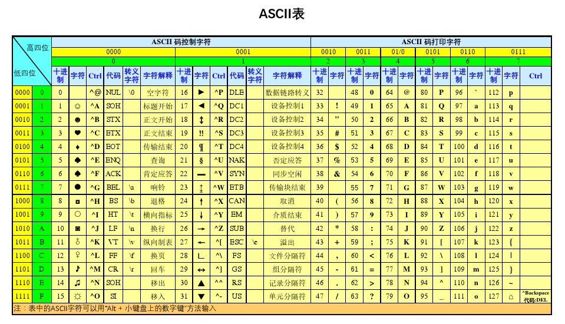
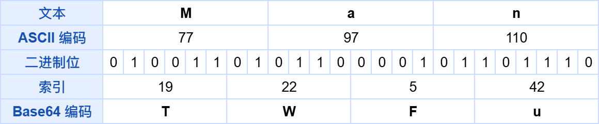
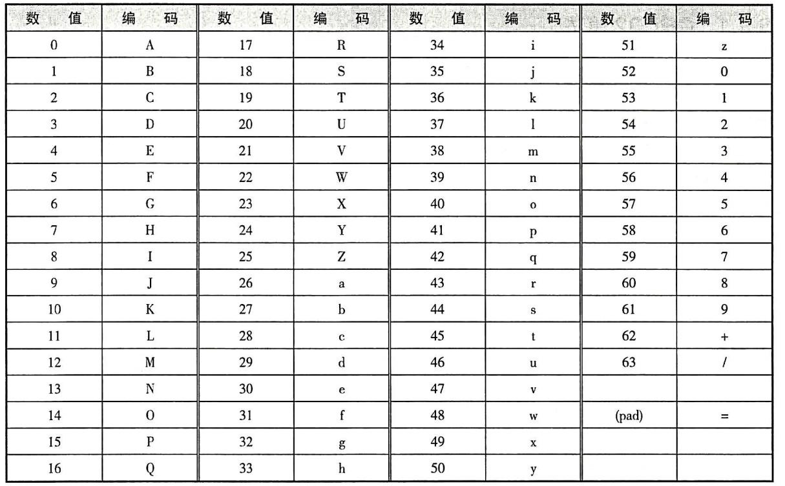
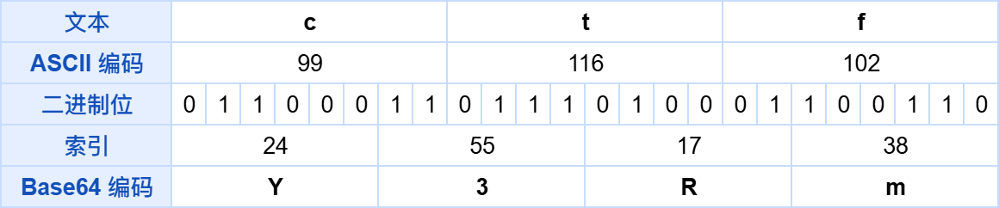

# NewStar CTF 2024 / Base

> 来源：NewStar CTF 2024  |  类型：wp_prose  |  https://github.com/pj-newstar/wiki-docs/blob/1a0f2ba21a30f950276396118b315eef0328371c/docs/wp/2024/week1/crypto/base.md

# Base

这题就是很简单的 Base 编码，也可以从题目描述里面看的出来，知道是 Base 编码就可以尝试一下，使用 [CyberChef](https://gchq.github.io/CyberChef/) 就能直接一把梭。

但 Base 编码的原理又是怎么样的？我们也可以来细致研究一下。

我们可以从最常见的 Base64 开始。

## 加密流程

### 转化为二进制

首先是将所需要加密的数据转换为二进制的数据

至于怎么将字母一类的数据转换为二进制，这就可以使用 ASCII 表去对应一下

〔原图省略〕

这样的话我们就可以将字母数字转换为ASCII值了，举个例子，`ctf` 对应的十进制和二进制为

| 字母 | 十进制 | 二进制   |
| ---- | ------ | -------- |
| c    | 99     | 01100011 |
| t    | 116    | 01110100 |
| f    | 102    | 01100110 |

拼接之后就是，`ctf` 对应的二进制为 `011000110111010001100110`。

::: tip
我们要注意的是，一个字母数字占8位，所以转换为二进制时若不足八位，在前面需要添零。
:::

### 二进制截断

随后就是进行截断，因为是 Base64 编码（可以记住这个规律，$2^6=64$，2 的多少次方就按多少截断），所以是按 6 位进行截断。可以参考下面的图去理解一下：

〔原图省略〕

这里将索引转换为 Base64 编码，还需要一张对应的表（Base64 编码表），一般常用的 Base64 的表如下：

〔原图省略〕

这样我们就可以自己尝试去转换一下：

〔原图省略〕

这样我们就成功将数据成功进行 Base64 编码了，即 `ctf` 对应的 Base64 编码为 `Y3Rm`。

### 拓展

对于其他的 Base 类型的编码（$2^n$ 类型的），我们只需要知道对应的编码表，即可进行对应的编解码了。

:::info 强调
这都是一些基本的基于 $2^n$ 类型的 Base 编码，还有一些类似于 Base45、Base85 这些类型的编码可能有所不一样，也可以去去了解一下：[BaseX 编码规则解析](https://bugwz.com/2019/11/18/basex/)。
:::

## 原文配图

