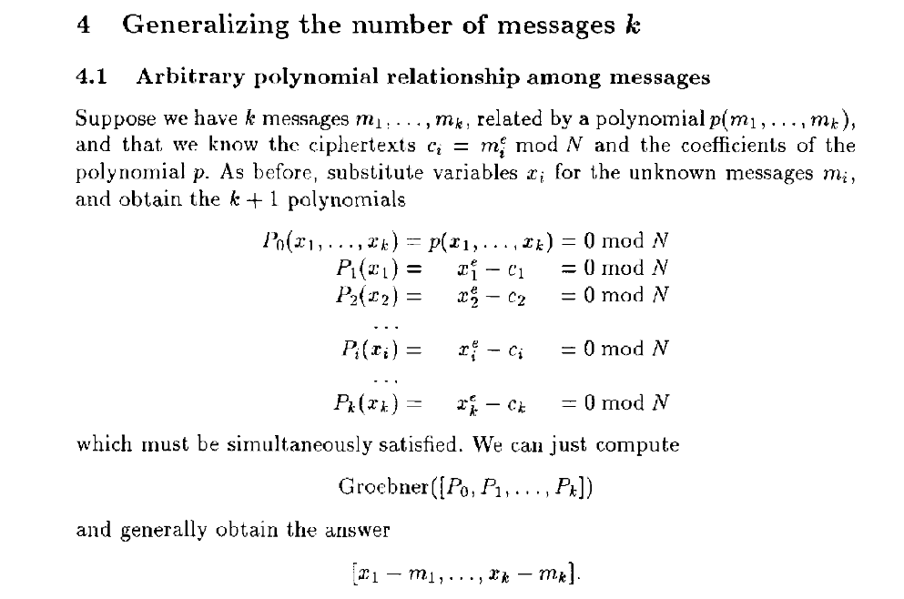
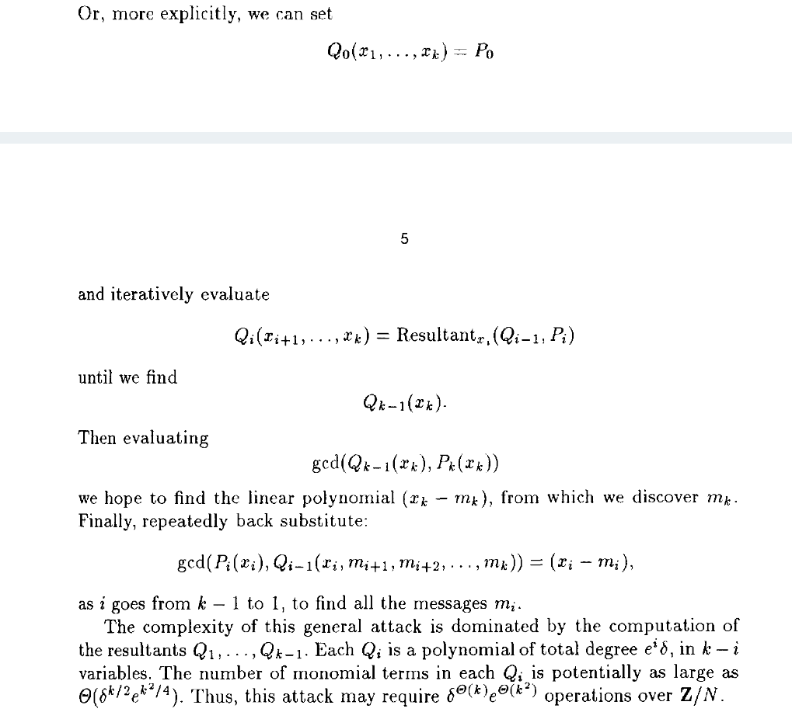

# NewStar CTF 2024 / 学以致用

> 来源：NewStar CTF 2024  |  类型：wp_prose  |  https://github.com/pj-newstar/wiki-docs/blob/1a0f2ba21a30f950276396118b315eef0328371c/docs/wp/2024/week5/crypto/xueyizhiyong.md

import Container from '@/components/docs/Container.vue'

# 学以致用

希望大家可以去探索 Sagemath 的妙用以及克服一下对 English 的恐惧。解题过程非常简单，而且解题过程都在给的 [PDF](http://users.ece.cmu.edu/~reiter/papers/1996/Eurocrypt.pdf) 文件里了。

归纳题目信息，本题归根结底是要解出下面这个方程组:

$$
\begin{gather}
\mathrm{flag}_1^3-c_1=0\mod N \\
\mathrm{flag}_2^3-c_2=0\mod N \\
(\mathrm{flag}_1+flag_2+gift)^3 - c_3 = 0 \mod N
\end{gather}
$$

经过分析后，即可定位到论文的这一部分，过程很清晰，结合题目信息寻找相应的 SageMath 实现即可，多搜索，多问 GPT（经出题人测试，免费的 GPT 4o-mini 可完成该题大半的工作量）。

〔原图省略〕

利用 `groebner_basis()` 很好解决，至于怎么写，[SageMath 参考文档](https://doc.sagemath.org/html/en/reference/)中的 Search 一栏给出了一些建议。

flag 即为 `flag{W1Sh_you_Bec0me_an_excelL3nt_crypt0G2@pher}`

虽然我们已经得到了 flag，但其实还有另一种解法，就是紧跟着的下一部分，所以 2 种解法都在这篇 PDF 里面了（一血的选手就是用这种方法完成的）:

〔原图省略〕

可参考：[结式（Resultant） - 维基百科](https://en.wikipedia.org/wiki/Resultant)

这道题不指望新生能够搞懂背后的原理，只是希望能够<strong>花时间潜下心来学习</strong>，然后学以致用，将样例代码迁移到这道题上。当然了，和 GPT 人机合一克服困难，也是一种实力。

## 原文配图

