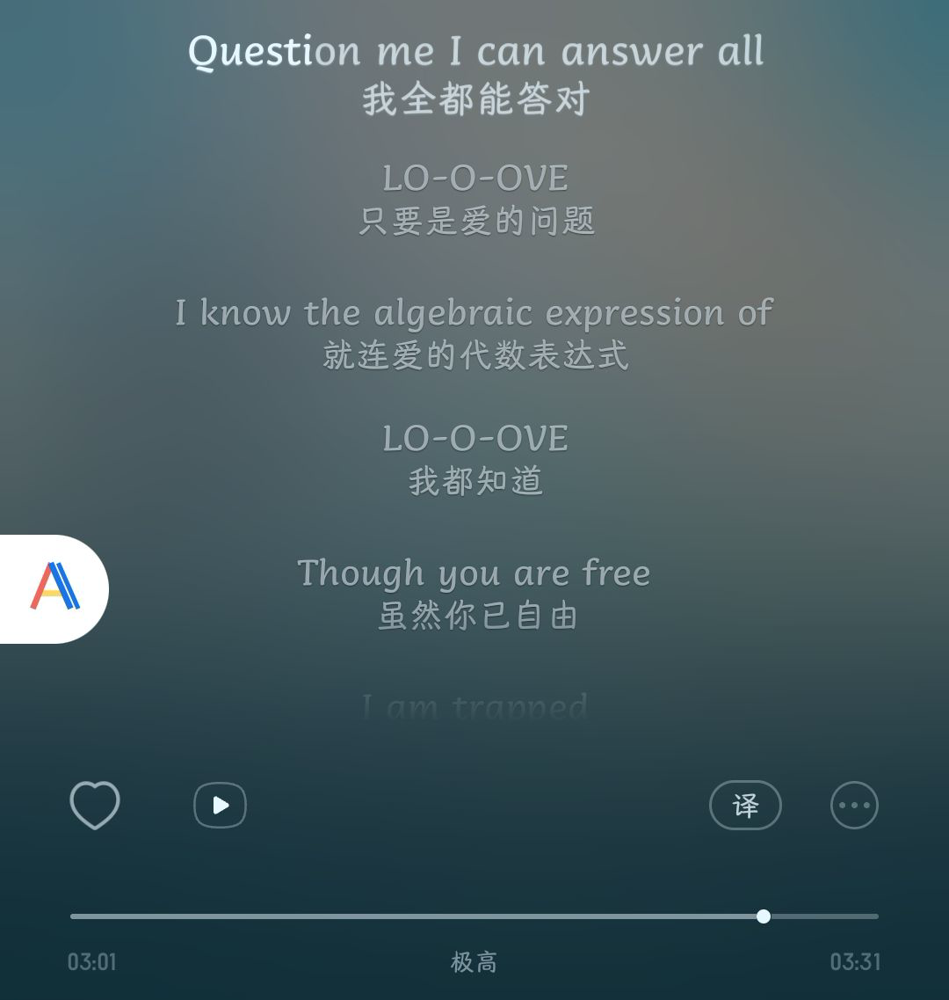
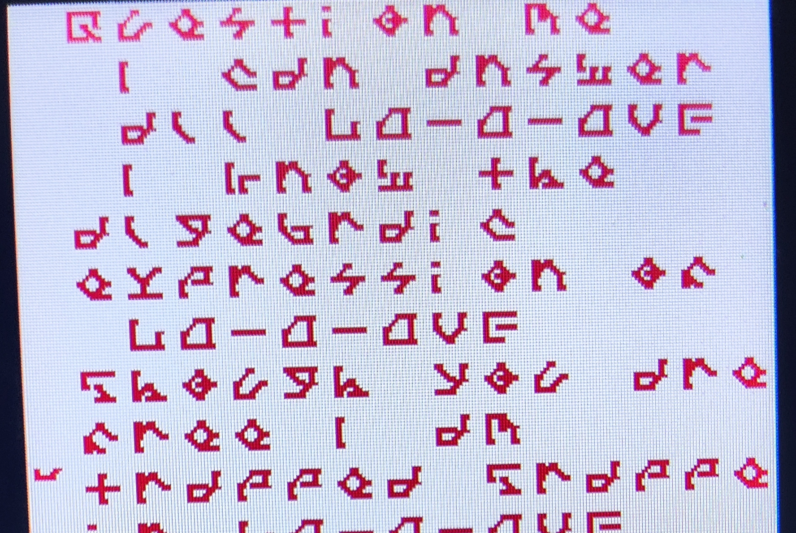
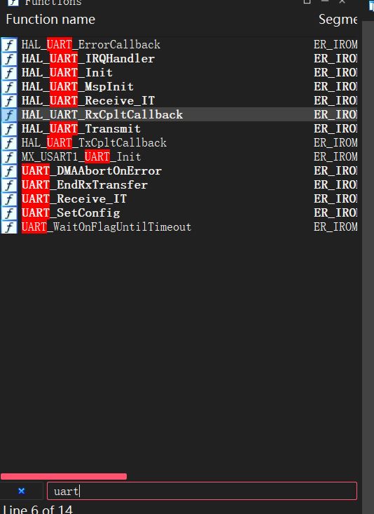

# NewStar CTF 2024 / PlzLoveMe

> 来源：NewStar CTF 2024  |  类型：wp_prose  |  https://github.com/pj-newstar/wiki-docs/blob/1a0f2ba21a30f950276396118b315eef0328371c/docs/wp/2024/week5/misc/plzloveme.md

import Container from '@/components/docs/Container.vue'

# PlzLoveMe

音频采样数据一般就是 PCM，根据所给采样率，我们可以直接找[线上网站](https://pcm.stanwind.com/)播放

直接找个音乐软件，听歌识曲可以知道是 `world.execute(me);`（这是歌曲名）

播放到 03:01 的歌词如下

〔原图省略〕

对照 LCD 图片

〔原图省略〕

仔细查看可以发现 LCD 上显示的是歌词（LCD 图片的第一行内容为 `Question me`，后面也有明显的 `LO-O-OVE`）

其实 LCD 上的符号是特殊字体，感兴趣的同学可以看看 LVDC-Secret-Passage 字体。

对照歌词可以得到符号的对应关系

歌词倒数第四排是 `flag:`，后三排仔细对照，可以知道是：

- `fhwdLd`
- `mnwdOnV`
- `mnwdOnV`

由题目可知 flag 是有意义的全英文字符串，我们还剩一个 AXF 文件没有用到

这是包含 ARM 符号信息的二进制文件，可以用 IDA 打开

题目里提到设备连上了电脑串口（其实一般是 USB 来串口通信，这里为了降低难度直接说明是串口了）

使用 `file` 命令：`file SD_MP3_RC.axf`，输出：

IDA32 函数列表搜索 `UART`

〔原图省略〕

看到一个 `RxCpltCallback`，搜一下是串口回调，用于接收数据后的处理，按 <kbd>F5</kbd> 查看伪代码

只有个异或 `0x1`，[CyberChef](<https://gchq.github.io/CyberChef/#recipe=XOR(%7B'option':'Hex','string':'01'%7D,'Standard',false)&input=Zmh3ZExkbW53ZE9uVm1ud2RPblY>) 解密后包上 `flag{}` 上交

**Ans:** `flag{giveMeloveNoWloveNoW}`

## 原文配图

