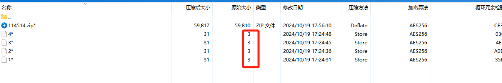
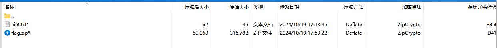
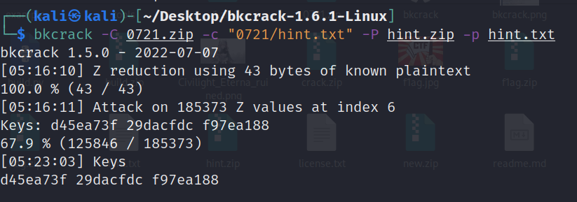
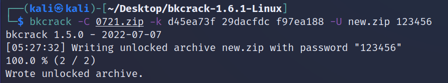
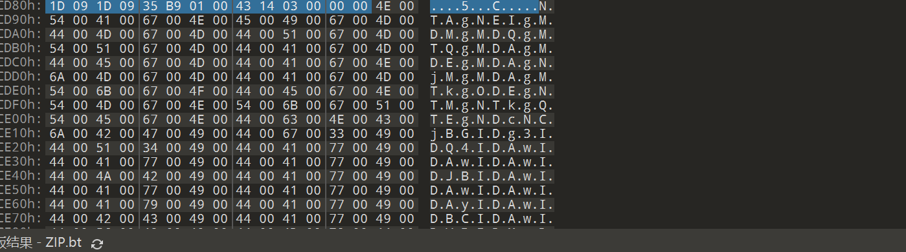
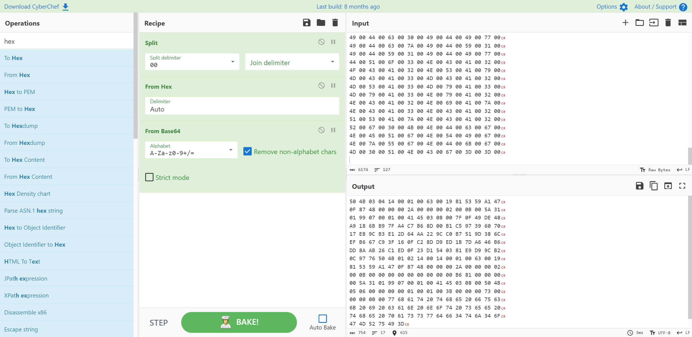
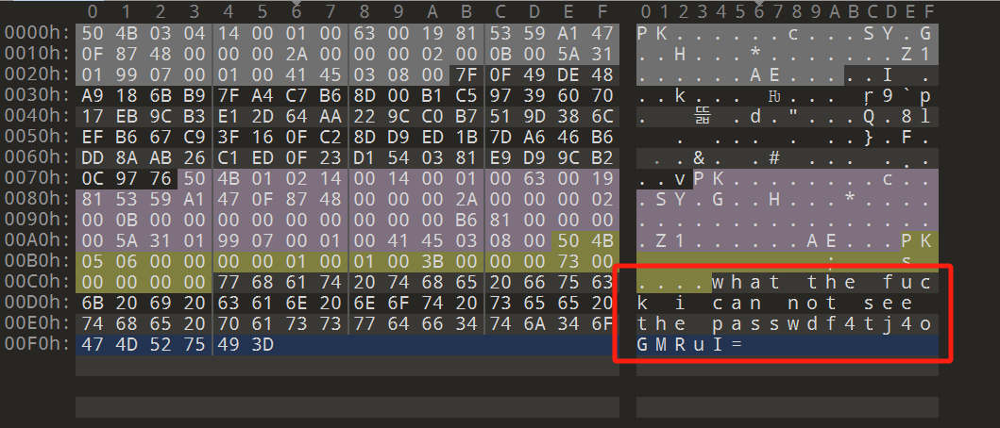

# NewStar CTF 2024 / zipmaster

> 来源：NewStar CTF 2024  |  类型：wp_prose  |  https://github.com/pj-newstar/wiki-docs/blob/1a0f2ba21a30f950276396118b315eef0328371c/docs/wp/2024/week5/misc/zipmaster.md

# zipmaster

拿到附件解压后看到是一个压缩包，是真加密。打开看一下结构

〔原图省略〕

发现有四个长度仅为 3 字节大小一样的文件，使用 CRC 爆破来得到其中的内容

CRC 值在压缩包中都可以看到，直接上脚本进行爆破

得到结果

使用 `this_is_key!` 作为密码来解压 `3077.zip`，得到 `114514.zip`，发现无密码，可以直接解压

得到 `0721.zip` 和 `hint.txt`

::: code-group

:::

看一下 `0721.zip` 的结构，发现有一个原始大小和压缩包外面的 `hint.zip` 完全一样的文件，同时看到压缩包使用的加密算法是 ZipCrypto，那么可以使用明文攻击来恢复解密密钥

〔原图省略〕

使用 bkcrack 来进行明文攻击。这里要注意 `-c` 参数后面写的是破解文件中的明文文件的绝对路径，从压缩包一层开始，我们可以看到在压缩包中还有一层名为 `0721` 的文件夹，所以这里路径要写 `0721/hint.txt`

〔原图省略〕

爆破出密钥之后我们直接构造一个弱密码加密的压缩包，密码是 `123456`，其中的内容和原来的 `0721.zip` 完全一样

〔原图省略〕

解压 `0721.zip` 之后得到一个 `flag.zip`，这个压缩包是个压缩包炸弹，具体原理可以自行搜索，这里我们直接使用 010 Editor 打开看一下它的文件结构，发现很多 Base64 字符串

〔原图省略〕

提取出来解密，得到一个新的压缩包

〔原图省略〕

同样将 16 进制内容放到 010 Editor 中另存为一个新的压缩包，在末尾找到 hint

〔原图省略〕

这里提到看不到密码，后面给的 `f4tj4oGMRuI=` 其实是密码的 Base64 加密后的字符串，但是解密之后发现密码是不可见字符（密码就是它），无法直接使用它来解压压缩包，写脚本来进行解压

解压后得到一个 Z1 文件，使用记事本打开得到 flag

## 原文配图

