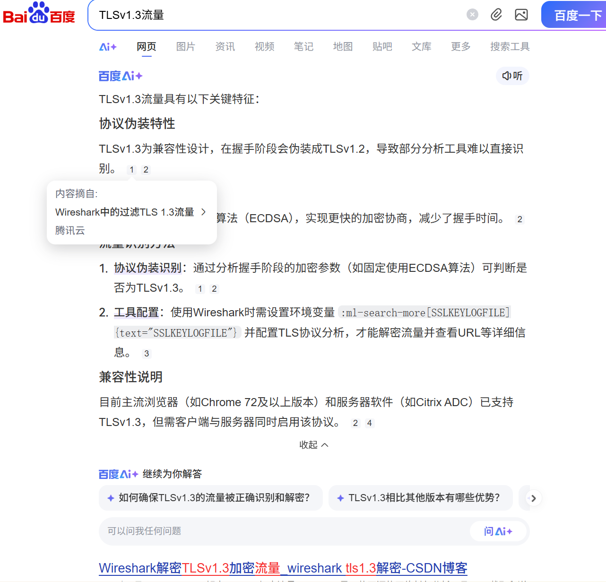
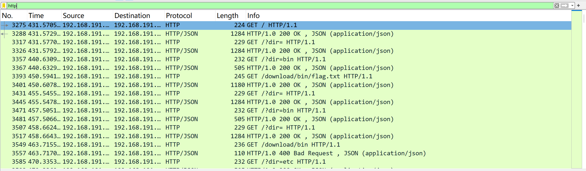
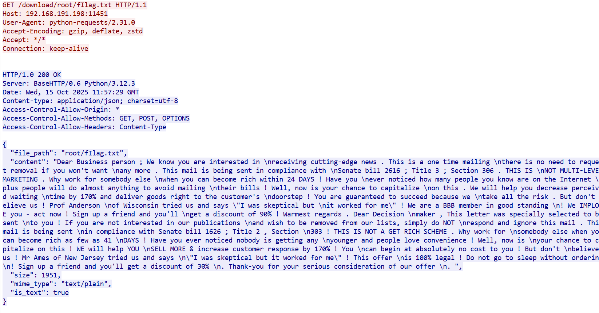
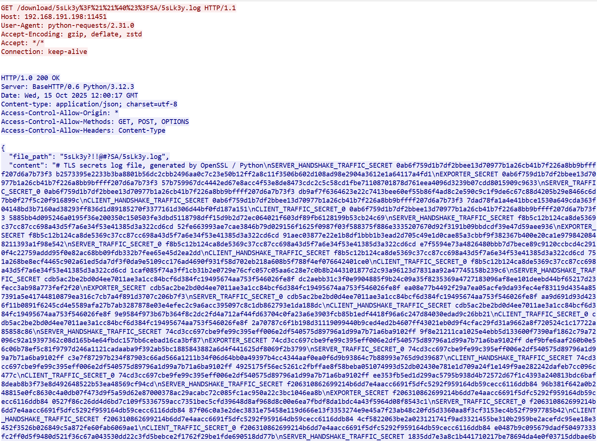
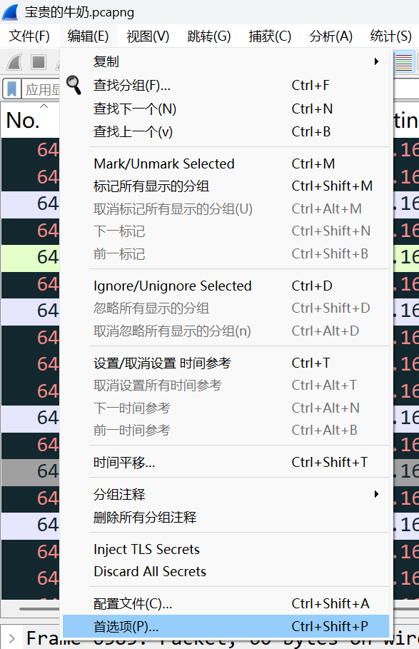
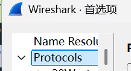
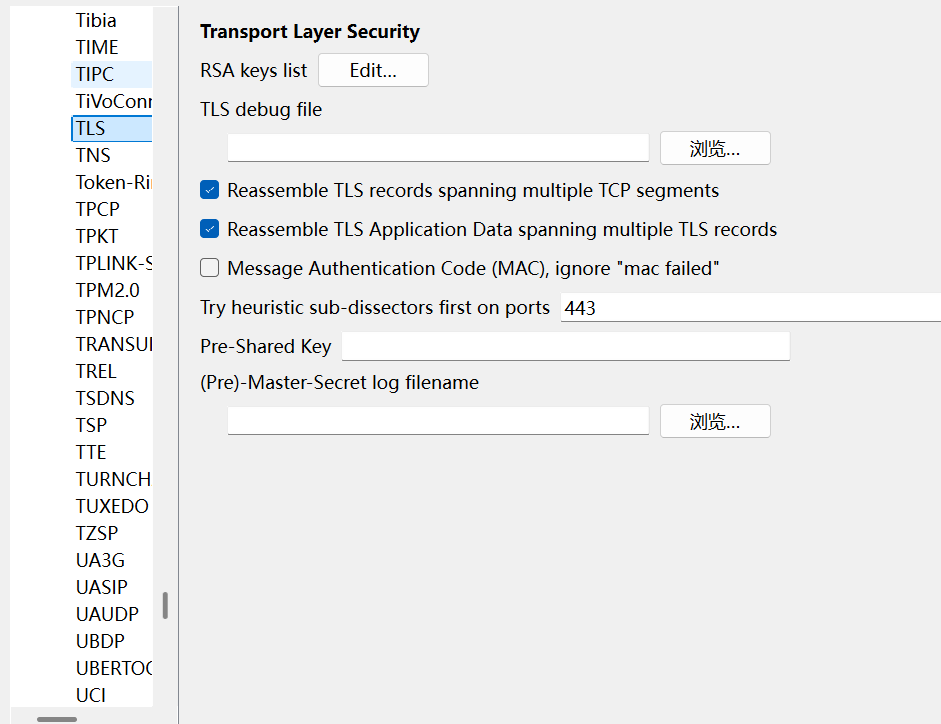
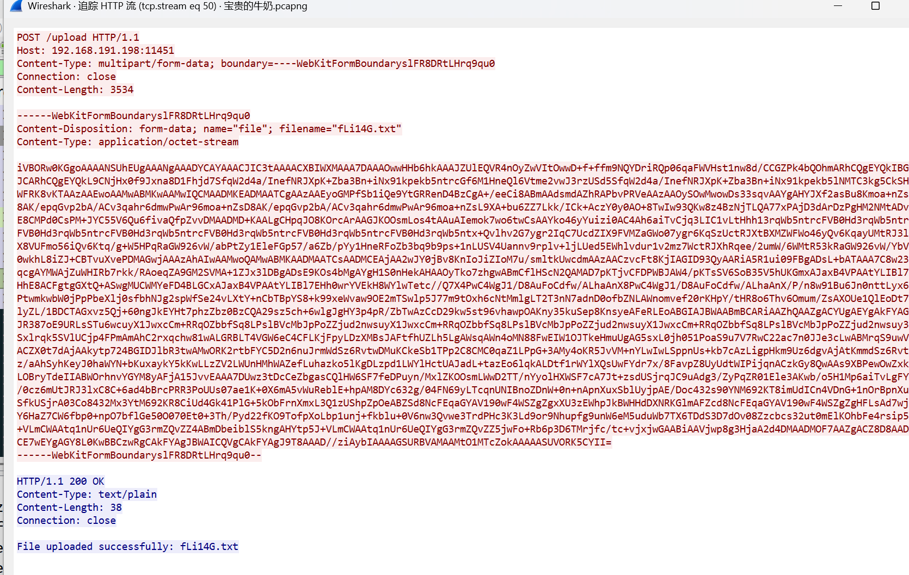

# NewStar CTF 2025 / 不是所有牛奶都叫\_\_\_

> 来源：NewStar CTF 2025  |  类型：wp_prose  |  https://github.com/pj-newstar/wiki-docs/blob/1a0f2ba21a30f950276396118b315eef0328371c/docs/wp/2025/extras/misc/not-all-milk.md

# 不是所有牛奶都叫\_\_\_

> 什么牛奶？MN？YGNC？YL？特 @$&!$&\*!@$^&-------------------.
> （FLAG 提交时去掉&符号）

这道题的核心知识点是 TLS 流量解密。

先从题目和题目描述入手。

题目描述引用的是较常见的广告语，横线处可联想到对应关键词。

根据题目描述，将一些常见品牌名缩写为大写首字母后，可以猜到空白处应为：

TLS

随后对流量进行分析。即使没有理解题目暗示，也可以从流量本身继续推进。

打开流量就能看到我们常见到的 TCP 协议流量，当然还看到一种平时可能不会看到的协议

TLSv1.3，老样子我们先搜索一下，就能够了解到一些信息

〔原图省略〕

除自动摘要外，搜索结果中已经能看到与流量加解密相关的信息。

TLS 全称为 Transport Layer Security，前身为 SSL，能够对传输信息进行加密保护。如果需要解密这些信息，除了通信双方使用约定密钥外，也可以借助 SSL key log 进行解密。

因此本题的首要目标是找到 SSL key log。

我们先继续审计一下，发现后半段开始出现了 http 协议的流量，我们把他们过滤一下

〔原图省略〕

在过滤器输入 http，我们单独过滤 http 流量，就会发现这似乎是在对某个服务器在进行浏览和文件的下载？

其中还不乏大量我们喜闻乐见的 FLAG 的变式，但是大部分都是些垃圾信息

〔原图省略〕

这些内容主要用于混淆视听。

我们慢慢查看，或许 sslkey 就隐藏在这些下载的文件当中。

虽然题目没有留下非常明确的定位提示，但该文件名明显区别于其他噪声文件，逐步筛查即可找到。

〔原图省略〕

初现端倪，我们看看哪里下载了他

原来就在下面两行

〔原图省略〕

追踪流看内容

〔原图省略〕

这就是所需的 SSL key log。

即使没有理解题目暗示，在流量审计过程中也会注意到这一长串内容。搜索其格式后，也可以判断它是 TLS secrets log file。

其中「TLS secrets log file」本身也是明显提示。

接下来将引号内的内容全部取出并处理，例如将 `\n` 转为真实换行，去掉末尾多余的 `\n`，最后保存为 `.log` 文件即可。

然后我们点击左上角的编辑，打开首选项

〔原图省略〕

然后在左侧选择 protocols（协议）

〔原图省略〕

然后找到 TLS

〔原图省略〕

把我们处理后的 log 文件选入（Pre）-Master-Secret log filename 中

点击确认，然后我们就会发现，原先大量只有 tlsv1.3 协议的部分就解密出了许多新的 http 协议流量，让我们重新过滤一次 http

请求方式大量都是 POST，少量 GET 的请求看到回复都是 file server ready，大概只是一些确认连接的无用信息，所以我们的中心转向查看 post 的内容都有什么

可以看到 post 的内容又是一大堆没有用的垃圾信息，既然我们已经经过了一轮这样的筛选信息，不难想到我们又要从中找到需要的内容

〔原图省略〕

终于在第 50 个流我们找到了不一样的内容，这个就是一个图片的 base64 编码形式，我们拿去 cyberchef 下载文件

〔原图省略〕

就得到了二维码，扫描之后就是 FLAG 了

总结：

本题核心考点是 TLS 流量解密，主要难点在于从较多噪声流量中定位 SSL key log。完成题目后，可以重点复盘 Wireshark 中 TLS 解密配置、HTTP 流量筛选以及可疑文件定位流程。

## 原文配图

