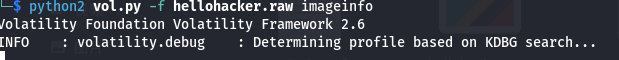
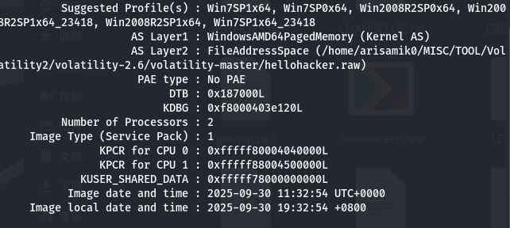
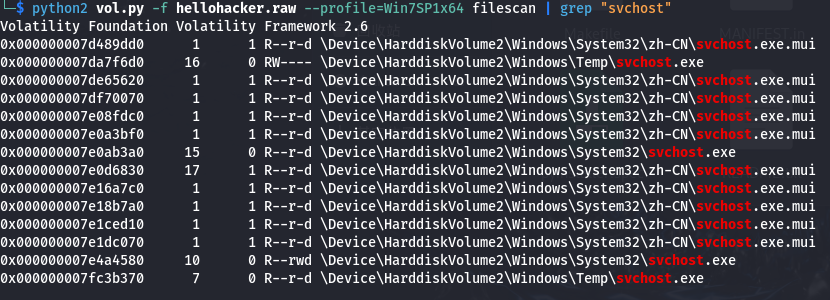
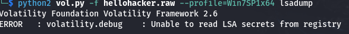
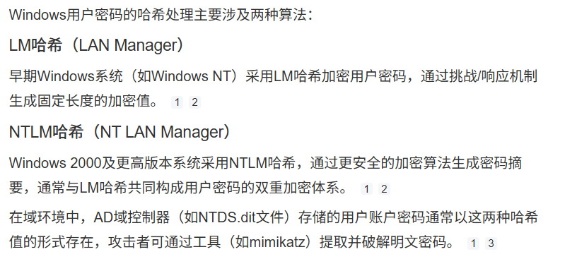
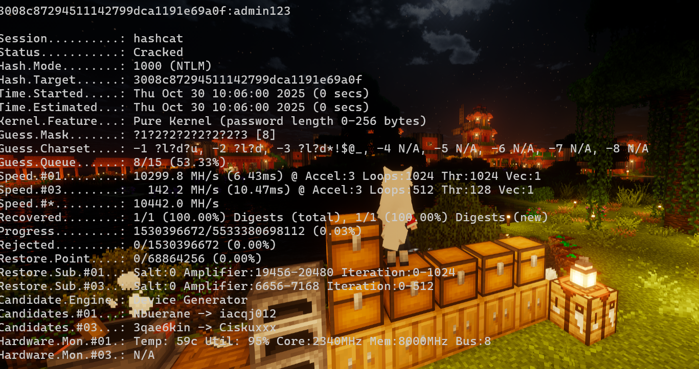

# NewStar CTF 2025 / 内存取证：Windows 篇

> 来源：NewStar CTF 2025  |  类型：wp_prose  |  https://github.com/pj-newstar/wiki-docs/blob/1a0f2ba21a30f950276396118b315eef0328371c/docs/wp/2025/week3/misc/mem-forensics-win.md

import Link from '@/components/docs/Link.vue'

# 内存取证：Windows 篇

本题是内存取证入门题，主要目的是熟悉常用工具、基础命令，以及 Kali 虚拟机或 WSL 等解题环境。

> 本关考验你内存取证本领，请考生携带好文具（kali 虚拟机和 Volatility2），做好准备，迎接挑战本题的 FLAG 由多个问题的答案组成，使用下划线"\_"将答案各部分连接，就能得到 FLAG
>
> 1. 恶意进程的外联 `ip:port`
> 2. 恶意进程所在的文件夹名称
> 3. 用户的主机登录密码
> 4. 电脑主机的名称
>    注意：涉及字母的部分统一小写，题目附件包含 FLAG 的举例，请做题人事先确认

先从题目开始一点点讲解。

虽然 Volatility 2 和 Volatility 3 也可以在 Windows 上使用，但结合工具兼容性和本题测试情况，这里更推荐使用 Kali 虚拟机或 WSL 进行解题。

下面列出 Kali 虚拟机、WSL 和 Volatility 的相关参考链接：

- <Link icon="external" theme="underline hover" href="https://blog.csdn.net/m0_74424496/article/details/147426082">Kali 虚拟机镜像安装教程</Link>：使用镜像逐步安装的版本。
- <Link icon="external" theme="underline hover" href="https://blog.csdn.net/m0_71744960/article/details/149971725">Kali 虚拟机快速获取教程</Link>：直接获取 Kali 虚拟机的版本，比较简单快速。
- <Link icon="external" theme="underline hover" href="https://blog.csdn.net/AIRBUSEX/article/details/147653921">WSL 环境配置教程</Link>
- <Link icon="external" theme="underline hover" href="https://github.com/volatilityfoundation/volatility">Volatility 2</Link>
- <Link icon="external" theme="underline hover" href="https://github.com/volatilityfoundation/volatility3">Volatility 3</Link>

如果缺少 Python 或必要依赖，可以根据报错安装对应包；这里仅列出关键工具。

至此，工具应当已经安装完毕。接下来从 FLAG 要求的内容开始入手。

## 首先应该要获得 `imageinfo`

使用 Volatility 2 的功能前，需要先获取题目附件的系统版本，这也是 Volatility 2 最基础的操作之一。

常用命令可以参考：

- <Link icon="external" theme="underline hover" href="https://blog.csdn.net/Y525698136/article/details/135368107">Volatility 常用命令整理</Link>

为了方便，直接把 `hellohacker.raw` 和 `vol.py` 放在同一路径下，然后执行：

会先出现这样的提示。

〔原图省略〕

稍等片刻，就可以得到「可能的」系统版本。

〔原图省略〕

一般优先使用第一个候选 Profile；如果不可用，再逐个尝试其他候选项。这里直接用第一个进行尝试。

## 恶意进程的外联 `ip:port`

这里是在引导我们进行常规排查。入侵者会利用恶意进程与外部建立连接，以长期监视目标机器；这里使用一个基础命令即可查看当前状态下各进程的网络连接状况。

`netscan` 会显示内存镜像被 dump 时仍在运行的所有进程信息，包括偏移地址、协议、本地地址、外部地址、连接状态、PID、创建连接的进程和进程创建时间。

我们要查看可能是恶意进程的外联 `ip:port`。

一般来说，优先关注连接状态为 `ESTABLISHED` 的进程。这些进程正在与外部建立连接，存在外联恶意进程的嫌疑。随后还需要结合其是否存在外联 IP、进程名称等信息判断；有时候，查看 Owner 也是一个有效的判断方式。

在这题中，上述的几种判断方式都可以单独起到作用，因为进程的情况没有那么复杂。

可以看到，本题中连接状态为 `ESTABLISHED` 的只有一个进程，目标较为明显。继续结合其他信息判断：存在非本地外联地址的进程只有两个，其中一个状态为 `CLOSED`，因此恶意进程大概率是最后一行的进程。再看进程名称 `svchost.exe`，这是系统中非常常见的程序，但出现在该外联场景下仍然可疑。到这里基本可以锁定目标。

## 恶意进程所在的文件夹名称

在上一题的连接状态信息中还有一项 PID，即进程 ID。这个信息可以帮助我们找到该进程所在的位置，以及与其相关的其他进程。本题只需要找到进程位置。

先进行文件扫描，然后结合已知的恶意进程名称 `svchost.exe` 进行特定查找。

〔原图省略〕

显然，`svchost.exe` 这种可执行文件不应该存在于 `Temp` 这种路径中。该目录通常用于存放临时文件，也经常被用于放置恶意文件。因此可以锁定文件目录名称为 `temp`。

## 用户的主机登录密码

这里涉及 Volatility 2 中两种获取密码的办法：`lsadump` 和 `hashdump`。`lsadump` 可以直接得到明文密码，但是很多时候无法使用；而 `hashdump` 顾名思义，可以得到密码的 Hash 值。

先尝试使用：

〔原图省略〕

很遗憾，该方法不可用，只能改用 `hashdump`。

这里的恶意用户较为明显。需要注意，前面以 `aad` 开头的 Hash 是空密码对应的 LM Hash，不需要爆破；第二段才是需要破解的密码 Hash（以 `31d` 开头的值也是空密码对应的 NTLM Hash）。

因为本题密码非常简单，直接在在线 Hash 查询网站中也能破解 NTLM：

- <Link icon="external" theme="underline hover" href="https://crackstation.net/">CrackStation</Link>

密码是 `admin123`。

但是还是要掌握 Hashcat 的使用，而不是依赖在线网站或 CMD5，避免线下环境无法联网。

- <Link icon="external" theme="underline hover" href="https://github.com/hashcat/hashcat">Hashcat</Link>

下载 Latest Release 后解压使用。

Hashcat 可以进行限定位数、限定字符范围的掩码爆破，也可以进行暴力破解或字典破解。

使用：

可以看到一些示例以及具体的应用方式。需要学会阅读 help 内容，不要因为是英文就跳过。

这里也给出了一些示例。在不掌握额外信息时，可以使用 Brute-Force。

先确认 Brute-Force 的各参数含义：

`-a` 用于指定爆破类型，`3` 表示暴力破解，其他类型可以查看 help。`-m` 用于指定 Hash 类型；如果不知道类型，可以使用 `0`，工具会自动尝试不同类型，但会减慢速度。随后指定 Hash 文件，或者直接粘贴 Hash 字符。最后的 `?a?a` 是掩码；如果直接暴力破解，可以不填。

为了加快爆破速度，一般需要先确定 Hash 类型，然后指定 `Hash mode`。`Hash mode` 可以在 help 中看到。

这里使用 `-hh` 而不是 `--help`，该命令输出较长，可能需要等待一段时间。

然后查询 Windows 用户密码使用的 Hash 类型。

〔原图省略〕

Windows 7 SP1 x64 高于 Windows 2000，因此使用的是 NTLM Hash。

NTLM Hash 在 Hashcat 中对应的 mode 为 `1000`。

因此命令为：

〔原图省略〕

可以看到状态很快变为 `cracked`。

因此密码为 `admin123`。

## 电脑主机的名称

这里需要查看注册表内容，先用 `hivelist` 确定该注册表的虚拟地址。

前面一列是 Virtual Address，因此查看 `\REGISTRY\MACHINE\SYSTEM` 下的键名时，需要使用 `-o` 指定偏移，并用 `printkey` 查看键名。

然后进一步查看 `ControlSet001`。

接下来循着这个路径查找：

即可找到主机名。

根据题目要求需要全小写，因此结果为 `arisamik`。

所以最终 FLAG 为：

## 结语

本题覆盖了基础内存取证流程，包括镜像识别、进程分析、注册表提取和 hash 破解。通过本题可以配置好常用环境，熟悉基础操作，并建立遇到工具问题时主动检索资料的习惯。

另外，本题也可以使用 LovelyMem 辅助完成分析：

- <Link icon="external" theme="underline hover" href="https://github.com/Tokeii0/LovelyMem">LovelyMem</Link>

该作者的其他工具也可以按需探索。`LovelyMem` 的开源版本已经足够完成本题分析。

## 原文配图

