# MoeCTF 2025 / 哈基米难没露躲

> 来源：MoeCTF 2025  |  类型：wp_prose  |  https://github.com/XDSEC/MoeCTF_2025/blob/da9e708029f4666da270064c5776ddd29c61dd6f/official_writeups/Misc/Writeup.md

# 哈基米难没露躲

打开文本文件，推测其为某种密文，需要寻找解密方法。

既然毫无头绪，我们不妨使用 Linux 下的 strings 工具或者 Windows 下的 010 Editor 打开这个压缩包仔细检查一下：

〔原图省略〕

都能发现 `hint{https://lhlnb.top/hajimi/base64}`，~~不难注意到~~这段文字是存储在压缩包的文件注释区段的。打开这个 URL 即为解密所需的网页，以下是解密得到的内容：

〔原图省略〕

注意到：**选定 402**，然而这段文字显示仅有一行，里面有大量的零宽度不可见字符（如 U+0xFEFF，U+0x200C 等），按照提示搜索文本隐写，或者更具体来说是零宽字符隐写。

〔原图省略〕

直接解密即可。

〔原图省略〕

# Enchantment

关于 Wireshark 使用，你可以[查看这个视频](https://www.bilibili.com/video/BV1FXRPYxEBP)

使用 Wireshark 打开 pcapng 文件，流量分析得知上传了一个文件。

〔原图省略〕

你可以如上图一样选择“显示分组字节”或者“导出分组字节流”，亦或是选择“文件-导出对象-HTTP...”，选中内容类型为 multipart/form-data 的 HTTP 对象并导出（这种方法要手动去掉多余的一部分信息）。

由描述“附魔台上的文字有一些不对劲”以及 Minecraft Wiki 上的相关条目 [1](https://zh.minecraft.wiki/w/%E9%99%84%E9%AD%94%E5%8F%B0#%E7%AC%A6%E6%96%87)、[2](https://zh.minecraft.wiki/w/%E5%AD%97%E4%BD%93#SGA) 可知附魔台上的文字是一种特殊的字母代替字体，对照表已在[条目 2](https://zh.minecraft.wiki/w/%E5%AD%97%E4%BD%93#SGA) 处给出。

〔原图省略〕

按照注释要求处理得到 `moectf{now_you_have_mastered_enchanting}`。

# Encrypted volume

使用 010 Editor 打开 rar 文件，通过对比可知 `Block[3]` 的 `HeadType` 被修改过，因此 key.png 被隐藏。

〔原图省略〕

将其改回 2，解压打开发现是一个二维码，扫码得到加密卷密码：`:@(s<"A3F:89x541Ux[<`

挂载加密卷，得到 `brainfuck.txt`，将其解码即得 flag：`moectf{nOW_YoU-h4V3_UNlocKED-VOlumE}`

# ez_png

〔原图省略〕

使用 TweakPNG 发现倒数第二个 IDAT 块没填满就创建了个新的 IDAT 块，且新的块长度很小。

〔原图省略〕

再使用 010 Editor 提取这个 IDAT 块的 data 部分，使用如下脚本解压。

得到 flag：`moectf{h1DdEn_P4YlOaD_IN-Id4T}`

注：另一种方法是使用 `binwalk -e ez_png.png`，其会直接解压出 FLAG，直接用文本编辑器打开解压后的文件即可。

# ez_ssl

使用 Wireshark 打开 pcapng 文件，我们可以看见有大量 TLS 流量，这种是加密流量，我们首先要找到解密的方法。

在 `文件-导出对象-HTTP...` 可以看到有一个 form-data，查看发现这是一个文件上传的 HTTP 数据包。

根据文件名（本题为 `ssl.log`，一般情况下也有类似名称）可以知道，这个文件记录的是 SSL/TLS 加密通信时协商出的​**​会话密钥​**​。服务器和客户端使用这个密钥来加密通信，而 Wireshark 获得这个密钥后，就能像通信双方一样解密数据流了。

用 [Enchantment](#Enchantment) 处同样的方法提取这个文件并保存。

〔原图省略〕

然后在 `编辑-首选项-Protocols-TLS` 处的 `(Pre)-Master-Secret log filename` 选择保存下来的 ssl.log，解密 SSL 流量后可以发现另一个上传文件的 HTTP 数据包，用上述方法提取到 flag.zip。

〔原图省略〕

得到压缩包注释，使用 Passware Kit Forensic 进行暴力破解。

〔原图省略〕

暴力破解得到密码为 `6921682`，解压发现需要 [Ook! 解密](https://wnkit.com/tool/brainfuck-ook-encrypt-decrypt)，解密得到 `moectf{upI0@d-l0G_TO-DeCrYPT_uploAD}`

# Pyjail

## Pyjail 0

做题环境配置相关内容已在题目描述中存在，此处不再赘述。

在本平台中，在线环境的题目使用 Docker 进行部署和管理，在启动 Docker 容器时，会向容器的**环境变量**中注入 FLAG，因此本题仅需猜测环境变量作为文件的位置即可。

Linux 遵循“一切皆文件”的设计理念，将系统资源（硬件、进程信息等）抽象为文件进行访问。而在这其中有：

- /proc 是一个特殊的虚拟文件系统，它动态提供运行中进程的信息。
- /proc/self 是一个符号链接，总是指向当前访问它的进程自身的信息目录。
- /proc/self/environ 这个“文件”则包含了当前进程的所有环境变量。

这时我们输入 /proc/self/environ 时，就能读取到包含 FLAG 的环境变量。

〔原图省略〕

## Pyjail 1

### 前置知识

PyJail（Python 沙盒逃逸）是一类常见的 CTF 题目，目标是突破一个受限的 Python 执行环境，通常是为了读取到服务器上的特定文件（如 FLAG）。题目会通过过滤危险关键字或函数等方式，为你创建一个“代码监狱”。

使用 `ncat` 命令连接到题目服务器时，实际上是启动了一个在服务器上运行的特殊 Python 程序（即题目源码）。`ncat` 在此充当了一个网络桥梁，它将你本地终端里的输入，直接传递给了服务器上那个 Python 程序的​**​标准输入流​**​ (`input()` 函数)；同时，也将该程序的标准输出流 (如 `print` 的结果) 返回给你的终端。

因此，你看到的提示符“Give me your code:”和后续的交互，都发生在这个远程的 Python 程序进程中。

### 解题

本题较为基础，解题方法很多，出题人的解法是：

`__builtins__.__dict__['__imp'+'ort__']('os').system('sh')`

以下是解释：

- 绕过关键字检测：这道题目通过检测 `import`、`eval`、`exec`、`open`、`file` 等关键字来限制用户输入。题解通过字符串拼接 `'__imp'+'ort__'` 的方式绕过了对 `import` 关键字的检测。由于检测机制只是简单的字符串匹配,当 `import` 被拆分成两部分后就无法被识别,从而成功绕过了过滤。
- 利用内置函数：`__builtins__` 是 Python 中存储所有内置函数和对象的模块,通过访问 `__builtins__.__dict__` 可以获取到所有内置函数的字典。其中 `__import__` 是 Python 内置的导入函数,功能等同于 `import` 语句。使用 `__builtins__.__dict__['__imp'+'ort__']` 就能获取到这个函数对象,然后调用它来导入 `os` 模块。
- 执行系统命令：成功导入 `os` 模块后,就可以使用 `os.system()` 函数来执行系统命令。这里执行 `sh` 命令可以获取一个 shell,从而完全控制系统。整个 payload 串联起来就是:`通过字符串拼接绕过检测 → 获取 __import__ 函数 → 导入 os 模块 → 执行系统命令`,最终成功突破 pyjail 的限制。

你也可以借用 Pyjail 2 的 payload，少改写几步即可。

## Pyjail 2

本题在 Pyjail 1 的基础上过滤了 `.`、`_`、`[`、`]`、`'`、`"`。

### 方法 1
 
使用 `breakpoint()`，我们能够进入 pdb（Python 调试器），在其中我们可以执行任意的 Python 语句，而不会被过滤与拦截。

### 方法 2

有个内置函数叫 `globals()`，能看下全局变量里有什么：

那我们就有目标了：`globals().get('__builtins__').__import__('os').system('sh')`
- 过滤了 `[]`，那么我们获取字典的值需要改用 get 方法
- 过滤了 `.`，那么我们需要用 getattr 替换
- 过滤了 `'"`，那就用 chr() 拼接

稍微改写得到：`getattr(getattr(getattr(globals(),'get')('__builtins__'),'__import__')('os'),'system')('sh')`

写一个将字符串转换为 chr() 函数调用的形式的脚本：

然后用这个脚本将所有的字符串改写成 chr() 调用的形式，构造出如下 payload

## Pyjail 3

这道题目禁用了 `__builtins__`，但可以通过 Python 的对象继承链来绕过限制。核心思路是利用字符串对象向上追溯到 `object` 基类，再通过其所有子类找到可以访问到危险函数的类。

具体来说，`"".__class__.__base__` 获取了 `object` 基类，通过 `__subclasses__()` 可以列出所有继承自 `object` 的子类。在这些子类中，`_wrap_close` 类的初始化方法 `__init__` 拥有 `__globals__` 属性，这个属性包含了该方法定义时所在模块的全局命名空间。关键是这个全局命名空间中包含了 `system` 函数（来自 `os` 模块），可以直接用来执行系统命令。

整个 payload 使用列表推导式筛选出名为 `_wrap_close` 的类，取其 `__init__.__globals__` 字典，从中提取 `system` 函数并执行 `sh` 命令来获取 shell。这种方法绕过了 `__builtins__` 的限制，通过 Python 内部机制实现了代码执行。

## Pyjail 4

这题禁止了绝大部分属性的点号访问，应该是只能栈帧逃逸了。

### [栈帧逃逸](https://www.cnblogs.com/gaorenyusi/p/18242719)

在 Python 中，栈帧（stack frame），也称为帧（frame），是用于执行代码的数据结构。每当 Python 解释器执行一个函数或方法时，都会创建一个新的栈帧，用于存储该函数或方法的局部变量、参数、返回地址以及其他执行相关的信息。这些栈帧会按照调用顺序被组织成一个栈，称为调用栈。

栈帧包含了以下几个重要的属性：  
`f_locals`: 一个字典，包含了函数或方法的局部变量。键是变量名，值是变量的值。  
`f_globals`: 一个字典，包含了函数或方法所在模块的全局变量。键是全局变量名，值是变量的值。  
`f_code`: 一个代码对象（code object），包含了函数或方法的字节码指令、常量、变量名等信息。  
`f_lasti`: 整数，表示最后执行的字节码指令的索引。  
`f_back`: 指向上一级调用栈帧的引用，用于构建调用栈。

注意：栈帧是一个对象，而其 `f_globals` 才是字典。

### 栈帧来源

正常情况下，我们使用 sys 模块来获得某些栈帧。但在 CTF 情景下，我们一般使用生成器和异常的相关属性来获取栈帧。

生成器栈帧逃逸同样可以看[上述博客](https://www.cnblogs.com/gaorenyusi/p/18242719)，这里给个例子：

而异常栈帧逃逸我也给个例子，具体情况自己查询相关内容；

### 解题

## Pyjail 5

用 AST 禁止了所有用 `.` 的属性访问。

查看[这个博客的第一节](https://pid-blog.com/article/noval-pyjail-tricks)，我们可以使用如下语句来绕过这个限制。

然后我们可以将 Pyjail 4 的 Payload 改成这样：

## Pyjail 6

本题的 `__builtins__` 里没有 object 类了，无法用上题的办法，怎么办呢？还有一种办法来访问属性，在[国外博客](https://shirajuki.js.org/blog/pyjail-cheatsheet/)的 `getting attributes` 看见的代码，加点注释放在下面：

但要实现这个，我们得拿到 format 方法和 obj 方法。你猜怎么着？这两个方法对应的实例所在的类在 `__builtins__` 里都有！结合上题：

然后我们重写，不拿 `obj.__doc__`，而是拿一个访问属性的方法：

# Rush

〔原图省略〕

使用 Honeyview 或者 StegSolve 等软件定位到第 12 帧，然后略微修复二维码即可扫码得到：`moectf{QR_C0d3s_feATUR3_eRror_c0RRECt10N}`

# SSTV

由题目名可知是 SSTV 解码，安装 [MMSSTV](https://hamsoft.ca/pages/mmsstv.php) 和 [VB-CABLE](https://vb-audio.com/Cable/)，前者用于解码 SSTV，后者用于将音频输出重定向至麦克风。

然后调整系统音频设置

〔原图省略〕

打开 SSTV，直接播放就能解码。

〔原图省略〕

# WebRepo

根据二维码扫码得到的提示使用 binwalk，发现在 16012 偏移量有一个 7z。使用 `dd if=WebRepo.webp of=output.7z bs=1 skip=16012` 提取或者直接将文件名修改为 WebRepo.7z 。

〔原图省略〕

看到压缩包里有个 `.git` 文件，这个是 [Git](https://git-scm.com/) 的数据文件。将其丢入一个单独的空文件夹，使用 Git GUI 之类的工具都能看到仓库里有一个 `flag.txt`。

使用 `git reset --hard` 恢复文件，拿到 flag：`moectf{B1NwA1K_ANd_g1t_R3seT-MaG1C}`。

# weird_photo

使用 010 Editor 打开会发现 CRC 报错，考虑高被修改，使用如下脚本爆破高度：

爆破得到高度为 600，用 010 修改回去，得到 flag：`moectf{Image_Height_Restored}`

〔原图省略〕

## 原文配图

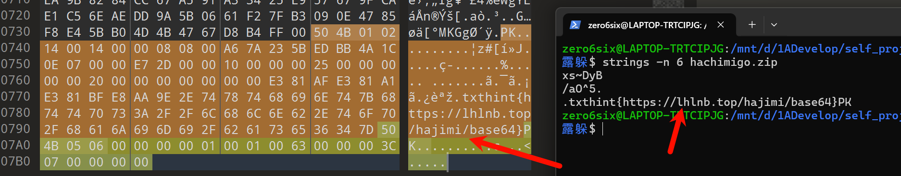

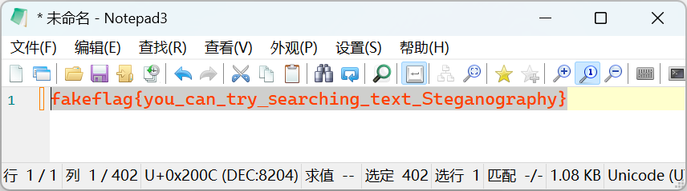

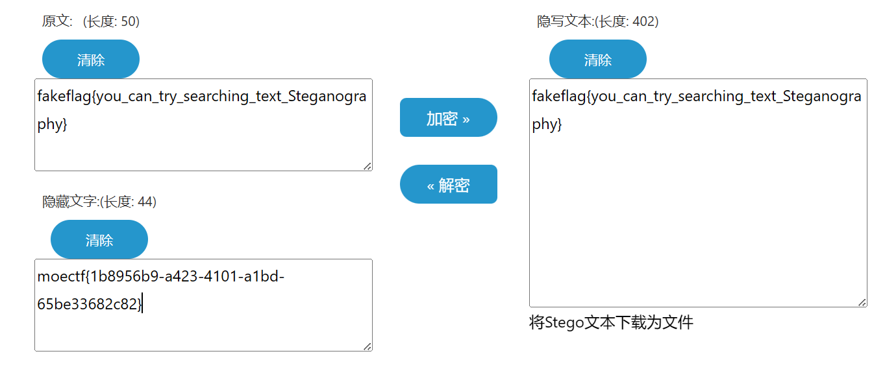

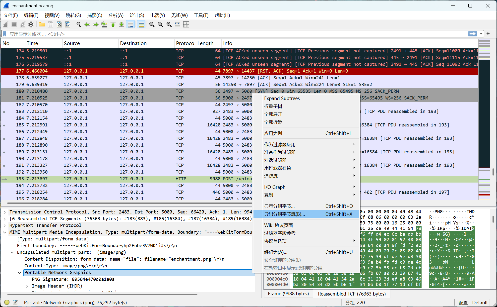

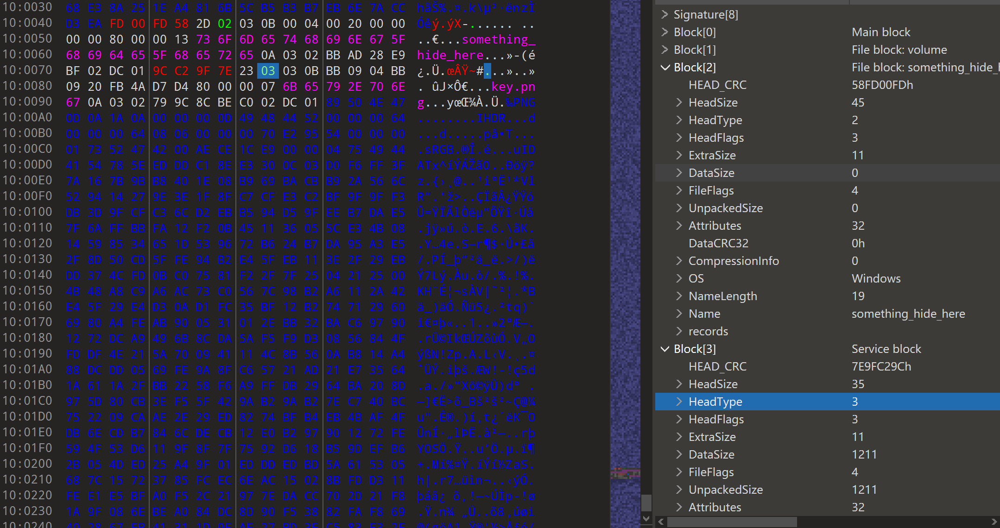

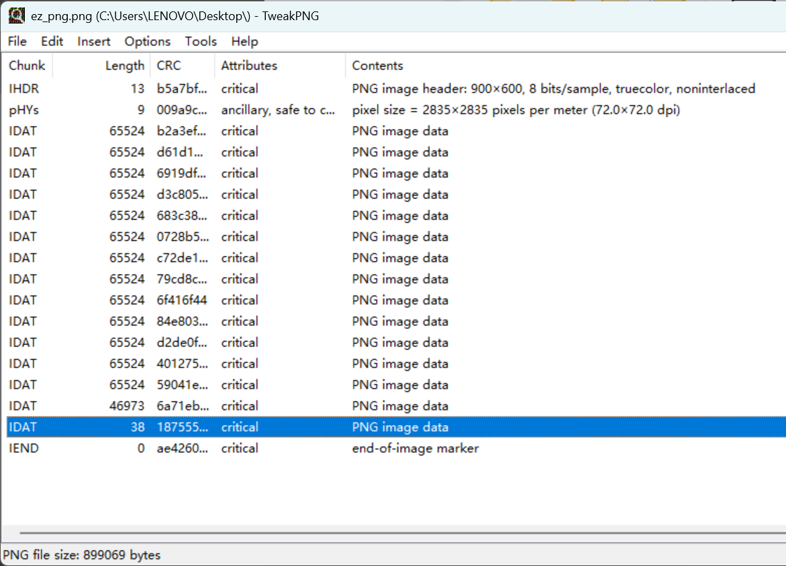

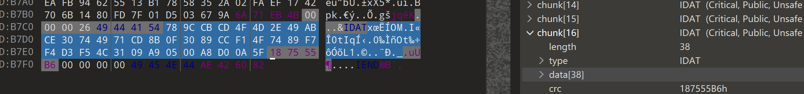

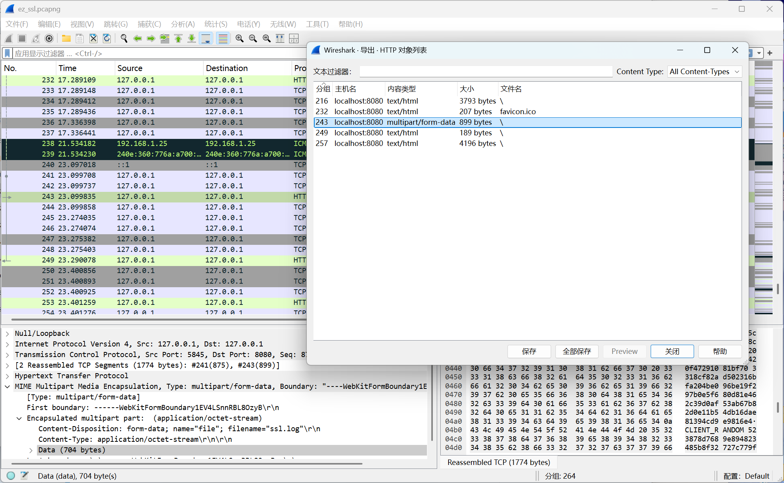

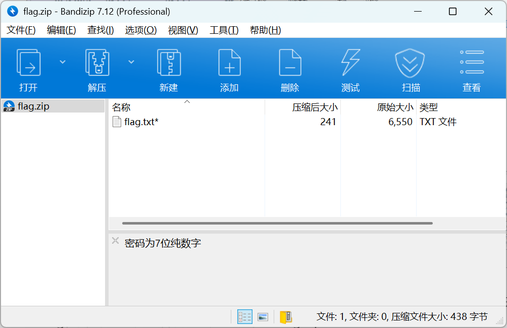

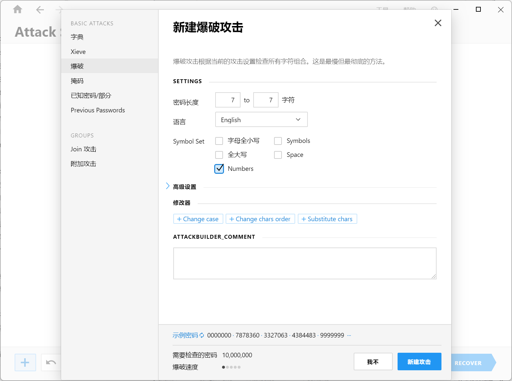

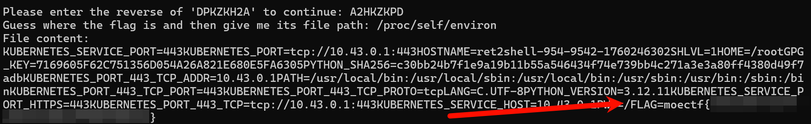

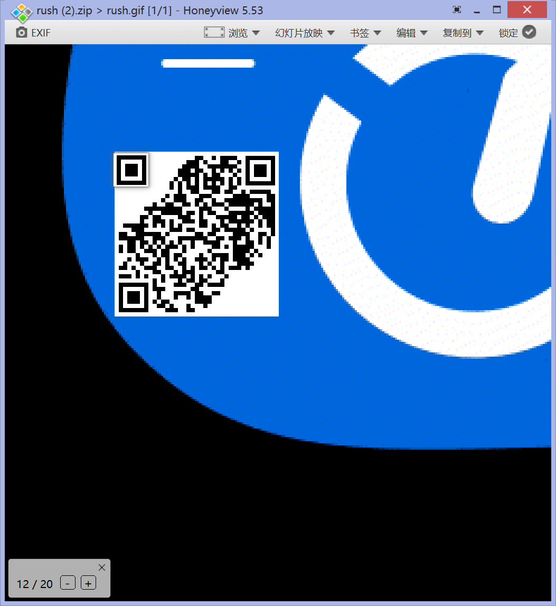

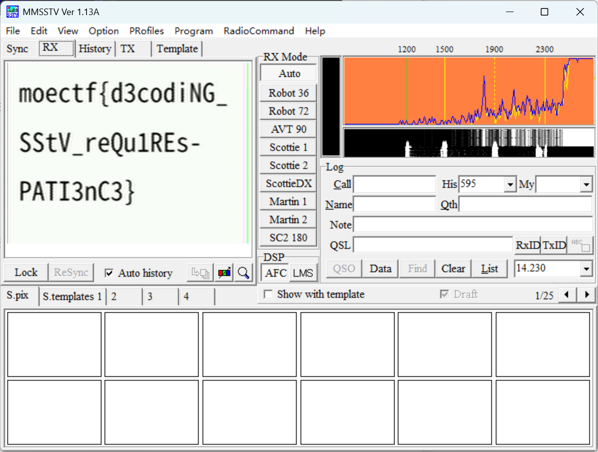

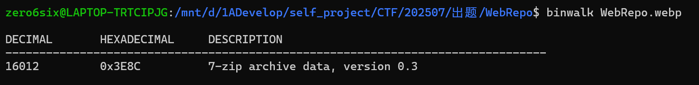

