# NewStar CTF 2024 / 擅长加密的小明同学

> 来源：NewStar CTF 2024  |  类型：wp_prose  |  https://github.com/pj-newstar/wiki-docs/blob/1a0f2ba21a30f950276396118b315eef0328371c/docs/wp/2024/week4/misc/xiaoming3.md

# 擅长加密的小明同学

涉及到取证常见的 Volatility 和 GIMP 看图的组合技，还融入（缝）了 BitLocker 解密环节。

拿到题目，题目含有一个 `.raw` 镜像和一个 `.vhd` 镜像，尝试挂载 vhd 镜像发现有 BitLocker 加密，看一眼简介：

> 小明在学习中对各类文件加密的方式起了浓厚的兴趣，并**把自己珍贵资料和 Flag 进行了套娃式加密**。然而，他却在某天的凌晨三点选择了重装系统，本来他就记不住自己的密码，还丢失了备份密钥……
> 据受害者回忆，**【他曾经使用画图软件把密码写了下来】**，尽管备份已经丢失，**如果能成功看到程序运行的样子**，说不定就找回密码了，但是硬盘的加密怎么办呢，哎呀 ~ **要是有软件能直接破解就好了www**

明确目标，我们围绕套娃加密分析：

双击 vhd 发现有 BitLocker，BitLocker 怎么解？理论上没有密码和恢复密钥还真解不开，也没有软件能直接破解，但是 dump 内存镜像的机器是成功解密 BitLocker 的，内存中会残留着 BitLocker 的密钥，而借助内存镜像来解密 BitLocker 的软件确实是有的，他是 `Elcomsoft Forensic Disk Decryptor`，基本上搜到的博客都用它，使用以上软件，按图示步骤解密：

〔原图省略〕

选择第一项「解密或挂载硬盘」：

〔原图省略〕

由于题目给了 vhd 文件，所以选使用镜像文件的第二项：

〔原图省略〕

数据来源选择被加密的镜像，而内存转储文件就选题目给的 raw 文件：

〔原图省略〕

一顿操作猛如虎，你就拿到了恢复密钥，这时候你就可以解锁被加密的 vhd 了，软件可以导出解密内容为 raw 格式镜像，raw 格式处理会麻烦一点，但不是不可以。这里在「更多选项」选择用恢复密钥解密，得到：

〔原图省略〕

然后你会发现套娃的第二层加密：

7z 在密码复杂的情况下基本不可能被解出密码，根据提示，我们得知小明曾经使用画图软件把密码写了下来，我们可以借助内存镜像看到程序运行的样子找回密码。

在这里我们借助 Volatility 和 GIMP 的力量解决问题：

首先按照上一道取证，分析镜像后查看进程：

〔原图省略〕

〔原图省略〕

发现 mspaint.exe（画图进程），我们提取出来，使用 memdump：

〔原图省略〕

提取出的程序对应的 dmp 文件是含有程序运行时的显示内容的，我们只需要寻找运行时图像在 dmp 文件中的位置，然后想办法让他显示出来，这里我们就可以借助 GIMP 通过调整偏移，高，宽的方式达到上面的目的。

在此之前，记得改后缀为 `.data`，拉入 GIMP 打开，可以看到：

〔原图省略〕

我们现在就是要调节位移、宽度、高度来显现程序运行时显示的内容。

:::tip 小提示

1. 一般正常的内存镜像的话，图像类型我们都选择「RGB 透明」

2. 适当调大宽高，能显示多一点内容，但别调太高，小心程序崩了

3. 位移看着拉，先拉到感觉有东西显示的位置，感觉差不多这样吧，一般画图就是白的夹依托的感觉：

   〔原图省略〕

4. 调好位移就调宽高，宽和高实际上就是和程序窗口大小有关，所以别太高，主要是宽度，如果和图上一样↘斜，那么你就该调高宽度，箭头一点一点加上去，如果是↗，你就得一点一点减下来，知道看上去正常了，下面是较为正常，也够用：

   〔原图省略〕

   〔原图省略〕

5. 936 其实已经是很正常了（上附虚拟机真实图片），其实如果你发现内容如果很不对劲，频繁重复的话，你也可以适当减小整数倍（当然这里会看起来很窄）：

   〔原图省略〕

总之多尝试 ~

:::

最后我们得到了：

〔原图省略〕

压缩包密码：`rxnifbeiyomezpplugho`

解压得到 flag：`flag{5ZCb44Gv5Y+W6K+B5pys5b2T44Gr5LiK5omL}`（君は取证本当に上手）

## 原文配图

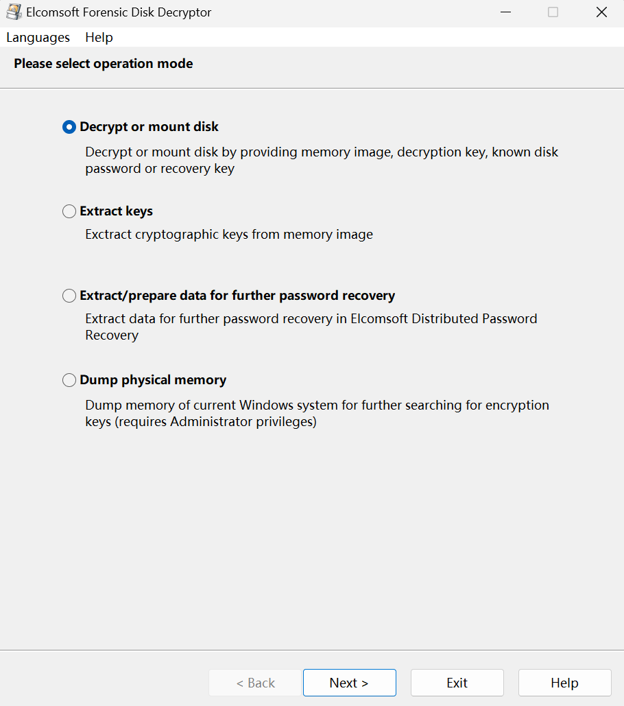

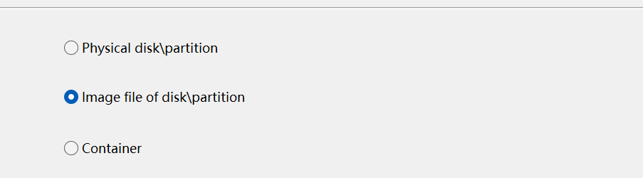

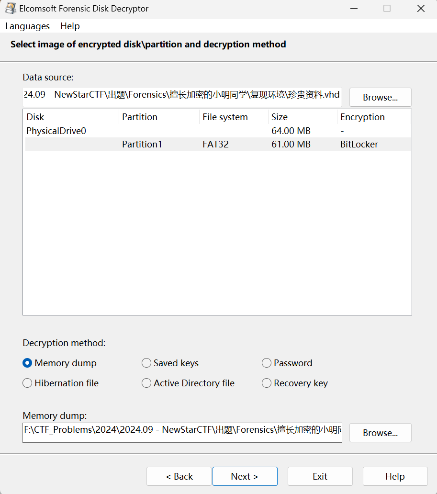

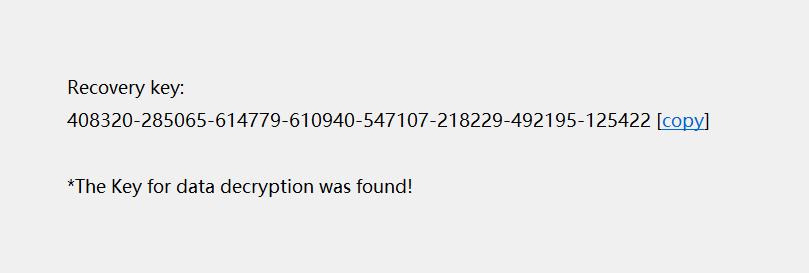

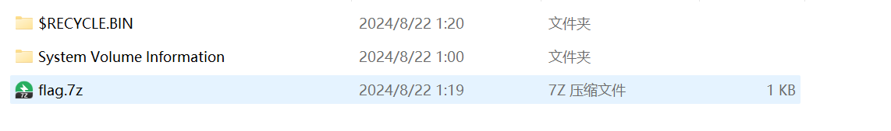

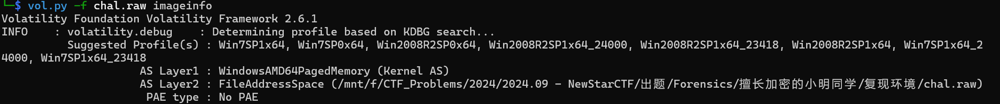

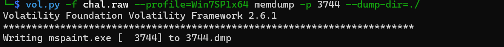

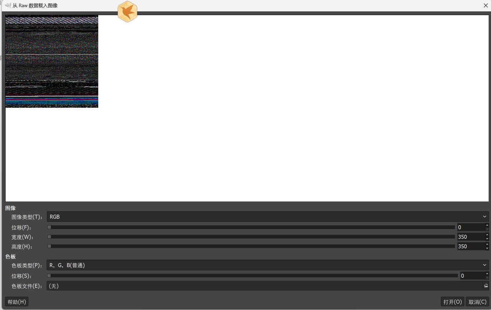

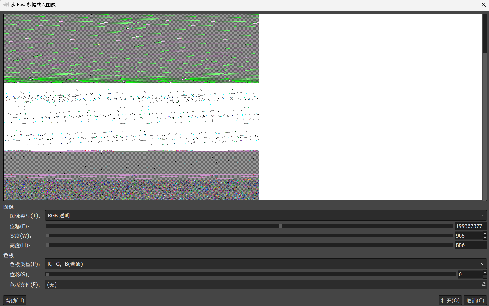

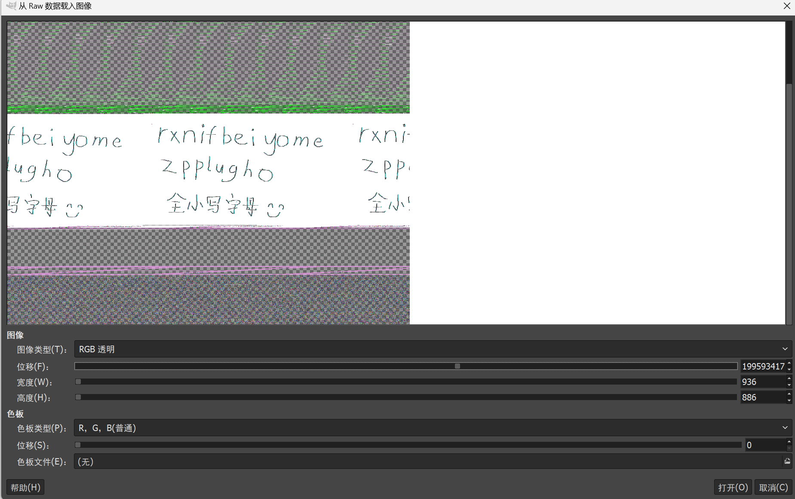

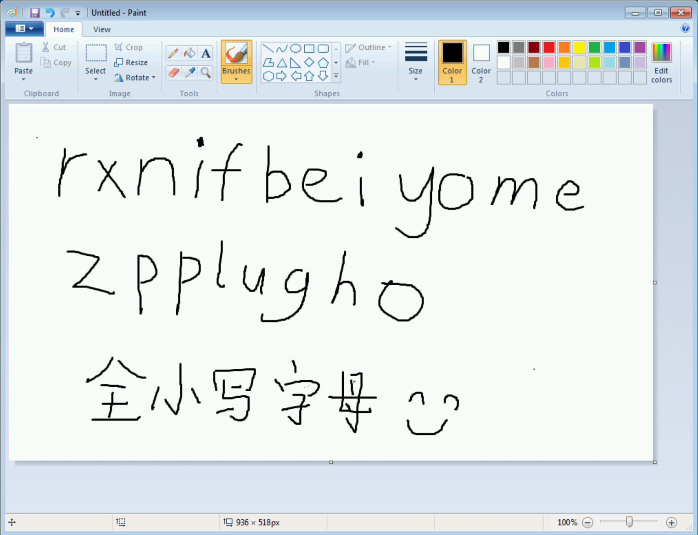

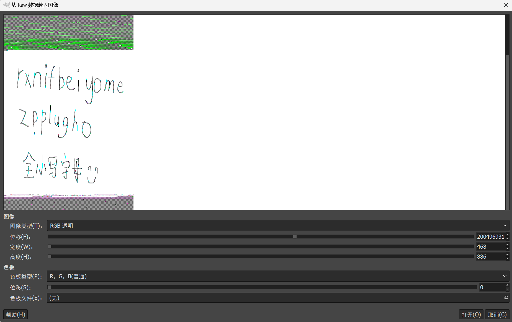

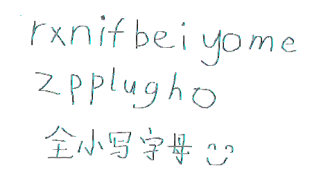
