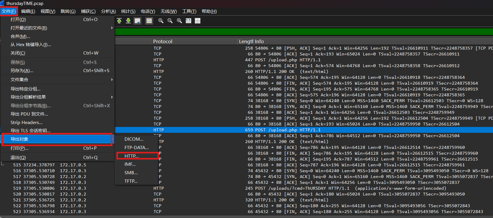
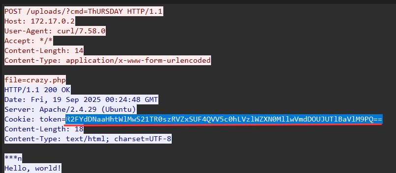

# NewStar CTF 2025 / 星期四的狂想

> 来源：NewStar CTF 2025  |  类型：wp_prose  |  https://github.com/pj-newstar/wiki-docs/blob/1a0f2ba21a30f950276396118b315eef0328371c/docs/wp/2025/week2/misc/thursday.md

import Container from '@/components/docs/Container.vue'

# 星期四的狂想

本题考查 HTTP 流量分析及简单的编码解码能力。

我们使用 [wireshark](https://www.wireshark.org/#download) 工具可以分析 pcag 文件。

打开之后会看到密密麻麻的通讯协议流量，我们可以点击“文件” → “导出对象” → “HTTP” 来分析所有使用 HTTP 通讯的流量。

〔原图省略〕

通过分析 `upload.php` 的所有流量，我们能获取到这样几个信息：

1. 攻击者上传了一个 `chickenvivo50.php` 文件，用于提供函数；
2. 攻击者上传了一个 `crazy.php` 文件，用于读取与混淆 flag；
3. 然后从 `uploads/index.php` 处触发攻击。

`chickenvivo50.php`：

`crazy.php`：

`index.php`：

很明显，如果我们设定 `cmd=ThURSDAY` 就会执行 `code($hahahahahaha)`，然后从 `Cookie` 处返回回来一个 `token` 参量。

这里的 `$hahahahahaha` 是 flag 通过编码后的形式。通过逆向 `crazy.php` 中的内容，我们可以知道，flag 被读取之后会被 base64 编码，然后被切成十个十个一组，通过随机的方式进行 rot13 或者 reverse 编码。

理解了加密逻辑之后，我们就可以编写一个解密脚本，由于块并不是很多，所以我们可以直接暴力枚举每一个块的可能性，如果在块比较多的情况下，我们可以考虑逐块尝试。

下面是我们的加密数据。

〔原图省略〕

`decoder.py`：

最终 flag 为 `flag{What_1S_tHuSd4y_Quickly_VIVO50}`。

## 原文配图

