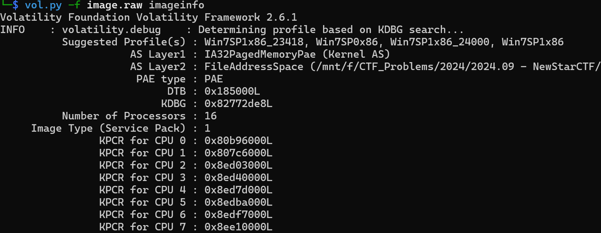
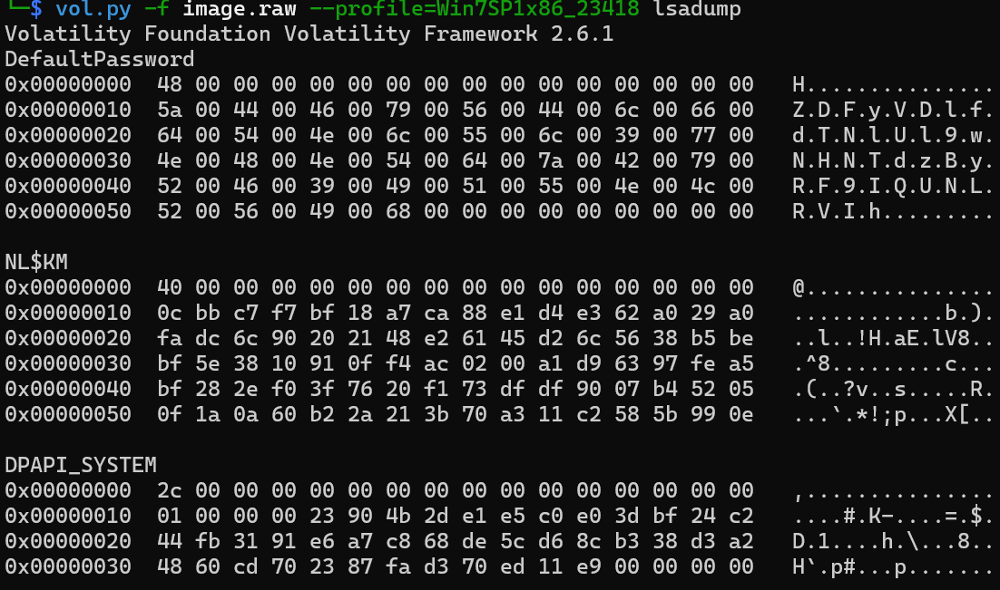
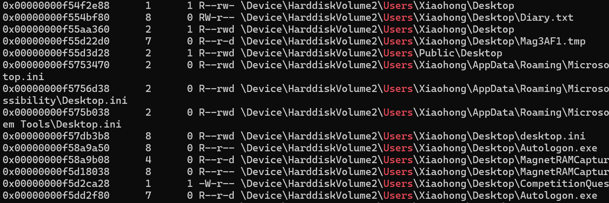
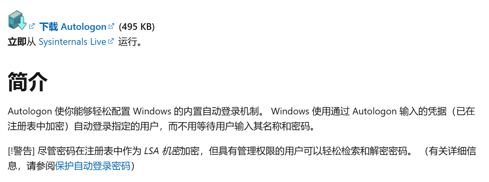
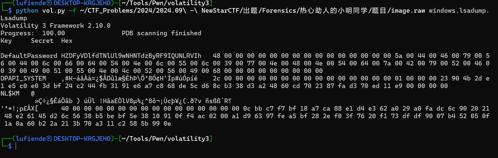

# NewStar CTF 2024 / 热心助人的小明同学

> 来源：NewStar CTF 2024  |  类型：wp_prose  |  https://github.com/pj-newstar/wiki-docs/blob/1a0f2ba21a30f950276396118b315eef0328371c/docs/wp/2024/week2/misc/xiaoming1.md

import Container from '@/components/docs/Container.vue'

# 热心助人的小明同学

拟定难度：简单

出题人：Lufiende

题目简介：

> 小明的邻居小红忘记了电脑的登录密码，好像设置的还挺复杂的，现在小红手里只有一个内存镜像（为什么她会有这个？），小明为了帮助邻居就找到了精通电脑的你……

拿到手的是一个叫 `image.raw` 的文件，由题可知是内存镜像。

## 不像预期的预期解：使用 Volatility 2 一把梭

什么是 Volatility？这是取证里一个很好用的工具，目前主流的有 2 和 3 两个版本，主流平台都可以使用，其中 Kali 如果进行了完整安装的话应该是自带这个软件的，如果没有 Kali Linux 的话可以前往[官网](https://volatilityfoundation.org/)下载。

如果新人在安装过程中出现了一些问题，也没有 Kali 虚拟机，可以先尝试 Windows 下的 Volatility 2 单文件版，当然大家也可以选择其他第三方取证软件，这里不多说了，因为一些第三方软件能一把梭。

这里以 Volatility 2 为例，在使用 Volatility 2 进行取证时，首先分析镜像确定镜像的来源操作系统版本，为进行下面操作做准备。

〔原图省略〕

可知建议选择的操作系统版本有：Win7SP1x86_23418, Win7SP0x86, Win7SP1x86_24000, Win7SP1x86. 这里选择第一个（Win7SP1x86_23418）进行尝试，反正不行就试试别的。

确定系统版本后就开始研究怎么拿到密码了，由于简介说过密码「好像设置的还挺复杂的」，又让找出密码明文，爆破是不现实的，在 Volatility 2 和密码明文有关的还有 lsadump，直接梭。

〔原图省略〕

开头的 `0x48` 并不是密码，你可以理解为是一个标志，除开这个你就能得到系统密码：`ZDFyVDlfdTNlUl9wNHNTdzByRF9IQUNLRVIh`.

为降低难度，随题目附件的文档强调了：

> flag格式为：flag\{你找到的系统登录密码\}
>
> 如果选手感觉自己的解题过程是正确的，请确保 **flag 括号内的内容是开机时需要输入的登录密码**
>
> \# 怕大家没有解密的想法于是就没摆上来

所以 flag 为 `flag{ZDFyVDlfdTNlUl9wNHNTdzByRF9IQUNLRVIh}`

## 没有意识到一把梭做法怎么办

关于 lsadump 的使用虽然在充分搜索之后能 get 到，但考虑到新人不容易 get，于是把提示留在桌面了。

〔原图省略〕

发现有可疑文件，`Diary.txt` 和 `Autologon.exe`，使用相关命令提取 `Diary.txt`：

提取文件内容为

结合 `Autologon.exe` 了解机主可能使用自动登录，通过必应搜索就可以在第一页打开 Microsoft 官方文档。

〔原图省略〕

其中「LSA 机密加密」是希望大家可以注意到了（出题人在必应搜索「ctf lsa 提取密码」是可以找到 lsadump 的使用的），提示使用 lsadump.

LSA Secrets 是一个注册表位置，存了很多重要的东西，只有 SYSTEM 帐户可以访问 LSA Secrets 注册表位置，在 `HKEY_LOCAL_MACHINE\SECURITY\Policy\Secrets`.

`lsass.exe` 负责访问和管理 LSA Secrets，当系统需要进行身份验证或访问存储的安全信息时，lsass 进程会从注册表中检索 LSA Secrets，并解密这些信息来完成任务，存密码的叫 DefaultPassword，也是我们要看的。

有人试过 mimikatz 的插件和 lsass.exe dump，不过这两种方式似乎是通过 wdigest<s>（我其实云了好像是使用的系统不再会自动打开这个所以使用这种方法看不见东西）</s>，而且 mimikatz 工具渗透的话很不错，好像取证不大用。

### Volatility 3 需要注意的

Volatility 3 在使用 lsadump 时会把前面不属于密码的 `H` 带进来。

命令为：

〔原图省略〕

## 原文配图

