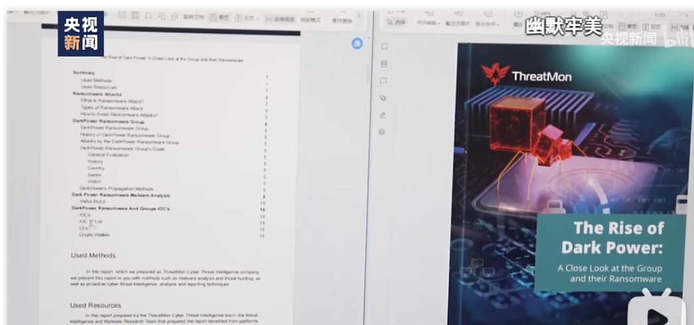
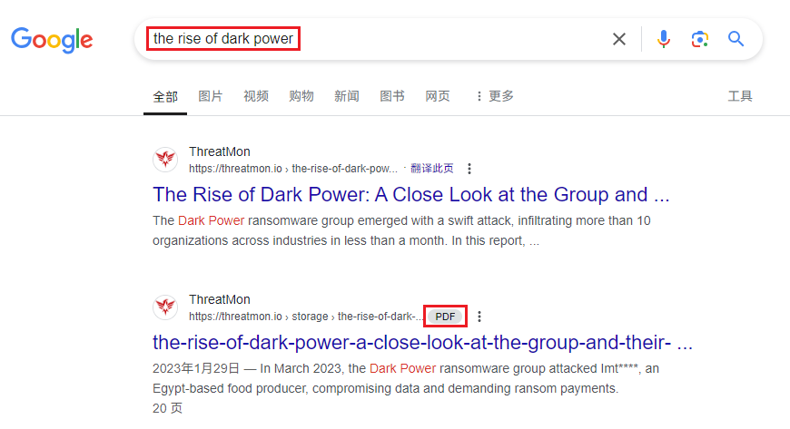
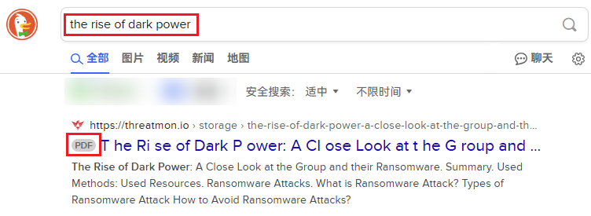
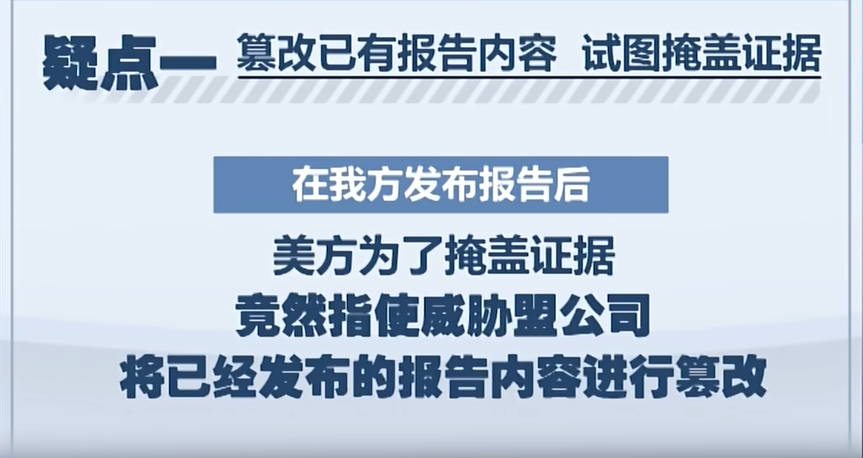
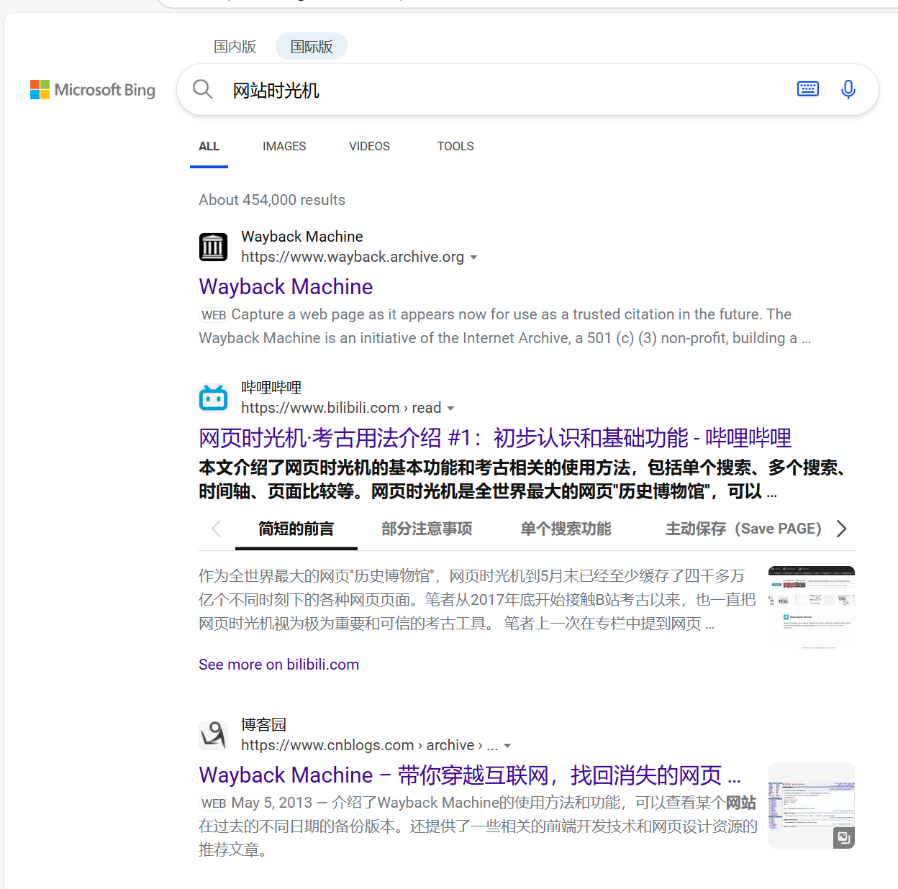
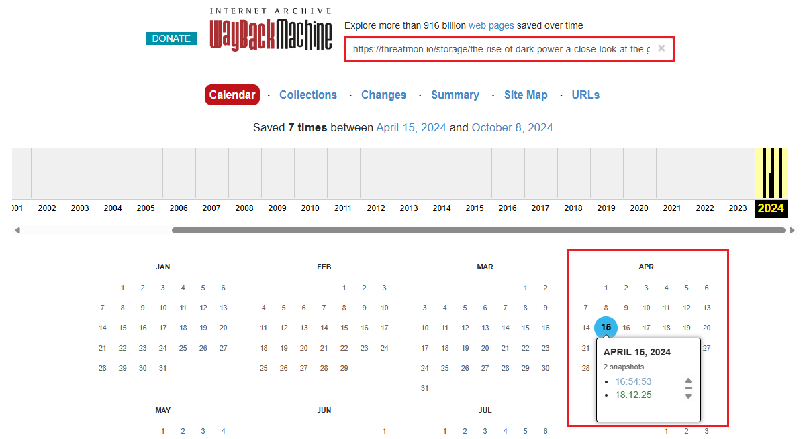
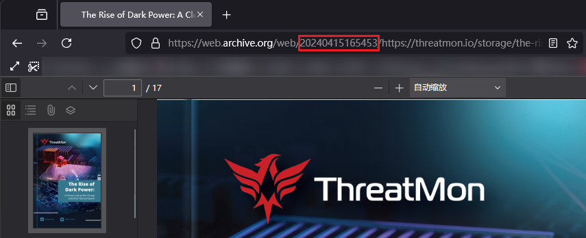
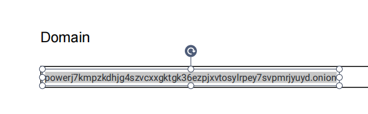
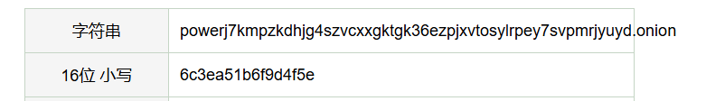

# NewStar CTF 2024 / 用溯流仪见证伏特台风

> 来源：NewStar CTF 2024  |  类型：wp_prose  |  https://github.com/pj-newstar/wiki-docs/blob/1a0f2ba21a30f950276396118b315eef0328371c/docs/wp/2024/week2/misc/futetaifeng.md

# 用溯流仪见证伏特台风

题目描述如下

> 漂亮国也干了。照着 2024 年 7 月 8 日央视新闻的方法来看看隐匿在图片下的东西吧。
>
> <strong>新闻视频：</strong><https://b23.tv/BV1Ny411i7eM>
>
> 新闻中提到的威胁盟报告里，隐藏在图片下，Domain 下方那个框里所有字符的 16 位小写 MD5，包裹 flag{} 即为 flag.
>
> <strong>提示：</strong>这个视频就是 WP；运气不好的话，你也许需要使用溯流仪（网站时光机）。
>
> <strong>PS：</strong>如果你眼力好，肉眼能从视频读出来，也是你的水平。祝你玩得开心。

第一步，打开新闻视频的链接

〔原图省略〕

〔原图省略〕

根据视频，我们获得以下信息：

- 所需报告：The Rise of Dark Power...
- 对应版本：最初 4 月 15 日版本
- 现状：所需信息已经被篡改

我们直接搜索报告名称

〔原图省略〕

〔原图省略〕

可以看到我们需要的 PDF 文件，但是视频中又提到报告内容已经被篡改

〔原图省略〕

所以现版本肯定是没有我们所需的信息的

出题人之前运气好，搜到过可以直接下载的原始版本 PDF，直接就可以开做。

但运气不好怎么办呢？我们请出我们的网站时光机—— wayback machine.

〔原图省略〕

输入官网链接，启动溯流仪，正好有 4 月 15 日的版本。

〔原图省略〕

〔原图省略〕

下载文件，剩下的内容就和视频中演示的一样了。

移开封底图片，拿到 Domain 框里的东西，然后 MD5，

当然，你要是能用肉眼直接把视频里的模糊信息读出来，出题人也认了。

〔原图省略〕

〔原图省略〕

包上 flag，得到 `flag{6c3ea51b6f9d4f5e}`.

## 原文配图

