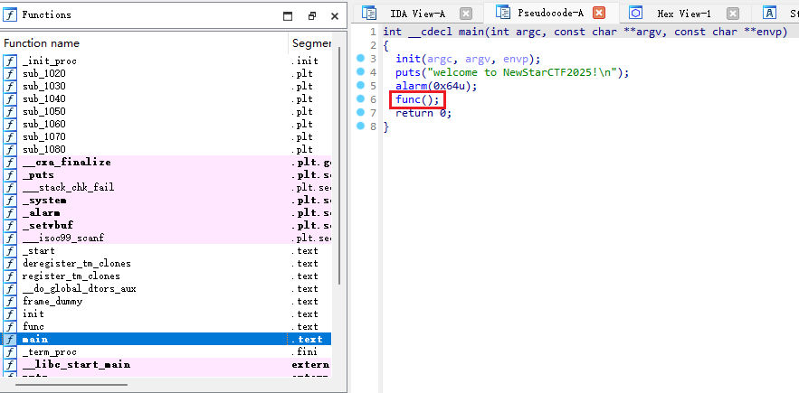
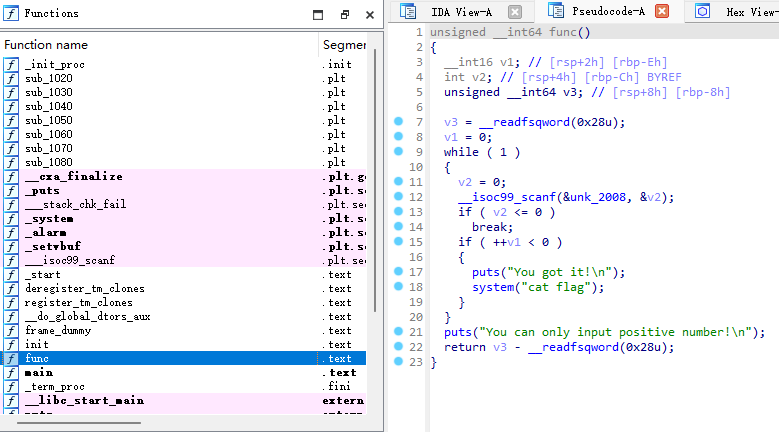

# NewStar CTF 2025 / INTbug

> 来源：NewStar CTF 2025  |  类型：wp_prose  |  https://github.com/pj-newstar/wiki-docs/blob/1a0f2ba21a30f950276396118b315eef0328371c/docs/wp/2025/week1/pwn/intbug.md

import Container from '@/components/docs/Container.vue'

# INTbug

本题考查整数溢出。

使用 IDA Pro 打开题目附件，按下 <kbd>F5</kbd> 进行反编译，查看 `main` 函数：

〔原图省略〕

双击 `func` 函数查看器内容：

〔原图省略〕

程序的逻辑很简单：若输入正数，`v1` 就会加 1；如果 `v1` 小于 0，那么就可以拿到 FLAG.

`v1` 的类型是 `__int16`，2 字节，有符号整数，可表示的数据范围为 `[-32768, -1]` `[0, 32767]`，用补码表示为 `[0x8000, 0xffff]` `[0, 0x7fff]`.

:::info 补码

「原码」的最高位为符号位，其余各位为数值位；「反码」是原码的符号位不变，其余各位取反。

「补码」是计算机中表示有符号整数的一种方式。对于正数，补码与原码相同；对于负数，补码是反码加 1，符号为不变。

但是这样会引入两个 0（正零和负零）。特别地，对于 $n$ 位原码：

- 符号为 0，数值位全为 0（正零），表示数值 $0$；
- 符号为 1，数值全为 0（负零），表示数值 $-2^n$.

对于负数的补码，根据补码求原码，也只需求补码的补码加 1 即可，符号位不变。即负数的原码与补码互补（保持总二进制位数不变的情况下，相加为 0）。

在本题中，补码 `0x8000` 二进制表示为 `1000 0000 0000 0000`，补码的补码为 `1111 1111 1111 1111`，加 1 得到原码 `1000 0000 0000 0000`，即表示数值 $-32768$.
:::

当 `v1` 等于最大值 `0x7fff` 时，再加 1 就会变为 `0x8000`，而 `0x8000` 为 `-32768`，发生整数溢出，小于 0，从而拿到 FLAG.

因此只要 `v1` 大于 `0x7fff` 即可，可以利用 Python 的 `pwntools` 库写一个循环。

## 原文配图

