# NewStar CTF 2024 / Maze_Rust

> 来源：NewStar CTF 2024  |  类型：wp_prose  |  https://github.com/pj-newstar/wiki-docs/blob/1a0f2ba21a30f950276396118b315eef0328371c/docs/wp/2024/week4/pwn/maze_rust.md

import Container from '@/components/docs/Container.vue'

# Maze_Rust

〔原图省略〕

IDA 逆向看不懂，先当黑盒打（

## 解法一

进入程序，发现这是个简单的迷宫

〔原图省略〕

于是可以搓脚本，读取迷宫用算法解迷宫了

成功解出迷宫后，会让我们输入

〔原图省略〕

随便试试可以发现，这是一个 `system()`，可以执行我们输入的东西

贴一个 GPT 生成的迷宫脚本

## 解法二

观察力惊人的我们发现，菜单

〔原图省略〕

只出现了 1、3，唯独跳过了 2，于是好奇心过剩的我们，尝试输入 `2`，得到了一句提示

〔原图省略〕

当然，不知道是什么数字也没事，我们可以掏出 IDA，一逆究竟

:::tip
本题是用 Rust 编写的，这会导致在 IDA 中会显得十分杂乱
:::

Rust 编译出来的程序，其主函数在 `Maze_Rust::main` 中

〔原图省略〕

进入到主函数中，我们通过题目的功能来进行猜测。题目的菜单要求我们输入数字来进行选择，我们找到类似多个 if 判断选择的地方

〔原图省略〕

在这段代码中，我们发现程序对 `v74` 进行了多次的if比较，猜测它就是我们输入的数字，判断后执行的如 `generate_maze`，也符合程序中菜单的功能

通过逆向（或是对绫地宁宁的理解）我们可以知道，输入的数字是 `0721`

〔原图省略〕

在代码中，我们发现程序对 DEBUG 的一个全局变量做了修改

〔原图省略〕

通过 <kbd>X</kbd> 键查找引用

〔原图省略〕

找到了第二处引用的位置，因此在第二次附近，我们猜测就是 Backdoor 的 Stage2

〔原图省略〕

激活后门 Stage1 后，程序会给出提示

〔原图省略〕

〔原图省略〕

我们找到输入的地方，发现输入的字符串最终是 `v20`，并且和后面的东西进行了 `cmp` 比较

〔原图省略〕

:::tip
Rust 的字符串比较用上了 xmm 寄存器，提高效率
:::

跟进查看这两处存的字符

〔原图省略〕

使用 <kbd>⇧ Shift</kbd><kbd>E</kbd> 提取内容

〔原图省略〕

〔原图省略〕

合起来就是 `I'm the best pwner!!!`

于是我们输入就可以 Get Shell：

〔原图省略〕

## 原文配图

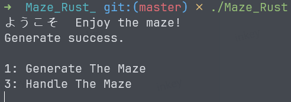

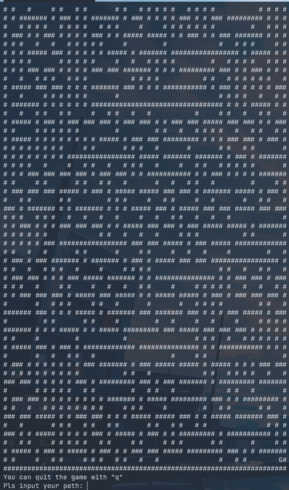

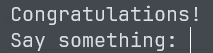

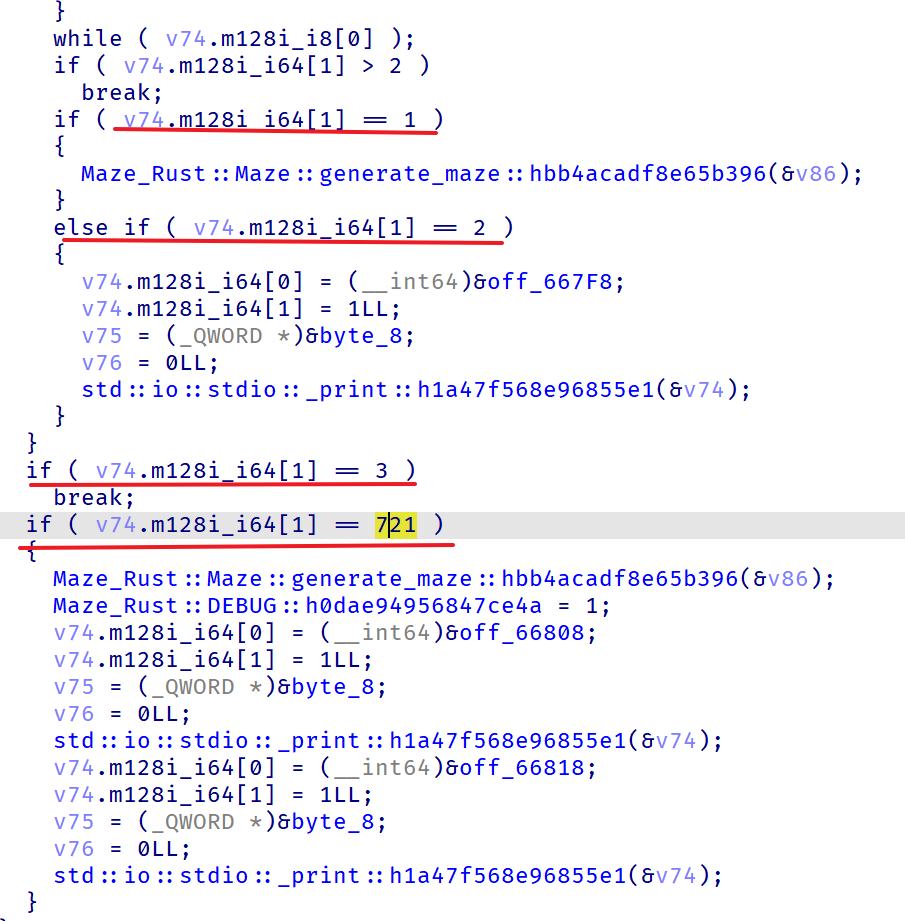

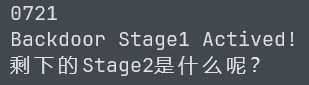

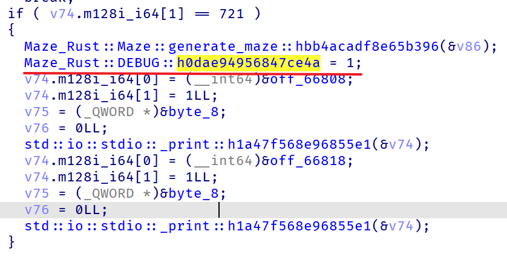

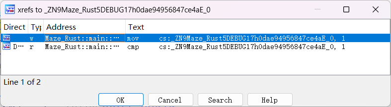

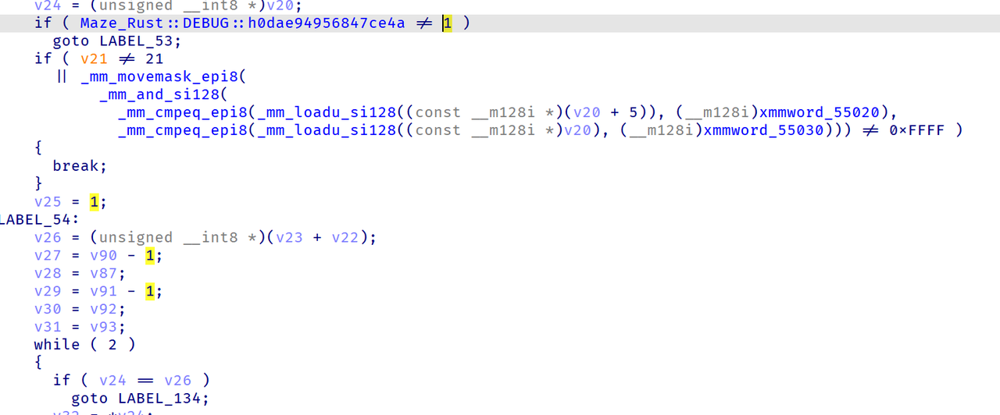

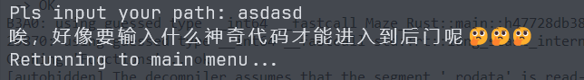

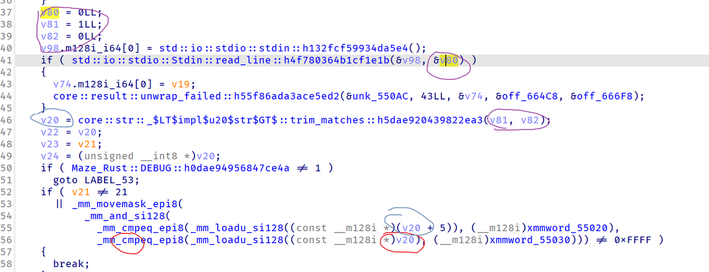

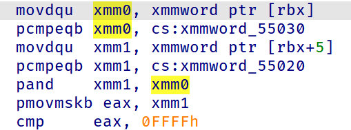

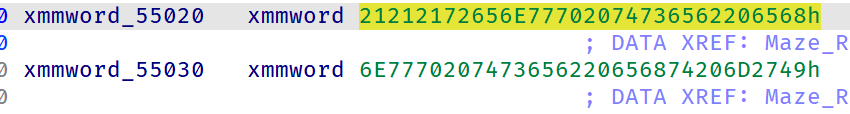

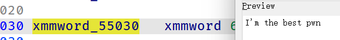

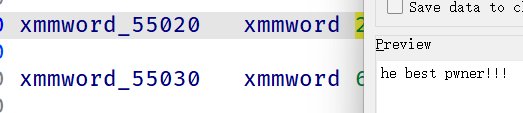

