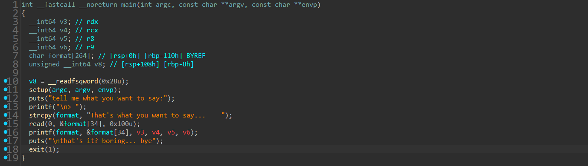
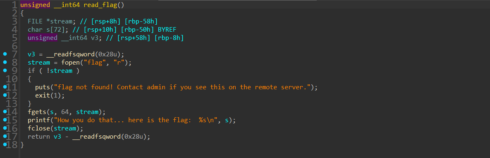
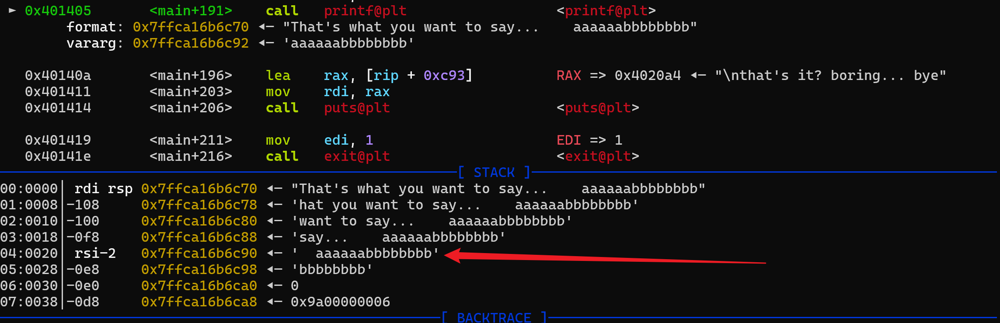

# NewStar CTF 2025 / fmt&got

> 来源：NewStar CTF 2025  |  类型：wp_prose  |  https://github.com/pj-newstar/wiki-docs/blob/1a0f2ba21a30f950276396118b315eef0328371c/docs/wp/2025/week4/pwn/fmt-got.md

import Container from '@/components/docs/Container.vue'

# fmt&got

本题考查格式化字符串漏洞覆盖 GOT。

前面几周已有利用格式化字符串漏洞泄露内存的题目，本题进一步考查通过格式化字符串覆盖内存。开始之前，可以先了解 Linux 保护机制中的 RELRO，以及格式化字符串漏洞覆盖内存的基本方法：

- [Linux 保护机制](https://zhuanlan.zhihu.com/p/666340476)
- [覆盖内存](https://ctf-wiki.org/pwn/linux/user-mode/fmtstr/fmtstr-exploit/#_8)

首先查看 `checksec` 结果：

`RELRO: No RELRO` 说明 GOT 表可写，同时程序未开启 PIE。继续查看程序逻辑。

〔原图省略〕

程序提供一次格式化字符串漏洞利用机会，最后调用 `exit(1)` 退出，同时程序中存在读取 FLAG 的函数。

〔原图省略〕

这里将 `exit@got` 改为 `read_flag()` 即可。不过需要注意：

`printf` 会输出额外内容，需要回顾 `%n` 的特性：

- `%n` 不输出字符，但会把已经成功输出的字符个数写入对应整型指针参数所指的变量。

通常使用 `%c` 配合 `%n` 覆盖内存。这里覆盖时需要先减去前缀 `That's what you want to say... ` 的长度。此外，还需要填充到 8 字节对齐，让目标地址正确放到栈上，因此也要减去填充数据的长度。

这里使用 pwntools 的 `fmtstr_payload()`。关于它的使用方法，可以参考 [pwnlib.fmtstr — 格式化字符串漏洞利用工具](https://pwntools-docs-zh.readthedocs.io/zh-cn/dev/fmtstr.html)。

在 payload 构造上，先填入 6 个 `a` 作为填充，使输入起始地址 8 字节对齐。`fmtstr_payload()` 的第一个参数是输入位置对应的偏移，这里不计前面的 6 个填充。例如输入：

在 GDB 中观察：

〔原图省略〕

可以得知偏移为 11。
第二个参数是一个字典，键为目标地址，值为要写入的数值。例如要把 `0x114514` 地址的内容覆盖为 `0xdeadbeef`，则填入 `{0x114514:0xdeadbeef}`。
第三个参数是 `numbwritten`，不一定要填写，但这里会用到，因为 payload 前面还有 40 个字节的输出。如果忽略这 40 个字节，写入数值会多出 40。
最后一个参数是 `write_size`。由于依靠 `%n` 写入数据，而 `%hn` 一次写入 2 字节，`%hhn` 一次写入 1 字节，因此可以通过 `write_size` 大致控制 payload 长度。本题没有对输入长度进行限制，因此不需要额外设置。

也可以手动构造 payload。

这里给出 EXP：

## 原文配图

