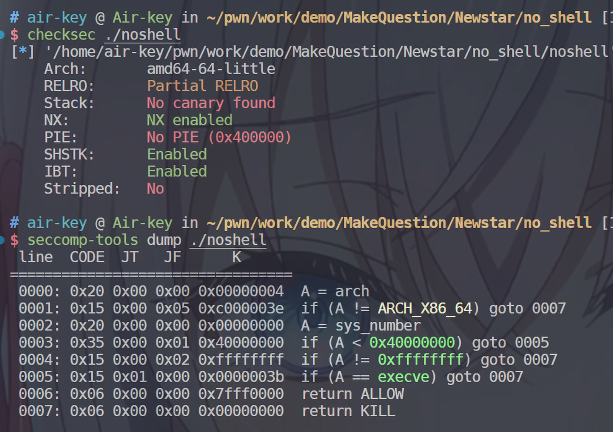
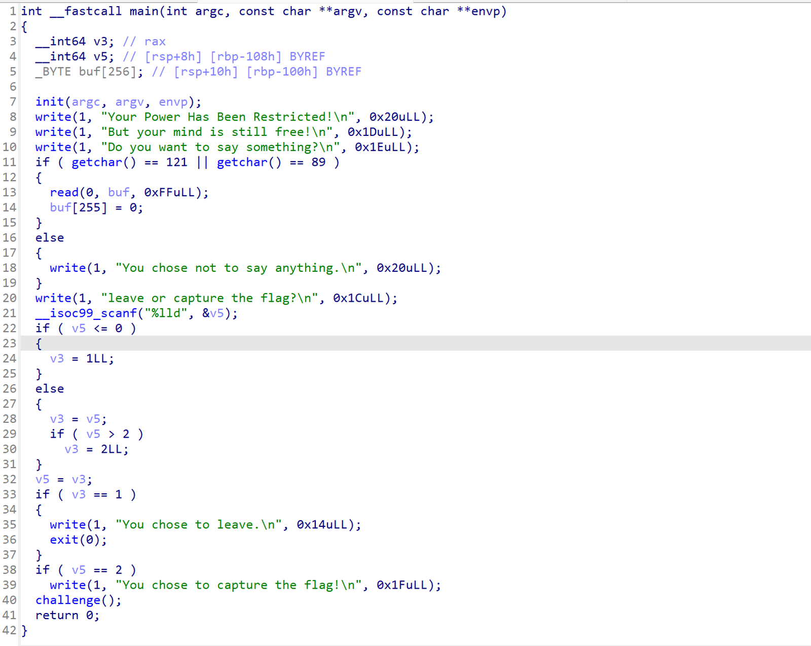
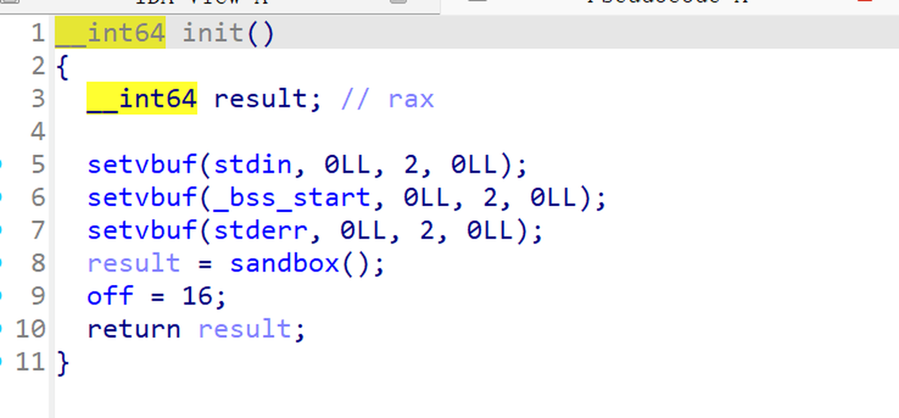
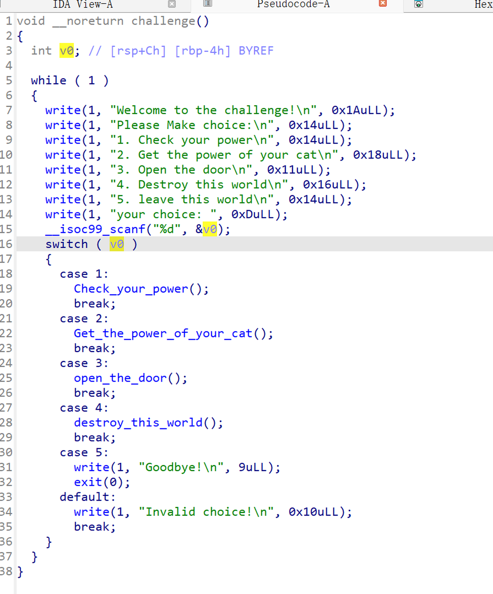
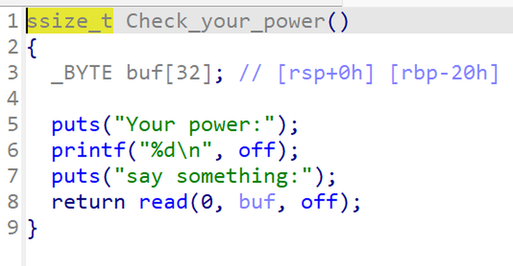
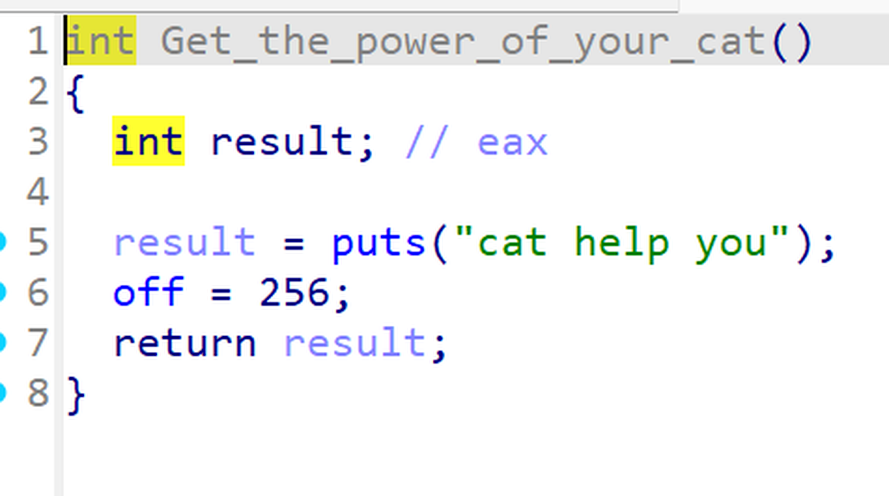
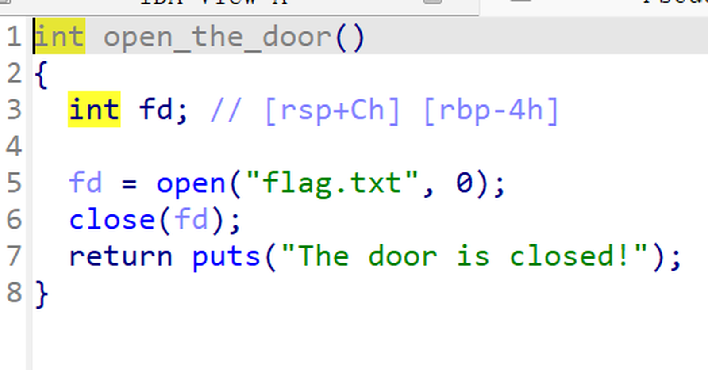
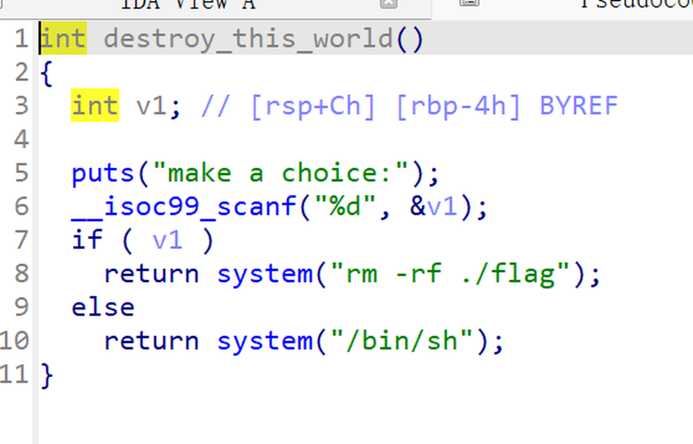
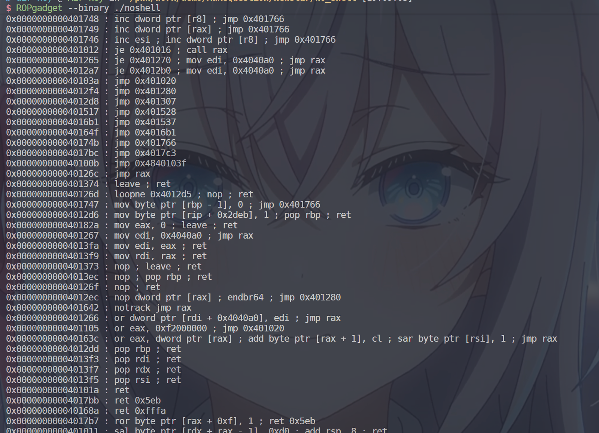
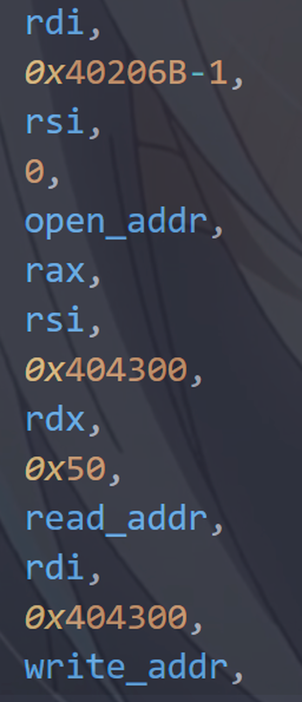

# NewStar CTF 2025 / no shell

> 来源：NewStar CTF 2025  |  类型：wp_prose  |  https://github.com/pj-newstar/wiki-docs/blob/1a0f2ba21a30f950276396118b315eef0328371c/docs/wp/2025/week2/pwn/no-shell.md

import Container from '@/components/docs/Container.vue'

# no shell

本题考查沙箱与 ROP.

参考链接

- [Linux沙箱之seccomp介绍 | arch3rn4r](https://arch3rn4r.github.io/2024/09/21/Linux%E6%B2%99%E7%AE%B1%E4%B9%8Bseccomp%E4%BB%8B%E7%BB%8D/)
- [ROP入门 - Hello CTF](https://hello-ctf.com/hc-pwn/ROP/)

在对一个 pwn 附件进行逆向分析前，挑战者不得不去获取一些其他的信息。

需要的工具有：checksec 和 seccomp-tools，前者在安装 pwntools 的时候就会附带，后者则需要独立安装，在 Ubuntu 环境下，安装可参考：

## 预处理

在安装好工具后，就来到了预处理环节，也就是获取“其他信息“。

〔原图省略〕

`check` 下可以看到程序的一些基础信息：

- amd64 架构、64 位、小端序（little）
- No canary，没有 canary 保护
- No PIE，没有 PIE 保护

其他的属性可以不关心。

至于 seccomp-tools，得知程序不允许使用 `execve` 系统调用（是的，就是 ret2syscall 中那个系统调用），`system` 因此无法使用。

## 逆向分析

〔原图省略〕

`init` 然后是一大堆输出。

有 3 个输入点，第一个是在第 11 行的 `getchar`，第二个是 13 行的 `read`，第三个是 21 行的 `scanf`，但是都没办法溢出

在 `init` 中，初始化了流，进行了 `sandbox`，初始了 `off` 变量为 16。

〔原图省略〕

经过了前面的一系列操作后，来到了本题的重点，`challenge` 函数

### challenge

〔原图省略〕

有 5 个功能。

#### 1. Check your power

输出 `off`，输入一些东西。

〔原图省略〕

#### 2. Get the power of your cat

设置 `off` 为 256。

〔原图省略〕

#### 3. Open the door

打开 `flag.txt`，然后关闭。

〔原图省略〕

#### 4. Destroy this world

删除 flag 或者 `system("/bin/sh")`。

〔原图省略〕

当然，由于沙箱机制，这俩个操作都不会成功，反而会让程序崩溃。

#### 5. leave this world

退出程序。

## 漏洞分析

在以上梳理后，漏洞相当明显，先设置 `off` 为 256，再输入，就能溢出返回地址。

至于 ROP 构造，由于不能构造 `system("/bin/sh")`，所以得使用 [orw](https://www.cnblogs.com/falling-dusk/p/18101528)。

`open` 有俩参数，要控制 `rdi` 和 `rsi` 寄存器。

`read` 和 `write` 有三个参数，要控制 `rdi`，`rsi`，`rdx` 寄存器。

〔原图省略〕

`pop rdi`，`pop rsi`，`pop rdx`，还有一个非常关键的 `mov rdi, rax` 用于传递返回值，形似于这样的 rop 链。

〔原图省略〕

在下面的 EXP 中，`rax` 指代 `mov rdi, rax ; ret` 所在的地址

`rdi`，`rsi`，`rdx` 指代 `pop rdi/rsi/rdx ; ret` 所在的地址

## EXP

## 原文配图

