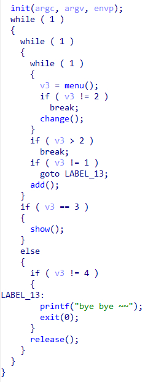
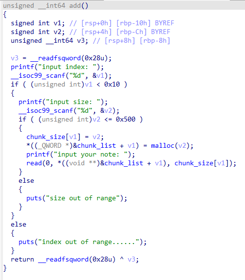
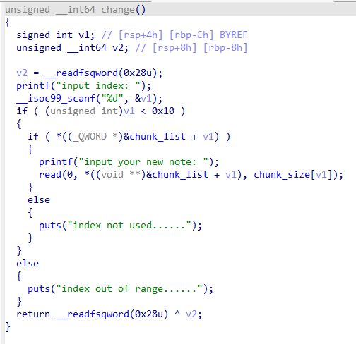
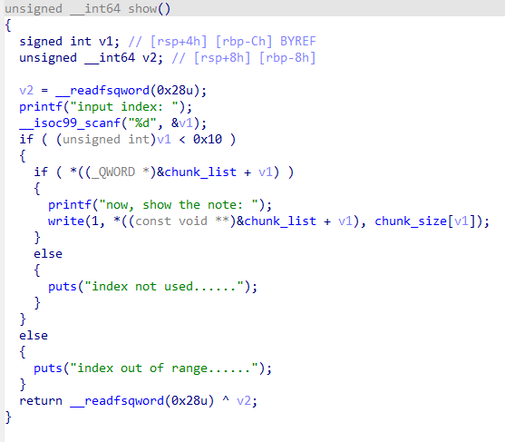
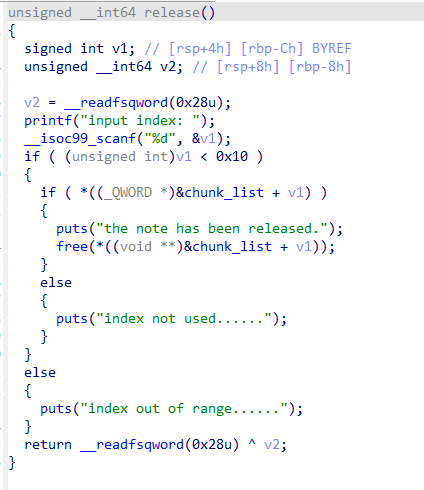
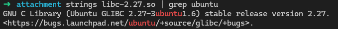
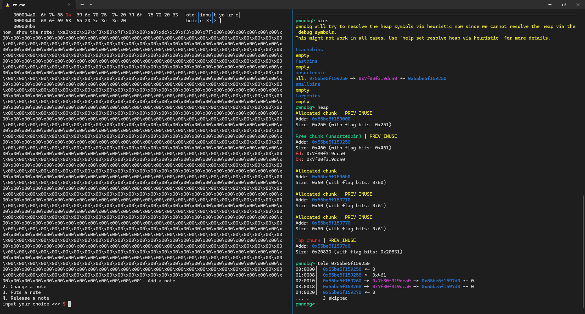

# NewStar CTF 2025 / note

> 来源：NewStar CTF 2025  |  类型：wp_prose  |  https://github.com/pj-newstar/wiki-docs/blob/1a0f2ba21a30f950276396118b315eef0328371c/docs/wp/2025/week5/pwn/note.md

# note

程序提供了一个菜单，并且提供了 `add`，`show`，`change`，`release` 的功能，我们逐个函数来看

〔原图省略〕

`add` 函数中程序读取了 `index` 和 `size`，并将 `size` 存入 `chunk_size` 中，将 `malloc(size)` 申请到的堆块地址存入 `chunk_list` 中，`chunk_size` 和 `chunk_list` 均为全局变量。随后通过一个 `read` 可以设置堆块的内容。

〔原图省略〕

`change` 函数可以通过指定 `index` 设置指定堆块的内容

〔原图省略〕

`show` 函数可以通过指定 `index` 去打印指定堆块的内容

〔原图省略〕

`release` 函数允许通过 `index` 去释放指定堆块，但是在 `free` 之后没有将 `chunk_list` 的 `index` 位置置零，因此还是可以通过这个 `index` 去访问这块已经释放的内存，存在一个经典的 `UAF` 漏洞

〔原图省略〕

由于堆利用手法与版本有关，因此我们查看 glibc 版本

〔原图省略〕

使用 glibc 版本是 `2.27-3ubuntu1.6`，这个版本开启了 `tcache bin`，和用户交互默认为 `tcache bin`，同时在这个版本中存在 `__malloc_hook` 和 `__free_hook` 可以攻击，所以我们考虑通过这个 UAF 去挟持堆块的申请地址，这样下一次申请就可以控制堆块申请到 `__free_hook` 处，这样就可以修改其为 `system` 的地址，这样只要执行 free，堆块中的内容只要是 `/bin/sh` 即可拿到权限

如何泄露 libc 呢？当我们申请的堆块足够大，释放后就会进入 `unsorted bin`，在其中会有一个 `libc` 地址，通过这个地址就可以泄露 `libc` 后计算 `system` 和 `__free_hook` 的地址

〔原图省略〕

## 原文配图

