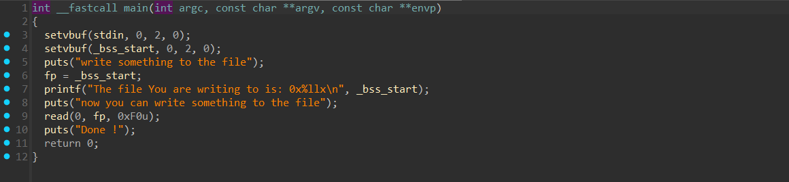
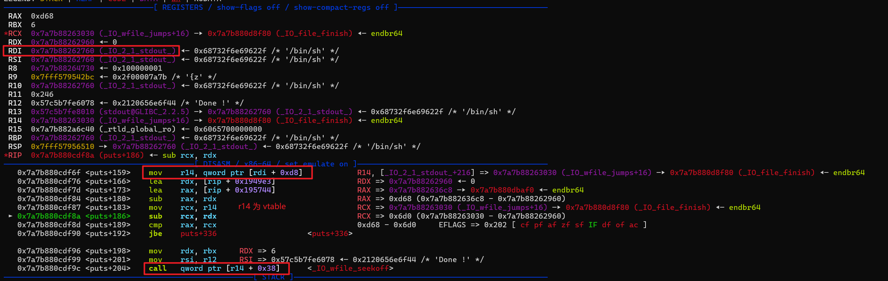
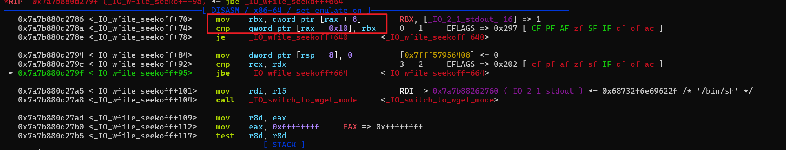
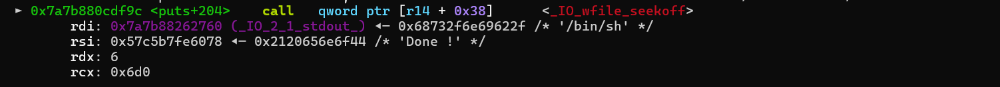
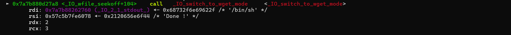
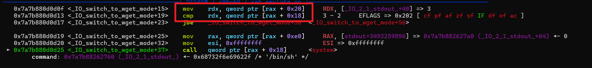

# NewStar CTF 2025 / stdout

> 来源：NewStar CTF 2025  |  类型：wp_prose  |  https://github.com/pj-newstar/wiki-docs/blob/1a0f2ba21a30f950276396118b315eef0328371c/docs/wp/2025/week5/pwn/stdout.md

import Container from '@/components/docs/Container.vue'

# stdout

本题考查 `_IO_FILE` 结构体利用。

开始做这道题之前，需要对 `_IO_FILE` 有基本认识，可以参考：

- [FILE 结构](https://ctf-wiki.org/pwn/linux/user-mode/io-file/introduction/)
- [FILE 结构体漏洞利用：0x01 介绍](https://www.bilibili.com/video/BV14f421B7zt?spm_id_from=333.788.videopod.sections&vd_source=b005ec5af584b4ef1ded2a09167f88a7)
- [FILE 结构体漏洞利用：0x02 任意读与任意写](https://www.bilibili.com/video/BV18m421g7mZ?spm_id_from=333.788.videopod.sections&vd_source=b005ec5af584b4ef1ded2a09167f88a7)
- [FILE 结构体漏洞利用：0x03 FILE_plus 和 vtable](https://www.bilibili.com/video/BV14T421k7RJ?spm_id_from=333.788.videopod.sections&vd_source=b005ec5af584b4ef1ded2a09167f88a7)

首先大致分析程序。

〔原图省略〕

表面上看，这只是向 bss 段输入的逻辑，实际情况如下：

- `_bss_start` 是一个文件指针（FILE\*），它与输出流相关联，在 C 语言中，通常 `_bss_start` 会被初始化为标准输出流 `stdout`

随后程序打印 `stdout` 地址，并执行 `read(0, fp, 0xF0u);`，因此可以劫持 `stdout` 结构体。

简而言之，需要修改 vtable，使原本的 `_IO_file_xsputn` 变为 `_IO_wfile_seekoff`。
〔原图省略〕
查看相关源码：

当满足 `fp->_wide_data->_IO_write_ptr > fp->_wide_data->_IO_write_base` 时，就会调用 `_IO_switch_to_wget_mode`。
〔原图省略〕
〔原图省略〕
进入 `_IO_switch_to_wget_mode` 后，关键点在内部调用链。
〔原图省略〕
继续查看源码：

大小比较的逻辑体现在这里
〔原图省略〕
当满足 `fp->_wide_data->_IO_write_ptr > fp->_wide_data->_IO_write_base` 时，会调用 `_IO_WOVERFLOW(fp)`。而 `_IO_WOVERFLOW` 实际取自 `_wide_data->_wide_vtable`，该地址可控。因此可以在这里布置 `system`，其参数来自 `_flags` 字段，将 `_flags` 字段设置为 `/bin/sh` 即可。

本题存在多种利用方式，这里给出其中一种调用链。

最后给出 EXP：

## 原文配图

