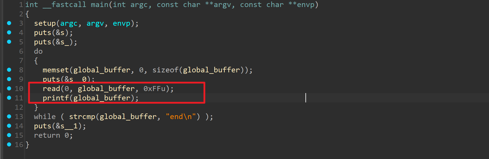
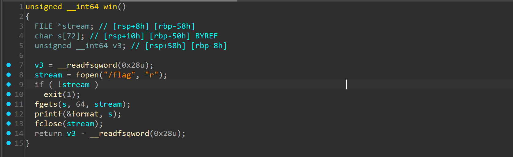
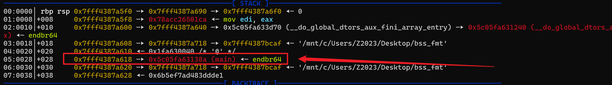
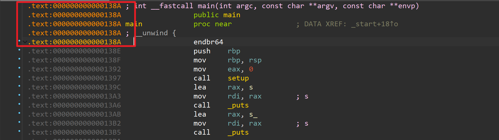
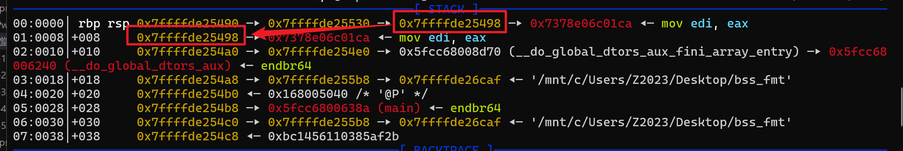
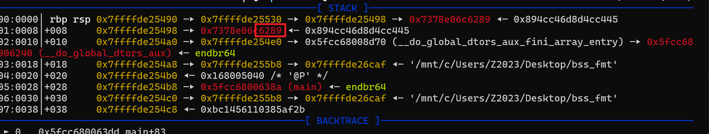
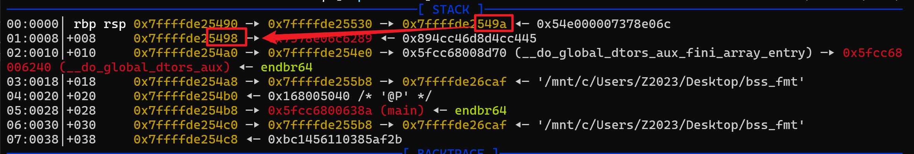
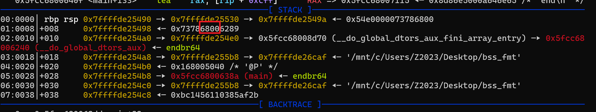
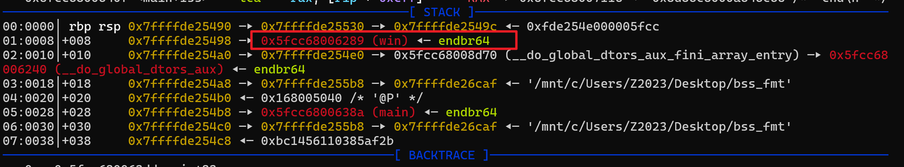
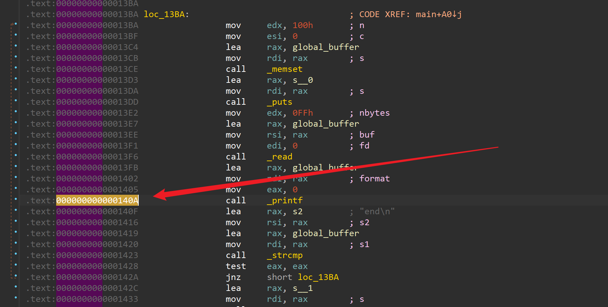

# NewStar CTF 2025 / 复读机堂堂归来！复读机堂堂归来！

> 来源：NewStar CTF 2025  |  类型：wp_prose  |  https://github.com/pj-newstar/wiki-docs/blob/1a0f2ba21a30f950276396118b315eef0328371c/docs/wp/2025/week5/pwn/fuduji-back.md

import Container from '@/components/docs/Container.vue'

# 复读机堂堂归来！复读机堂堂归来！

本题考查非栈上格式化字符串漏洞的泄露与覆盖。

## fmt&got

对于常规的栈上格式化字符串漏洞，可以任意构造自己的恶意数据来实现任意地址写，但是对于非栈上变量来说，就无法直接给出目的地址的指针，此时，我们需要利用栈上的残留数据。

开始之前，可以先了解 PIE 保护：

- [Linux 保护机制](https://zhuanlan.zhihu.com/p/666340476)

首先查看 `checksec`：

注意 `Full RELRO` 和 `PIE enabled`，这次无法直接写 GOT。接下来使用 IDA 分析。

〔原图省略〕

与 Week 3 的题目类似，但本题输入位置在 bss 段。由于输入不在栈上，无法直接布置目标地址进行泄露或覆盖，因此需要借助栈上残留的栈地址，覆盖 `main` 函数返回地址。同时，程序中存在用于读取 FLAG 的 `win` 函数。

〔原图省略〕

先 patch 程序，然后在 GDB 中调试，仍然停在 `printf` 之前。由于程序开启了 PIE 保护，需要先泄露 `PIE_base`，用来计算 `win` 函数的真实地址。方法与泄露 `libc_base` 类似：先泄露程序中某个函数地址，再减去其固定偏移。

〔原图省略〕
可以看到栈上残留了 `main` 地址，利用它即可泄露 `PIE_base`。

因为需要修改 `main` 函数的返回地址，而返回地址位于栈上，所以还需要一个栈地址。这里选择 `rsp` 指向的栈地址，减去 `0x98` 即为 `main` 返回地址所在位置。利用 `rsp` 处的栈地址修改其指向地址的末尾两字节，使其指向 `main` 返回地址。相关代码如下：

首先泄露 `PIE_base` 和栈地址。`0x00000000000138A` 这个值可以在 IDA 中找到，也可以使用 `elf.sym.main` 代替。

〔原图省略〕

然后构造如下 payload：

让 `rsp` 上的栈地址指向 `main` 函数返回地址所在的栈地址，效果如下：
〔原图省略〕
接着找到 `rsp` 上的栈地址对应的偏移，利用该栈地址直接修改 `main` 函数返回地址。

这里每次写入两个字节，可以利用 `rsp -> stack_addr -> main_ret_addr` 这条链覆盖 `main` 函数返回地址。

第一次修改 `main` 函数返回地址的末尾两字节。
〔原图省略〕
第二次将指向 `main` 函数返回地址的栈地址向后移动 2 字节。
〔原图省略〕
第三次继续写入两字节。
〔原图省略〕
以此类推，直至 `main` 函数返回地址完全被覆盖，最终效果如下：
〔原图省略〕
最后输入 `end`，让 `main` 函数返回到构造好的 `win` 函数。

面对开启 PIE 保护的程序，如果想提前下断点，例如在 `printf` 处：
〔原图省略〕
可以先在 IDA 中找到对应偏移地址，再在 GDB 中使用 `b *$rebase(0x140A)` 下断点。

完整 EXP：

## 原文配图

