# NewStar CTF 2024 / Pangbai 泰拉记（3）

> 来源：NewStar CTF 2024  |  类型：wp_prose  |  https://github.com/pj-newstar/wiki-docs/blob/1a0f2ba21a30f950276396118b315eef0328371c/docs/wp/2024/week5/reverse/pangbai-terra3.md

# Pangbai 泰拉记（3）

个人做所有逆向题思路：找判断，找密文，找密钥，找算法，写正向，写逆向

运行程序显示

〔原图省略〕

有 ROOT 的果子机的话可以用巨魔装，我 iPhone 7 装过了

一个 iOS 的安装包，用压缩包方式打开 ipa 文件，找到里面的可执行文件 `test`，然后对其进行反编译，全是 swift

最简单就是搜字符串，都试试

〔原图省略〕

可以搜到这些

〔原图省略〕

先看下面，这涉及到 swift 编译的知识，他的函数是动态的，这里只能显示函数名，交叉引用其他啥都没有，但是只要是 `_TtC4` 开头的基本都是在 `main` 中被调用的函数，也就是这道题用到了这些函数（这个可以给直接提示），里面看到一个 RC4 和 AES，大胆猜测有用到这两个加密

〔原图省略〕

交叉引用 `input your flag` 可以到 `contentView` 中，里面可以看到好多 swiftUI 的调用函数，看到一个倒过来的 `click me`，是个小提示，提示去找这个 `string` 被绑在哪里

〔原图省略〕

被绑定在这个 button 里面，查看这个 button 里的函数

〔原图省略〕

一个倒着的 `correct` 函数和 `wrong` 函数，还有 `==` 判断，可以肯定这个肯定是关键函数

看上面，`a1` 是输入，通过 `a1` 来找几个关键函数

〔原图省略〕

我还原了一下大致的函数，着重讲一下几个难的怎么看出特征的

`set256able` 中（`rc4_init`）：

〔原图省略〕

`rc4_encrypt`：

〔原图省略〕

结尾一个异或，再顺着往前看偏移，看数据，发现与 RC4 很符合

AES:

〔原图省略〕

〔原图省略〕

一个 ECB 模式，确认是分组加密，然后结合前面，大概率是一个调用了库的 AES ECB 加密

摸清楚加密后，只剩下密文密钥，发现前面两个很奇怪的字符串还没用

〔原图省略〕

第一个密文，第二个密钥（`0x10` 刚好 16 位符合 AES 密钥长度）

〔原图省略〕

**Ans:** `flag{Sw1ft_$0_funny!}`

## 原文配图

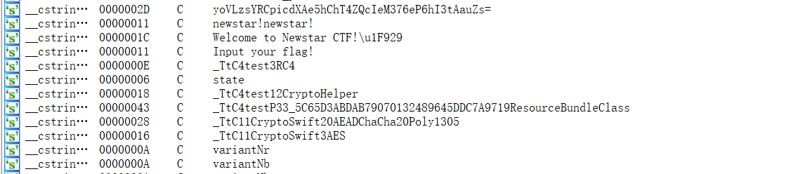

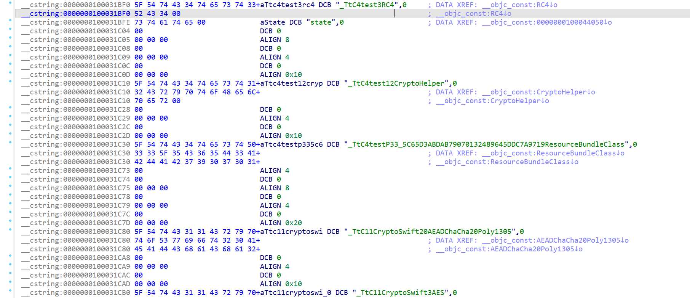

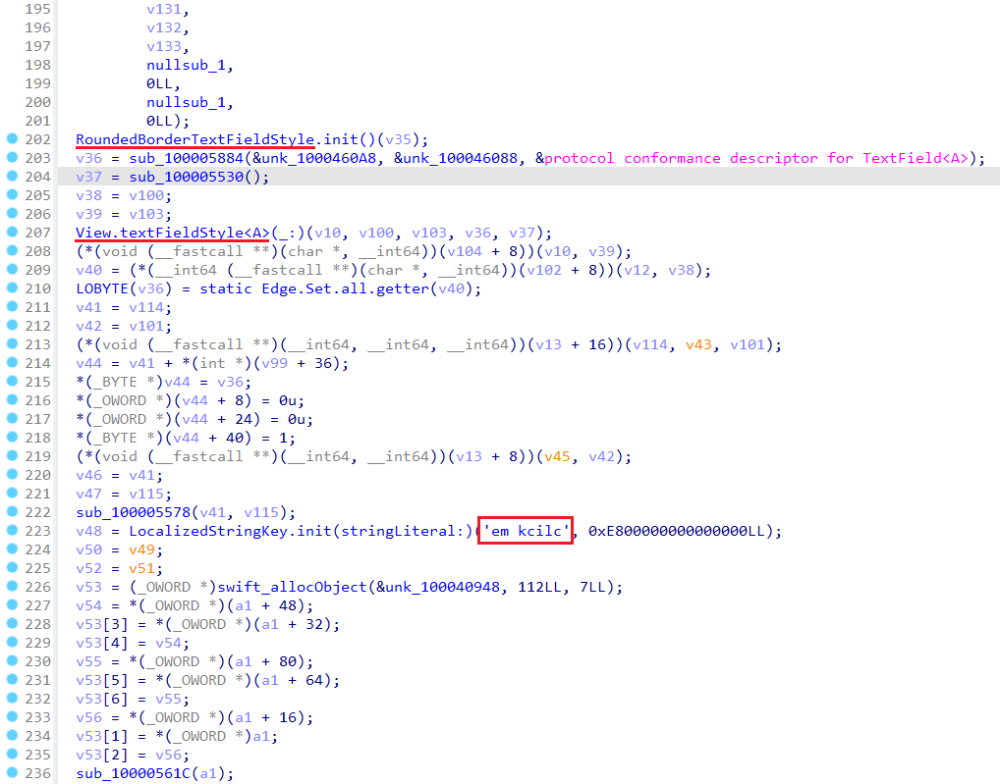

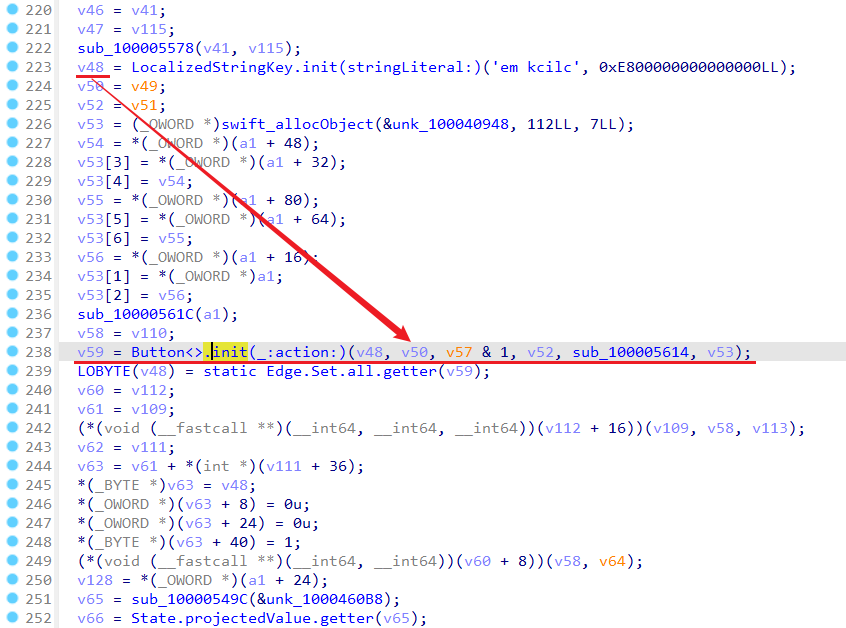

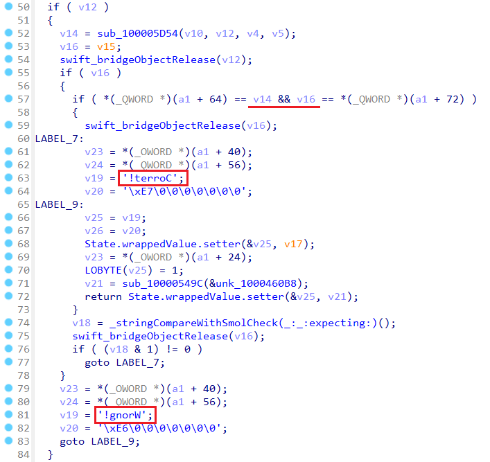

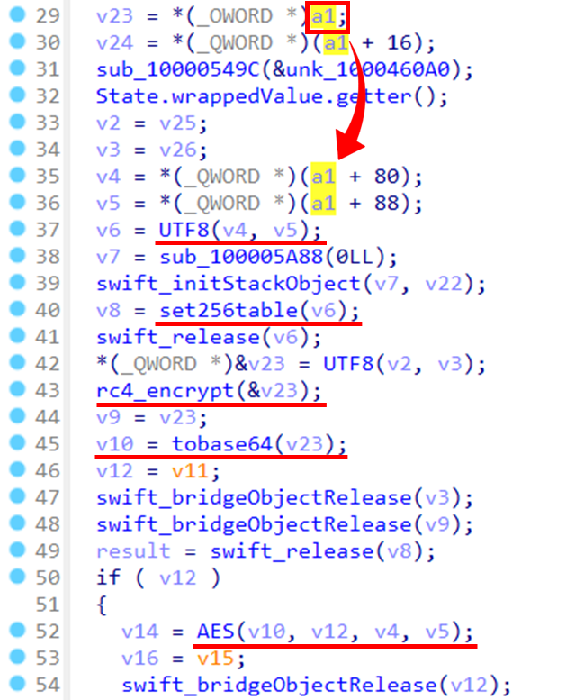

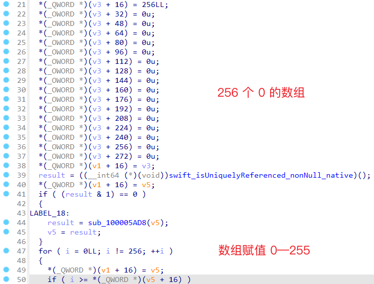

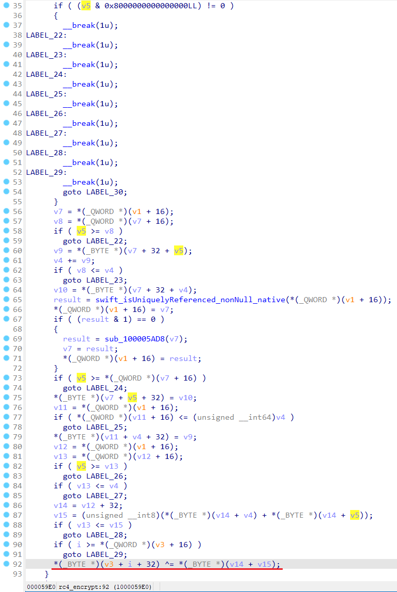

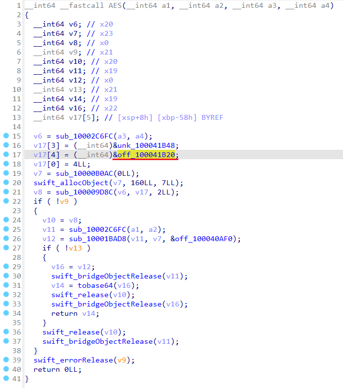

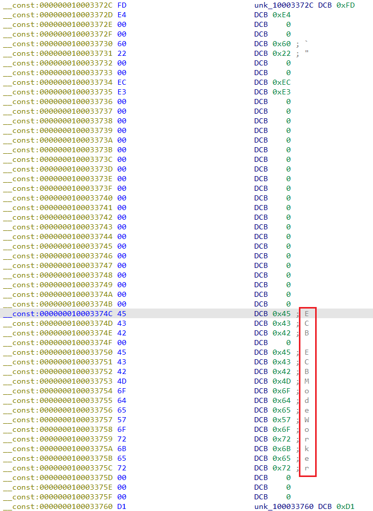

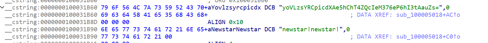

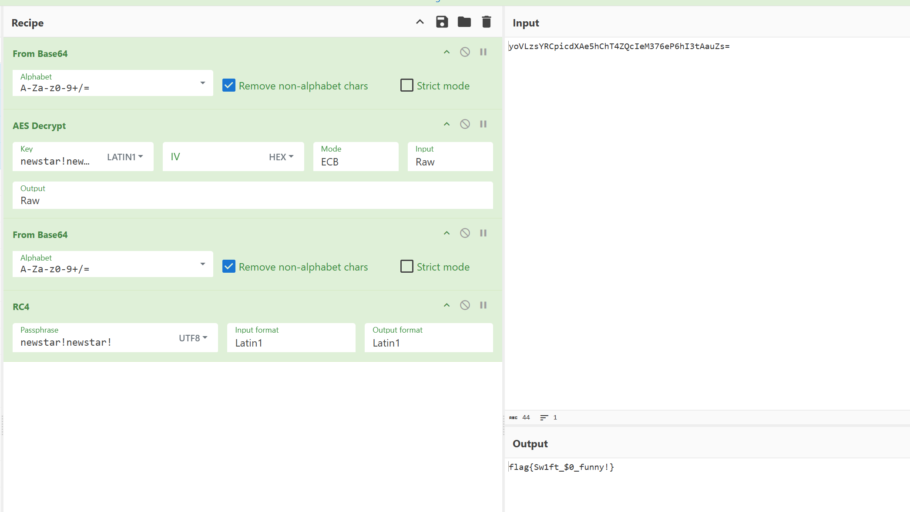
