# NewStar CTF 2025 / plzdebugme

> 来源：NewStar CTF 2025  |  类型：wp_prose  |  https://github.com/pj-newstar/wiki-docs/blob/1a0f2ba21a30f950276396118b315eef0328371c/docs/wp/2025/week1/reverse/plzdebugme.md

import Container from '@/components/docs/Container.vue'

# plzdebugme

本题考查 IDA 软件中动态调试功能的使用。

## 1、IDA Local 模式调试

IDA Pro 不仅是反汇编器，还是一个强大的调试器。

**Q**：什么是 Local 模式？

**A**：IDA 的 Local Windows Debugger（本地调试器） 模式，顾名思义，是在当前操作系统中直接运行目标程序并调试它的方式。

- Windows 上调试 .exe → 使用 Local Windows Debugger
- Linux 上调试 .elf → 使用 Local Linux Debugger

**设置断点：**

在汇编视图或伪代码视图中，移动光标到想要设置断点的行，按下 <kbd>F2</kbd> 键，或点击行号左侧的空白区域（会出现一个小红点）。再次按下 <kbd>F2</kbd> 或点击红点可以取消断点。

〔原图省略〕

**启动调试：**

在顶部的工具栏中，选择合适的调试器 （Debugger）。例如，分析本地 Windows 程序，可以选择「Local Windows debugger」。

〔原图省略〕

然后点击绿色的运行按钮 （通常是一个向右的三角形，快捷键 <kbd>F9</kbd>） 开始调试。程序会在第一个断点处停下。

调试器还提供了单步执行 （<kbd>F7</kbd> 步入，<kbd>F8</kbd> 步过）、查看寄存器、内存、堆栈等功能。

常见错误：

| 问题               | 解决方法                                                      |
| ------------------ | ------------------------------------------------------------- |
| 无法启动调试器     | 检查是否正确选择了 “Local Windows debugger”                   |
| 断点没触发         | 确保你设置的断点是在程序真正执行路径上                        |
| 一运行就崩溃或退出 | 尝试在更靠前的位置（如入口点）设置断点 |
| 无法查看栈或寄存器 | 运行状态下才能看到，静态分析时是空的                          |

## 2、IDA Remote 模式（远程调试）

**Q**：为什么需要 Remote 模式？

**A**：程序必须在它所支持的平台上运行。

如果你的程序不是本机架构，比如：

- Windows 上调试 Linux ELF 文件
- x86 上调试 ARM 指令集
- 调试 Android 的 so 文件

那么你有两个选择：

- 把这个程序放到目标系统（如 ARM Linux）+ 安装 IDA + 用 Local 调试（成本高）。
- 使用 Remote 模式：IDA 在你主机上，通过网络连接一个运行目标程序的调试器代理。

Remote 模式本质：

- 你在目标平台上运行一个 调试代理程序（IDA Debug Server），IDA 通过网络连接这个代理，远程控制调试过程。

常见代理如：

- linux_server（调试 Linux ELF）
- android_server（调试安卓 .so）

环境要求：

1. 你需要有一个 Linux 环境。
2. 在 IDA-dbgsrv 里有个文件叫 `linux_server`，把它放到你的 Linux 环境里。

〔原图省略〕

然后在 Linux 里依次输入以下命令：

〔原图省略〕

然后在 IDA 里选择 Remote Linux Debugger，输入你的 Linux 服务器 IP 地址和端口号，然后点击连接。

〔原图省略〕

输入在你的 Linux 环境里面，其他与本地调试相同。

〔原图省略〕

## 3、 基础调试技巧

| 功能                                    | 快捷键                           | 说明                                      |
| --------------------------------------- | -------------------------------- | ----------------------------------------- |
| 设置断点                                | <kbd>F2</kbd>                    | 点击某行或在地址上按 <kbd>F2</kbd>        |
| 启动调试                                | <kbd>F9</kbd>                    | 开始运行程序                              |
| 继续运行                                | <kbd>F9</kbd>                    | 从当前断点继续                            |
| 单步跳入                                | <kbd>F7</kbd>                    | 进入子函数                                |
| 单步跳过                                | <kbd>F8</kbd>                    | 跳过函数（不进入） |
| 显示寄存器                              | <kbd>Alt</kbd><kbd>C</kbd>       | 弹出 CPU 寄存器窗口                       |
| 调试内存（Dump） | <kbd>D</kbd>                     | 查看任意内存段                            |
| 查看字符串                              | <kbd>⇧ Shift</kbd><kbd>F12</kbd> | 快速查看程序中引用的字符串                |

## 4、常见调试窗口介绍

调试状态下，IDA 会显示多个重要窗口。理解它们，是学好调试的第一步。

### 1️⃣ General Registers（寄存器窗口）

位置：Debugger → Debugger Windows → General Registers 一般动调打开就有

〔原图省略〕

〔原图省略〕

通用寄存器：如 `EAX`, `EBX`, `ECX`, `ESP`, `EBP` 等，展示当前 CPU 寄存器状态

`XMM` 寄存器：显示 `SIMD` 浮点指令用到的寄存器，常用于加密算法或浮点运算

> [!INFO]
> 寄存器中的值可以直接右键修改！

### 2️⃣ Stack（栈窗口）

位置：Debugger → Debugger Windows → Stack view

〔原图省略〕

展示当前栈内存的布局，能看到局部变量、函数返回地址、调用参数等。

### 3️⃣ Modules

位置：Debugger → Debugger Windows → Modules

〔原图省略〕

显示当前加载的模块，比如：

- 主程序本体
- Windows 动态链接库（如 kernel32.dll, user32.dll）
- 可以查看模块基址、大小等。

### 4️⃣ Output 窗口（下方）

实时输出调试信息、IDA 插件信息等，便于跟踪调试过程中的反馈。

〔原图省略〕

## 题解过程

根据提示在 `x0r()` 里找到 flag，因为 cipher 经过自解密，我们在解密完的地方打断点：

〔原图省略〕

〔原图省略〕

〔原图省略〕

按 <kbd>a</kbd> 就能将数据转化为可见字符形式。

〔原图省略〕

最终 FLAG 为：`flag{It3_D3bugG_T11me!_le3_play}`。

## 原文配图

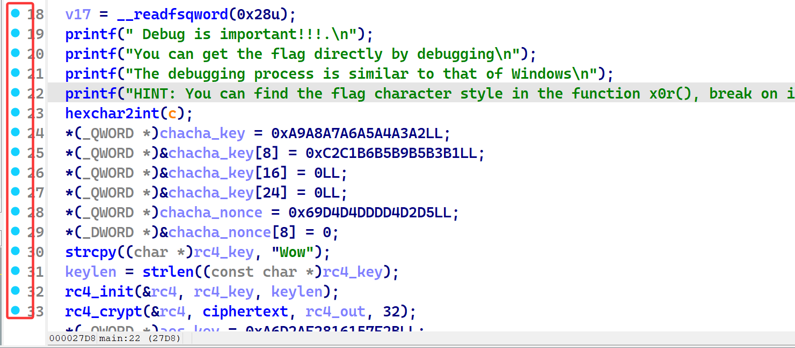

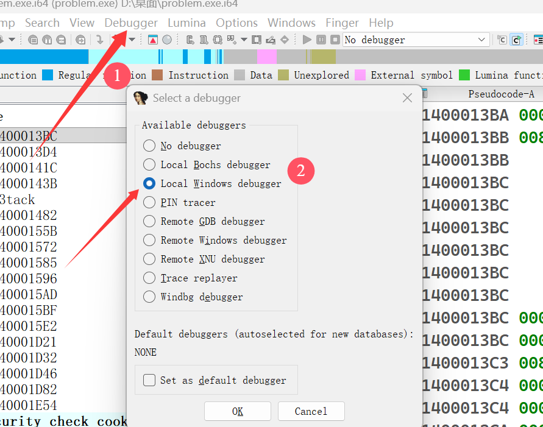

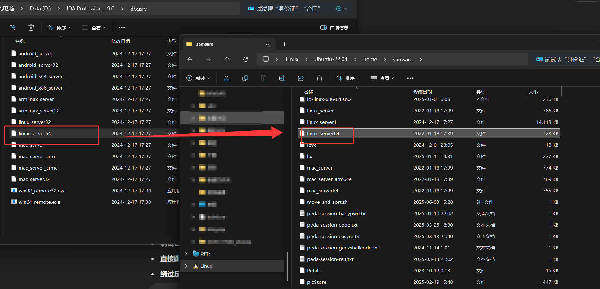

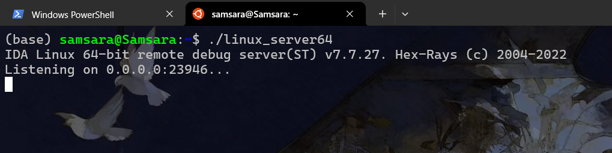

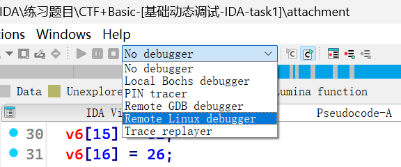

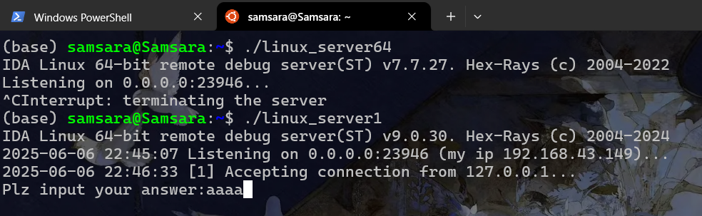

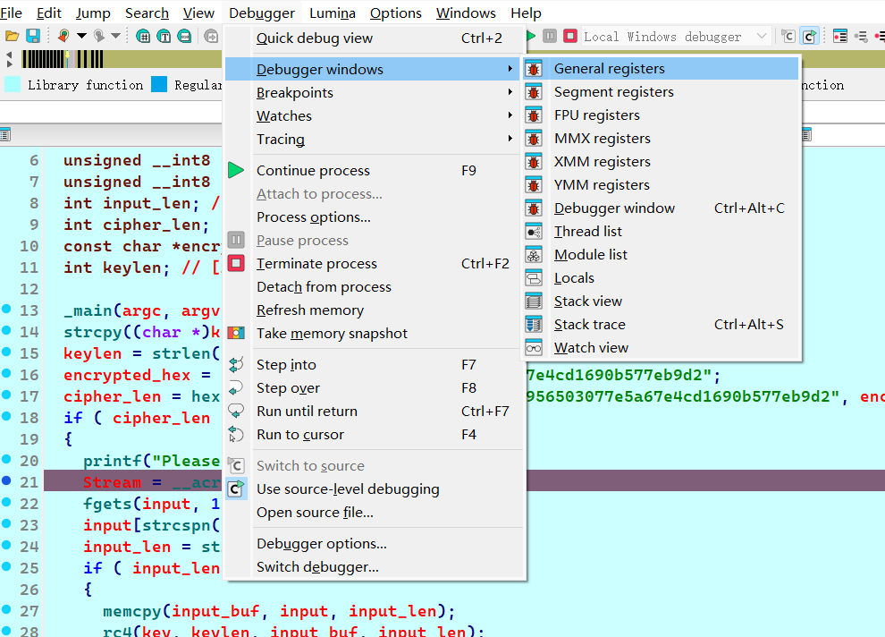

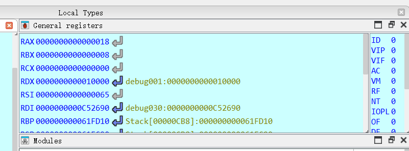

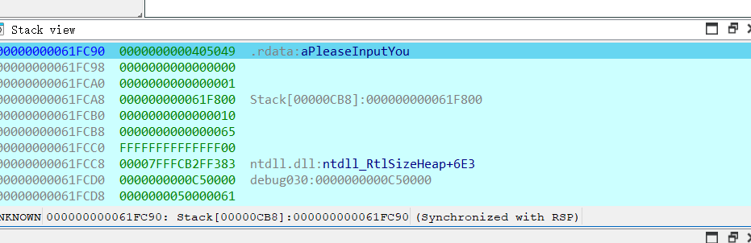

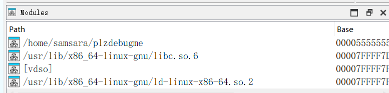

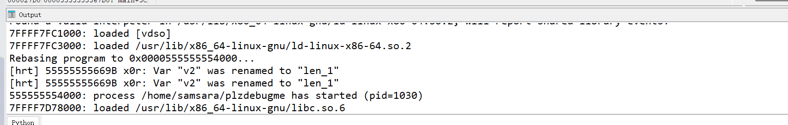

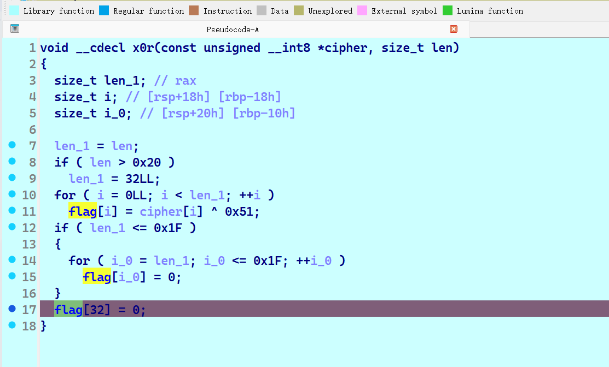

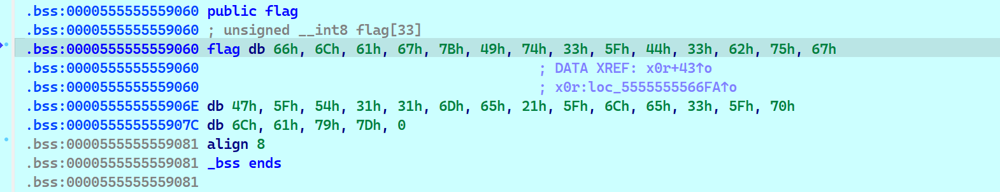

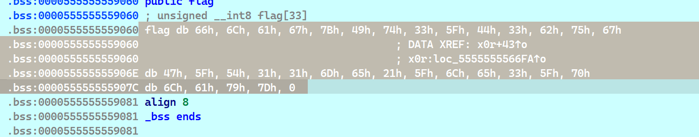

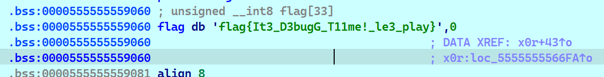
