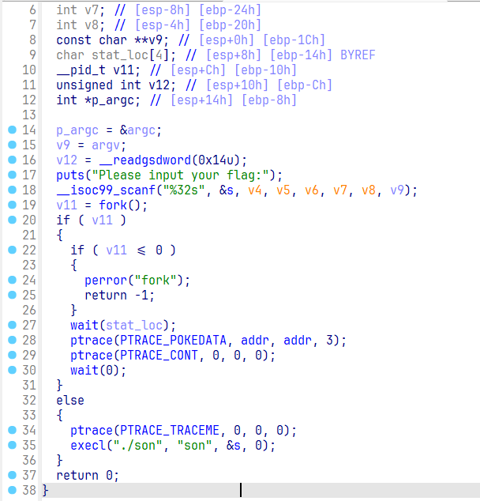
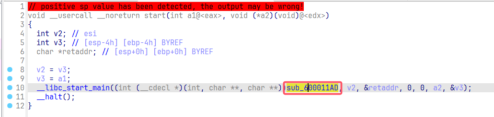
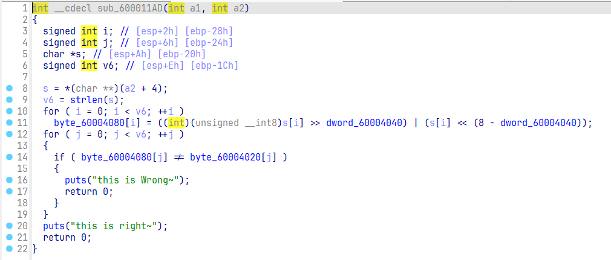
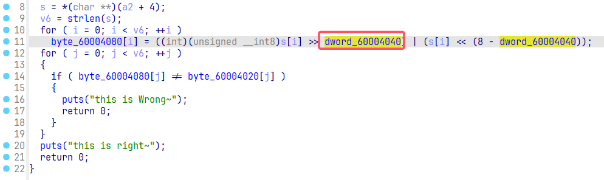

# NewStar CTF 2024 / Ptrace

> 来源：NewStar CTF 2024  |  类型：wp_prose  |  https://github.com/pj-newstar/wiki-docs/blob/1a0f2ba21a30f950276396118b315eef0328371c/docs/wp/2024/week2/reverse/ptrace.md

# Ptrace

首先查看 `father` 文件，可以看到使用了 `fork` 创建了子进程，这里返回的 `pid` 就是 `v11`. `v11 > 0` 为父进程，`v11 = 0` 为子进程。

这里可以看到子进程，也就是 else 中使用了 `execl`，它**提供了一个在进程中启动另一个程序执行的方法**，在这里就是启动了当前目录下的 son 文件，然后传递输入的数值 `s` 作为新进程的参数，同时这里新进程会替换掉之前的子进程，使自身作为父进程的子进程存在。

〔原图省略〕

然后查看替换的子进程的内容，打开 son 文件。找到主函数，发现它这里就是把 `s` 进行移位操作，然后比对内置的数据 `byte_60004020`。

这里的 `s = *(char **)(a2 + 4)`，它就是指向上面 `father` 传入的 `s`. 上面 execl 执行的命令为 `./son s`，而对于 son 文件的主函数而言，第一个参数是 `a1` 表示执行命令参数的个数，这里就是 2，而后面的 `a2` 真实类型为 `const char **argv`，它指向的就是命令的各个参数，因此这里的 `a2 + 4` 执行的就是第二个参数，也就是 `s`.

〔原图省略〕

〔原图省略〕

因此目前可以得知它这里的逻辑就是通过 `father` 来打开 son，通过执行 son 中的每个字节循环移位来进行变化，最后与密文进行比较得到结果。

然后继续关注 `father` 中的 `ptrace`，`ptrace` 是用于进程跟踪的，它提供了父进程可以观察和控制其子进程执行的能力，并允许父进程检查和替换子进程的内核镜像(包括寄存器)的值。而这里查看子进程，可以发现使用`ptrace(PTRACE_TRACEME, 0, 0, 0);`，它就是允许父进程对自身进行调试的语句，然后在父进程中，使用 `PTRACE_POKEDATA` 对数据进行修改，然后使用 `PTRACE_CONT` 让子进程继续执行。因此我们关注的就是父进程对于子进程的什么数据进行了修改。

查看语句 `ptrace(PTRACE_POKEDATA, addr, addr, 3);`，它就是对于 `addr` 所指向的地址修行了数据修改，更改为了 `3`，由此点进去发现 `addr` 指向的就是 `0x60004040` 位置的数据。

〔原图省略〕

然后回想起之前 son 文件的内容，找到了相似的地址。由此可以判断这里修改的就是偏移的数值，把这里的 `4` 在运行的时候改为了 `3`。

〔原图省略〕

因此得到了整个程序逻辑，在运行时，父进程会更改子进程中偏移量，然后数据的判断就是通过子进程来进行的，所以这里只需要把子进程中的密文按照偏移 3 进行逆变换即可。

## 原文配图

