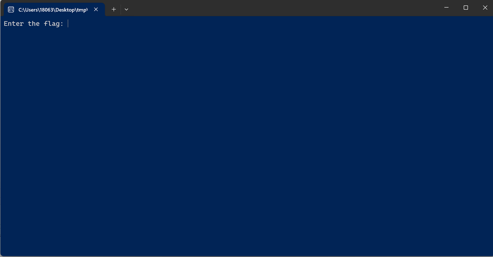
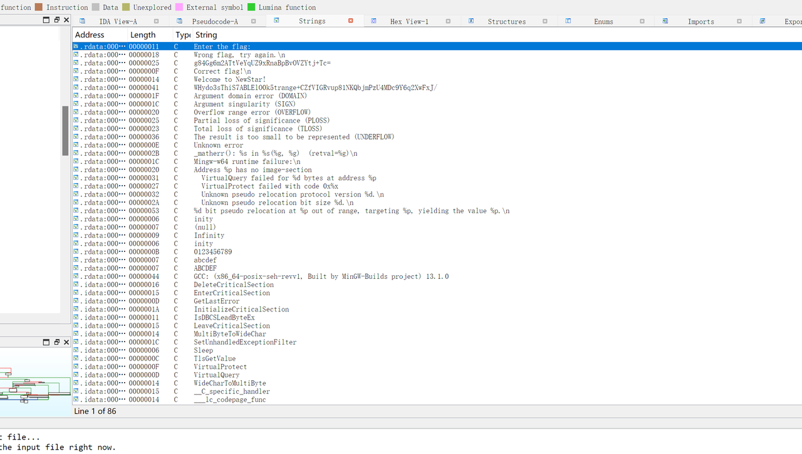
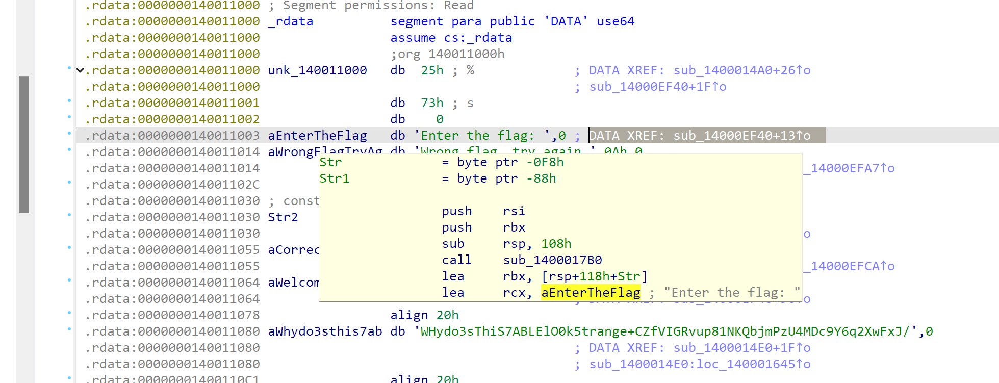
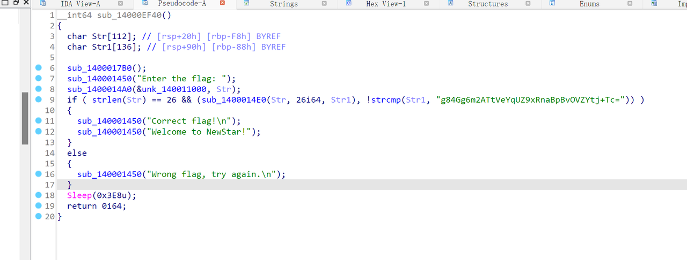
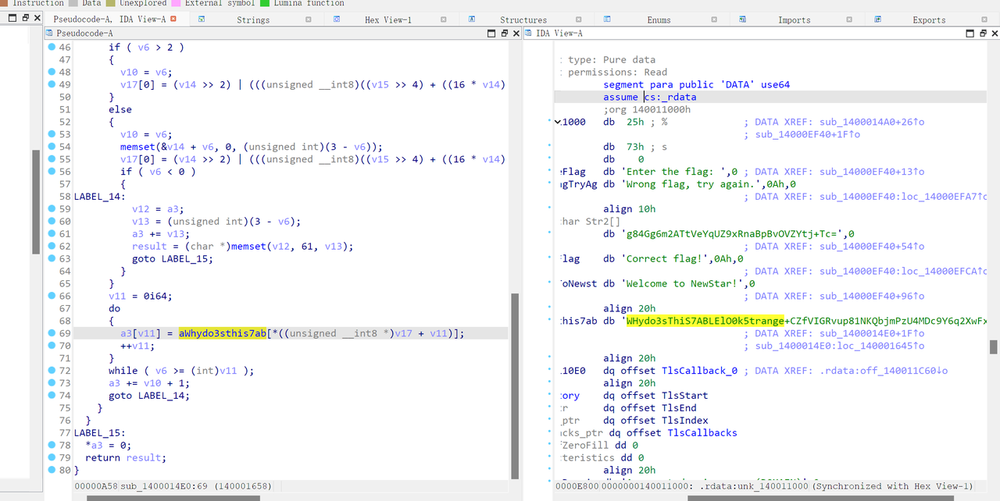
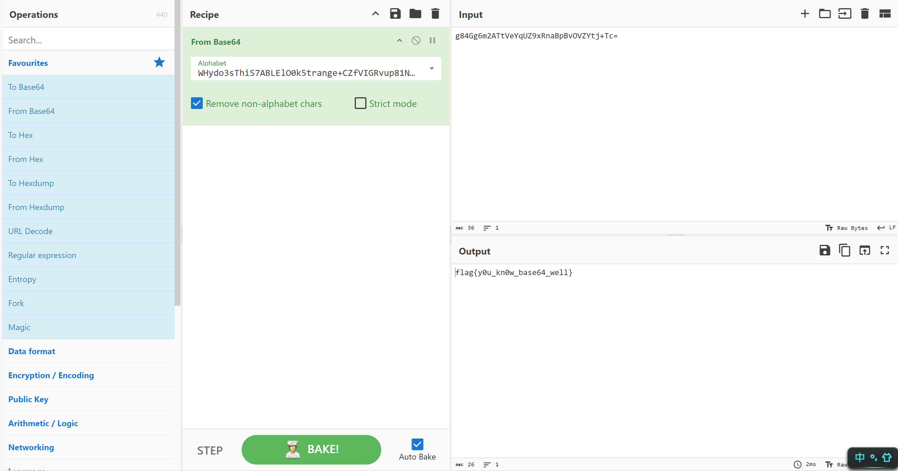

# NewStar CTF 2024 / base64

> 来源：NewStar CTF 2024  |  类型：wp_prose  |  https://github.com/pj-newstar/wiki-docs/blob/1a0f2ba21a30f950276396118b315eef0328371c/docs/wp/2024/week1/reverse/base64.md

# base64

在开始之前，你需要知道什么是 Base64，可参见 [密码学 base 的 WriteUp](/wp/2024/week1/crypto/base).

此题目是教大家定位主函数，Base64 的一个常见的魔改方式——换表，以及 CTF 一个编解码工具 [CyberChef](https://gchq.github.io/CyberChef/).

双击打开程序，我们看到如下界面：

〔原图省略〕

可以看到让你输入一个字符串，然后会判断对错。一般来说，`Enter the flag:` 这个字符串会离主逻辑不远，所以我们找到这个字符串的位置就可以定位到主逻辑。

在 IDA 中，按 <kbd>⇧ Shift</kbd><kbd>F12</kbd> 调出字符串界面。

〔原图省略〕

双击就可以转到对应的 IDA View.

〔原图省略〕

双击 `DATA XREF` 右边的地址加偏移，就可以到引用他的地方，按下 <kbd>F5</kbd>，即可反编译这段逻辑。

〔原图省略〕

这就是主逻辑了。看到 `=` 结尾的字符串可以想到 Base64（常识）。但是直接解会出乱码。

此处需要大家识别出 Base64 算法的魔改点。大家可以自行对比标准的 Base64 编码算法，为了不过多增加难度，我仅把码表换了。

〔原图省略〕

base64标准码表是 `ABCDEFGHIJKLMNOPQRSTUVWXYZabcdefghijklmnopqrstuvwxyz0123456789+/`，这里换成了 `WHydo3sThiS7ABLElO0k5trange+CZfVIGRvup81NKQbjmPzU4MDc9Y6q2XwFxJ/`.

推荐使用`CyberChef`进行解密，这个工具用了的都说牛逼，你也来试试吧！

〔原图省略〕

把左边的「From base64」拖到「Recipe」那一栏，然后把「Alphabet」换成上面说的魔改后的码表，「Input」处输入密文，「Output」处就得到 flag 了。当然，编写脚本解码也是可以的。

## 原文配图

