# NewStar CTF 2024 / simpleAndroid

> 来源：NewStar CTF 2024  |  类型：wp_prose  |  https://github.com/pj-newstar/wiki-docs/blob/1a0f2ba21a30f950276396118b315eef0328371c/docs/wp/2024/week3/reverse/simpleandroid.md

# simpleAndroid

得到一个 apk 文件，它是 Android 的安装包，类似于 zip 格式的压缩文件。这里使用 jadx 进行打开，首先找到 `AndroidManifest.xml` 文件，里面标识了 app 一开始显示的 Activity.

〔原图省略〕

然后发现它是先经过了 `checkRoot.check()` 的判断，返回正确结果后跳转到 `CheckActivity` 这个里面。

〔原图省略〕

再进去查看这里的 `check()` 函数，发现它就是一个 root 检测，通过使用 `which su` 来进行检测。

〔原图省略〕

对于静态分析而言，可以不用管上面对于 root 的检测，然后直接查看 `CheckActivity` 这一个类，发现这里就是对于输入进行检测的地方，首先通过`isValidInput` 对输入的格式进行检测，然后通过 `CheckData` 来进行比较，查看这个方法，发现它是 native 层的，因此需要看 so 文件。

〔原图省略〕

更改后缀名为 `.zip` 或者直接打开压缩包的方法打开，可以看到这里存在 so 文件，这里有四种架构，是由相同的源码编译而来，可以选一个反编译效果比较好的架构进行静态分析，这里选择的架构是 `x86_64`.

〔原图省略〕

然后直接用 IDA 打开 so 文件，首先在函数名称列表中搜索 Java，没有发现和 `CheckData` 相关的函数名称，由此怀疑不是静态注册，而是动态注册。

〔原图省略〕

因此直接搜索 `JNI_OnLoad`，发现在这里动态注册的 `CheckData` 函数，下面就是函数的位置，点击就可以看到函数了。

〔原图省略〕

点击 `CheckData` 函数，首先修改相关参数，这里前面两个参数都是自带的，第三个参数才是我们在 Java 中传入的 `String` 类型的 `input`，在这里就是 `jstring` 类型。

〔原图省略〕

然后分析下面的内容。这里分为两部分来看，上面的部分就是对 `UseLess` 中的 `CHAR_DATA` 进行修改，下面就是把输入作为参数传入 `func` 函数中，然后拿到返回值。

〔原图省略〕

这里再看一下 Java 层的 `UseLess` 类。然后根据 `CHAR_DATA` 的数据和下面 `func` 的代码，可以知道这是进行 Base64 的变换，而由于上面 so 对于 `CHAR_DATA` 进行了更改，所以这里是换表的 Base64 变换。

〔原图省略〕

那么上面的内容就理清楚了，我们的输入首先经过了 Base64 的变化，然后来到了下面的代码。然后经过分析，这里就是首先前后交换位置，然后进行循环右移4位的操作，最后和密文进行比较。

〔原图省略〕

然后我们直接从后往前进行逆运算即可。

## 原文配图

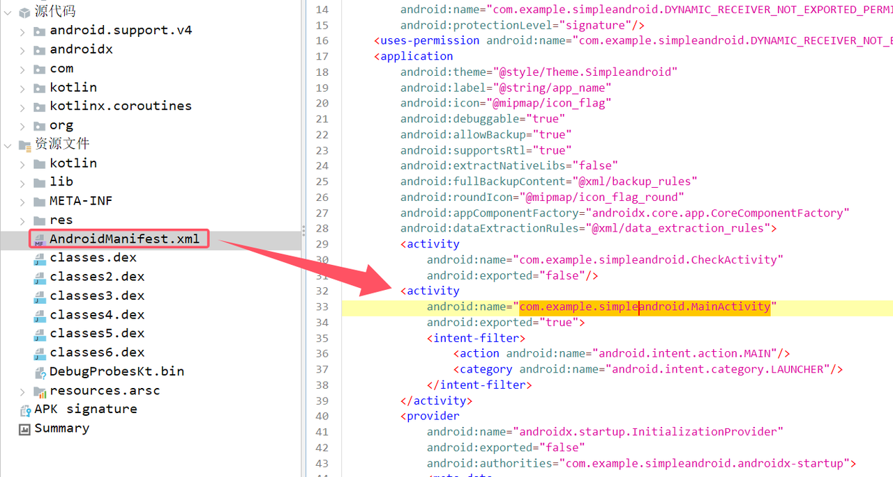

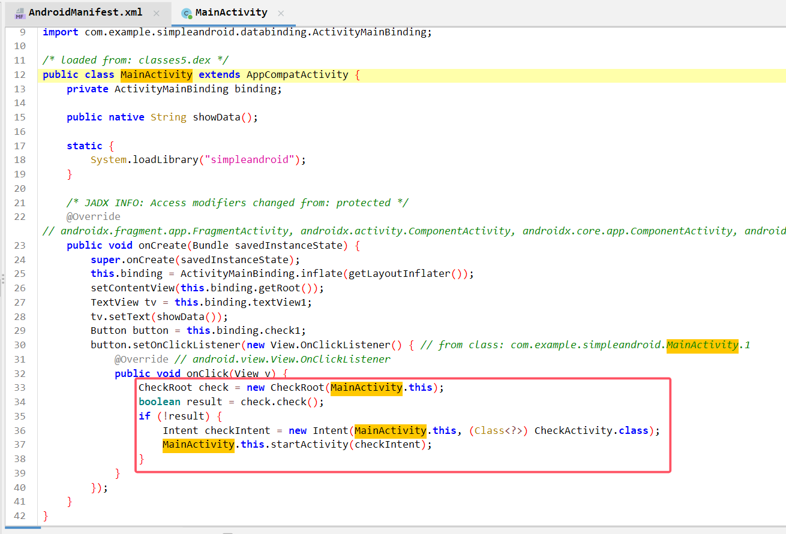

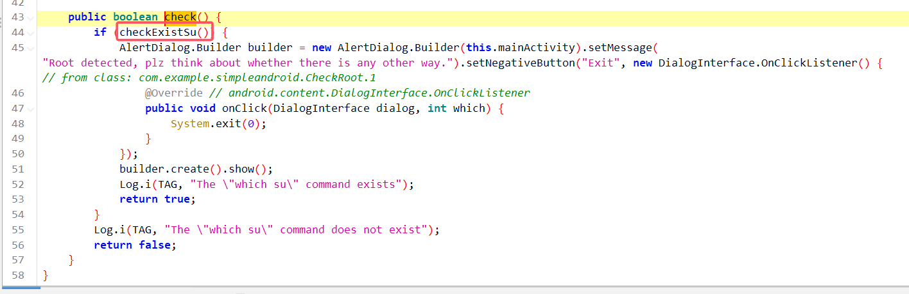

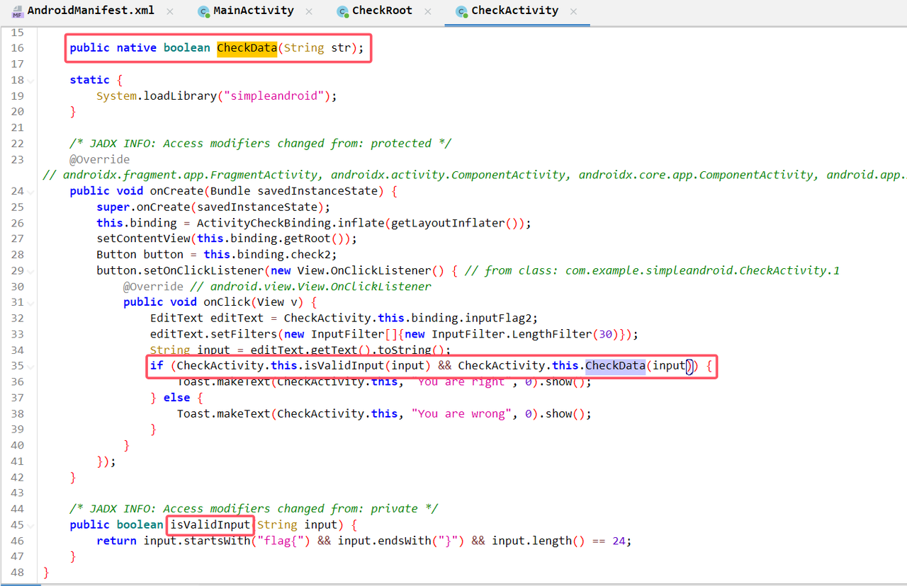

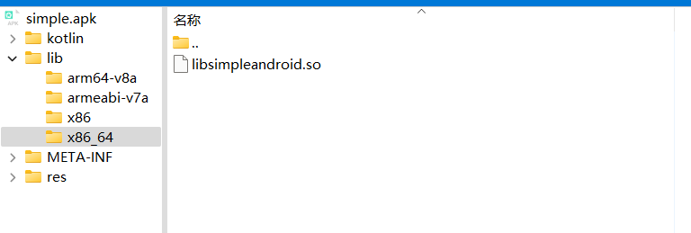

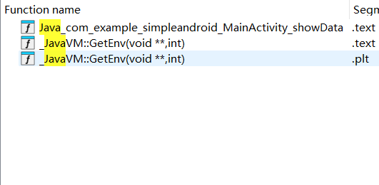

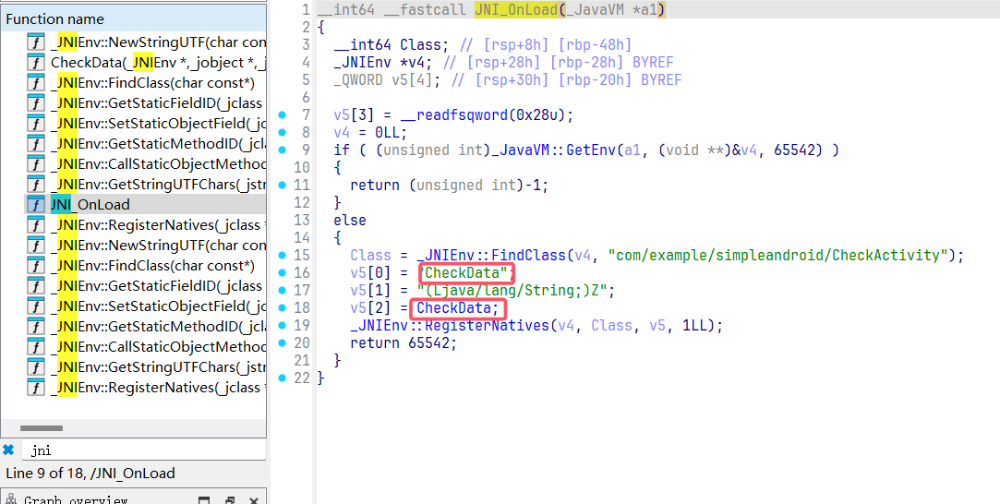

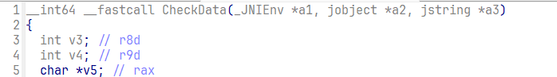

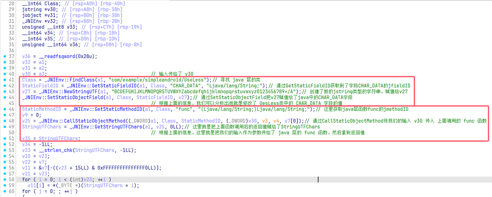

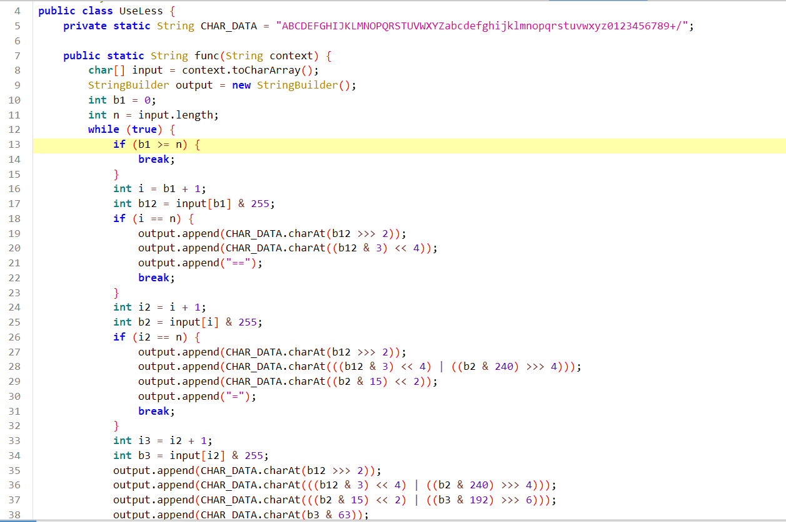

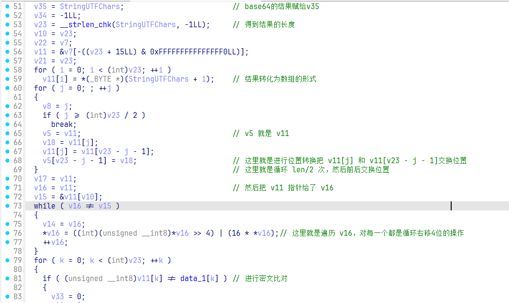
