# NewStar CTF 2024 / 取啥名好呢

> 来源：NewStar CTF 2024  |  类型：wp_prose  |  https://github.com/pj-newstar/wiki-docs/blob/1a0f2ba21a30f950276396118b315eef0328371c/docs/wp/2024/week3/reverse/qushaming.md

# 取啥名好呢

先静态分析程序，`mian`（没有打错字）函数是根据不同的信号进行不同的处理

〔原图省略〕

`main` 函数从这里开始，下面有很多分支跳转，暂时不放出来

〔原图省略〕

使用动态调试，在 IDA 中打开 `main` 函数（Linux动态调试取消地址空间随机化还没去找怎么做，这里用鼠标慢慢划找到的代码），在 `00005643EA39A9CF cmp eax, 4` 处下断，看看 eax 的值是多少，跳转到哪个分支（这里想下断点看看是因为没找到 env 的值是什么情况，当时猜测是一个 0，这一步是验证一下猜想）

〔原图省略〕

要输入 flag，先随便输入一个

〔原图省略〕

运行到断点处，看到 eax 的值是 0，然后单步执行一下，运行到此处，报错 `got SIGSEGV signal`

〔原图省略〕

再次按下 <kbd>F9</kbd>，运行，选 `yes`

〔原图省略〕

运行到此处，这两步做了个指针的赋值，转换到 C 语言就是 `qword_562D6BA47060 = &dword_562D6BA47068`

〔原图省略〕

这时候可以去查一下 `got SIGSEGV signal` 错误的信号，是 11，转头去静态分析里面看看这个信号的处理函数，在 `func2` 里面，`longjmp` 和 `setjmp` 是对应的函数，运行完后会回到 `main` 函数的 `setjmp` 下面

〔原图省略〕

看了下静态分析的汇编代码，好像也没啥内容了，`longjmp` 执行后会继续执行下一个 `switch`，代码运行如下，相当于给指针赋值为 233，即静态分析中的

〔原图省略〕

在动态调试里面直接F9运行一下吧，又报错了 `got SIGILL signal`，信号是 4，去静态分析里看看，没啥重要的函数，只有一个 `longjmp`

〔原图省略〕

〔原图省略〕

回到 `main` 函数继续调试，运行到此处又报错 `got SIGFPE signal`，其中这一块前面还有一部分重要的操作，在静态分析中体现如下

〔原图省略〕

〔原图省略〕

看看汇编，用一个数除以 0 报错，查看信号码是 8，在静态分析中执行 `func1`，查看静态分析的代码：

〔原图省略〕

〔原图省略〕

看到这里就没有调试的必要了，加密逻辑也很简单，先使用 `flag+4068` 里面的值（233），然后每一位都和下标进行异或

`enc` 的值如下：

〔原图省略〕

编写解密代码：

flag 为 `flag{WH47_C4N_1_54y???}`

## 原文配图

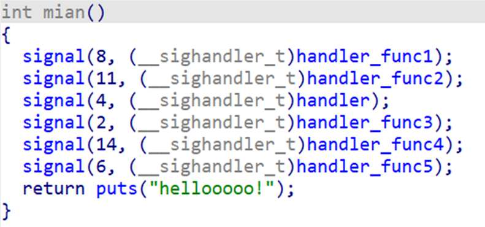

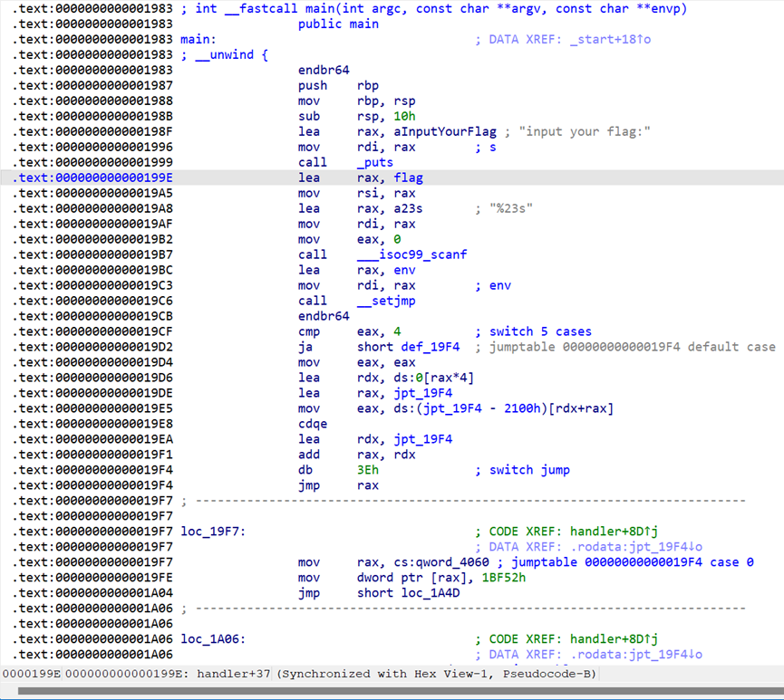

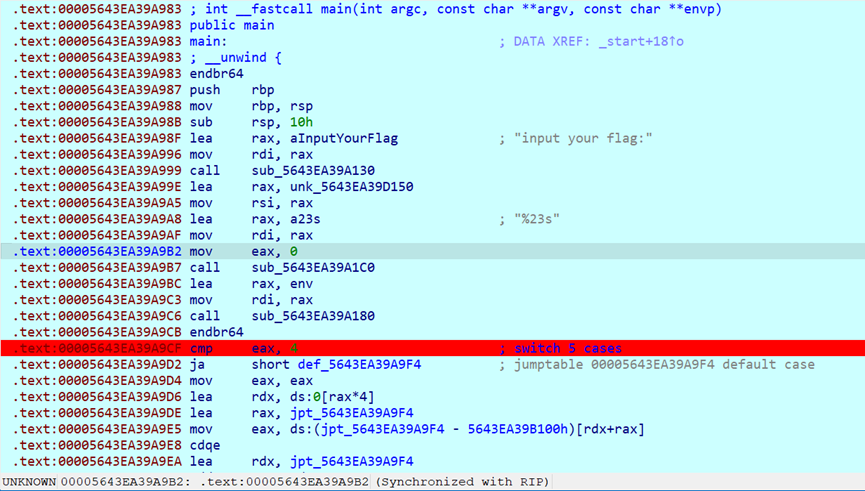

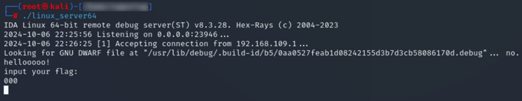

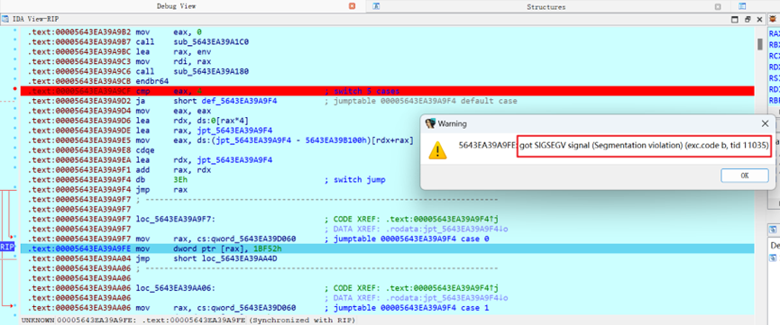

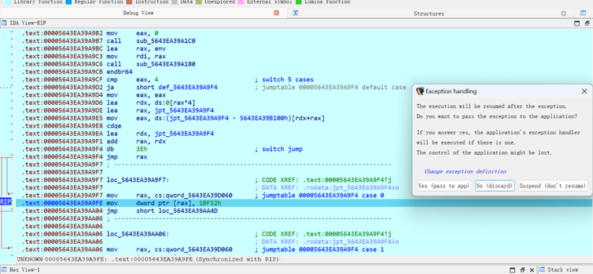

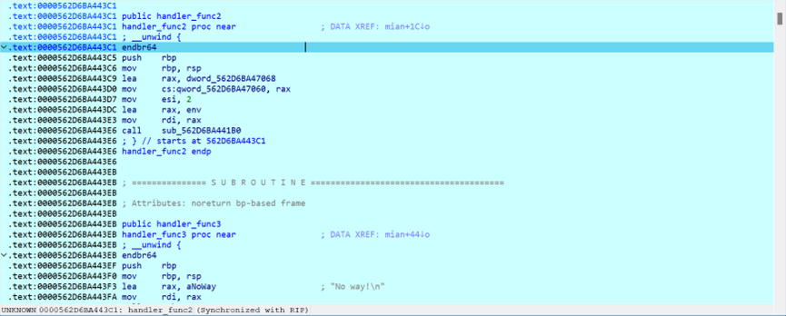

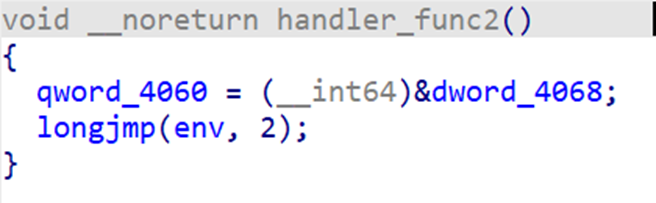

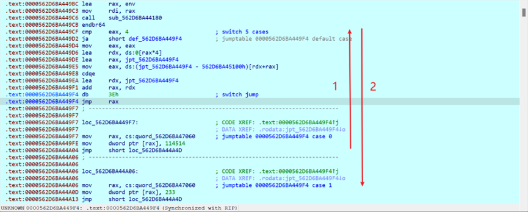

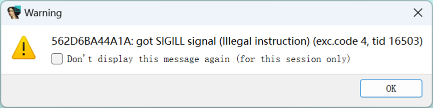

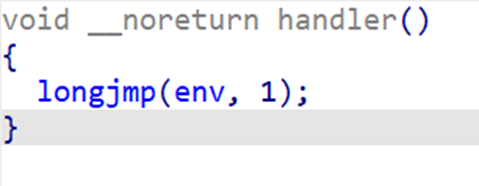

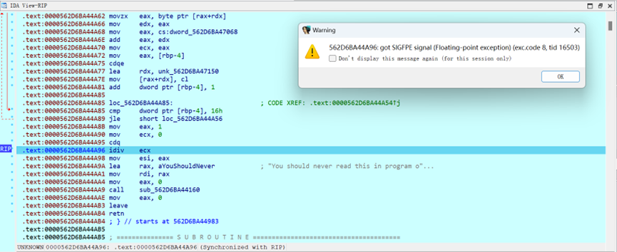

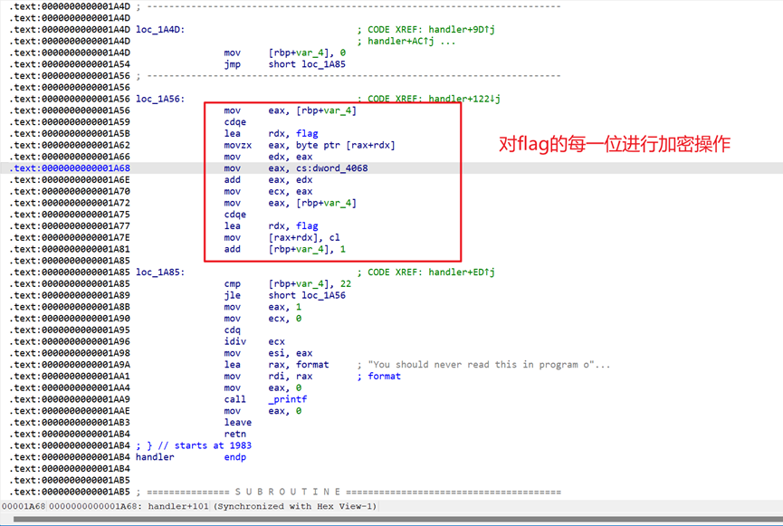

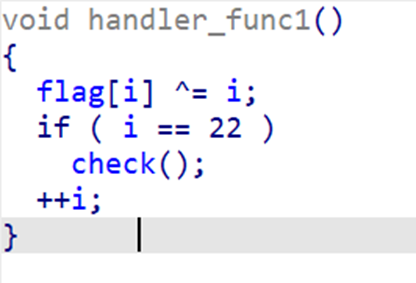

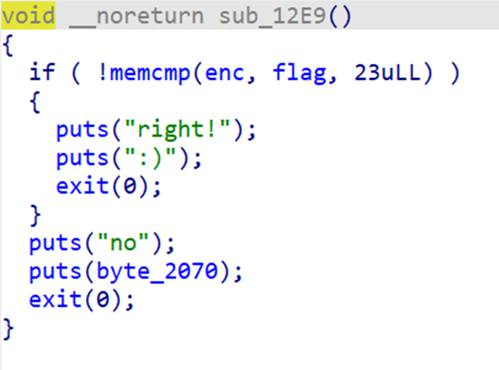

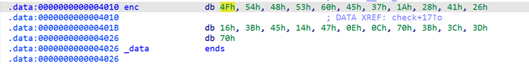
