# MoeCTF 2025 / MoeCTF2025 官方 WriteUp

> 来源：MoeCTF 2025  |  类型：wp_prose  |  https://github.com/XDSEC/MoeCTF_2025/blob/da9e708029f4666da270064c5776ddd29c61dd6f/official_writeups/Web/Writeup.md

# MoeCTF2025 官方 WriteUp

## 0 Web入门指北
下载附件，查询可知是jsfuck编码。
预期解1：
控制台输入
〔原图省略〕
预期解2：
找到在线jsfuck解码网站
〔原图省略〕

## 01 第一章 神秘的手镯
本题目考察F12的使用和查看网页源代码的能力
预期解1：
查看前端js源代码
〔原图省略〕
预期解2：
下载附件txt文件，以html格式修改即可把文本复制进去
〔原图省略〕

## 02 第二章 初识金曦玄轨
使用F12看到模糊的字，跳转路由到/golden_trail。使用bp抓到/golden_trail路由的包，查看响应包的请求标头即可获得。

## 03 第三章 问剑石！篡天改命！
bp抓包修改，使用GET方法和POST方法分别传输即可。
注意：flag从响应包获取，不要直接看着输入。

## 04 第四章 金曦破禁与七绝傀儡阵
考察对于`get`，`post`，`put`方法，`xff`，`Referer`，`user-agent`，`cookie`的使用。

〔原图省略〕
〔原图省略〕
bW9lY3Rme0Mw
〔原图省略〕
〔原图省略〕
bjZyNDd1MTQ3
〔原图省略〕
〔原图省略〕
MTBuNV95MHVy
〔原图省略〕
〔原图省略〕
X2g3N1BfbDN2
〔原图省略〕
〔原图省略〕
M2xfMTVfcjM0
〔原图省略〕
〔原图省略〕
bGx5X2gxOWgh
〔原图省略〕
〔原图省略〕
fQ==

## 05 第五章 打上门来！
简单的目录穿越

## 06 第六章 藏经禁制？玄机初探！
经典`mysql`绕过登录

## 07 第七章 灵蛛探穴与阴阳双生符
根据省流拿到根目录文件`/robots.txt`
进入`/flag.php`看到
考点为`md5`弱相等，在`php8`版本下，`/?a[]=1&b[]=2`的方式被禁止。

## 08 第八章 天衍真言，星图显圣
利用`UNION`，`SELECT`，`FROM`读取`MySQL`数据库内容

## Moe笑传之猜猜爆
js代码审计，可以得知随机数生成并且储存为一个参数`randomNumber`，直接在控制台里输入这个参数名字即可获得随机数字。

## 摸金偶遇FLAG，拼尽全力难战胜
编写Python脚本即可获得。

exp:

## 09 第九章 星墟禁制·天机问路
核心源代码为
getshell payload:

## 10 第十章 天机符阵
XXE注入
payload:

> 10 第十章 天机符阵_revenge只需改动`file://`

## 11 第十一章 千机变·破妄之眼
参数爆破，可以使用`BurpSuite`的`Intruder`进行`Payload`爆破，令参数等于参数名即可
具体参数可以使用`Python`生成

参数爆破正确会接收到如下响应

打开`/find.php`看到三个文件并且只有`flag.php`正常回显，但并不能看到全部内容（注释中的php不会显示）
我们需要通过编码将他们显示出来

## 12 第十二章 玉魄玄关·破妄
一句话木马，蚁剑连接即可，`FLAG`在环境变量中

## 13 第十三章 通幽关·灵纹诡影
图片木马，对文件头和文件后缀进行检验（其实文件头修改后后缀都可以不修改）
上传用bp抓包，然后修改文件头即可。

## 14 第十四章 御神关·补天玉碑
经典的.htaccess文件上传，上传一个.htaccess文件后就可以自动解析指定后缀文件为PHP了。

## 01 第一章_revenge
题目提到：文件修改后有一个备份文件，即可得知访问相关路由/wanyanzhou.txt.bak
获得最新万言咒后根据第一章做法修改进入输入框，使用bp的爆破模块重复发送500份
（特意增加了一个特殊请求头来禁止使用python等其他方式发送）

## 15 第十五章：归真关·竞时净魔
条件竞争，一边使用爆破一直高速上传一个普通木马文件，一边使用爆破访问这个木马文件。

## 16 第十六章：昆仑星途

传进去之后拼接不受`.php`影响

## 17 第十七章：星骸迷阵·神念重构
PHP反序列化

exp:

## 18 第十八章：万卷诡阁·功法连环
构造POP链

exp:

## 19 第十九章：星穹真相·补天归源
构造POP链（此题有多解）

exp:

## 19 第十九章_revenge
exp:

## 20 第二十章：幽冥血海·幻语心魔 
无限制`SSTI`

## 21 第二十一章：往生漩涡·言灵死局
简单限制`SSTI` 

## 22 第二十二章：血海核心·千年手段
无回显`SSTI`

无回显大概有两种方法：
1. 通过`static/`回显

直接就能通过`http://ip:port/static/out.txt`访问到
2. 打内存马
然后通过`/?cmd=whoami` `RCE`

然后发现由于权限不足，`flag`文件不可读
尝试`SUID`提权，通过`find / -perm -4000`拿到具有`SUID`权限的命令
注意到`/usr/bin/rev`，尝试正常提权，发现并没有回显。

通过`base64`、`xxd`、`hexdump`等方式读取`/usr/bin/rev`
或者你通过找寻目录注意到环境编译遗留下来并未及时清除的`rev.c`
都可以拿到源码：
`payload:`

## 这是...Webshell?
禁止了数字字母，经典无数字字母webshell。
其中有两个主要的思路：
1.利用位运算
2.利用自增运算符
exp1:
exp2:

## 这是...Webshell? _revenge
禁止了数字字母、下划线、美元符号，防止构造参数。
具体原理不过多赘述，直接上exp。
exp:

## 23 第二十三章：幻境迷心·皇陨星沉(大结局)
非常基础的java反序列化，大概能知道java反射，类加载，urldns链基本就可以。
因为题目不出网，23章提供跳板机反弹shell, 附加挑战只能用回显技术打。

反弹shell：

exp:

TemplatesImpl动态加载类，恶意类也可以反弹shell, 这里只用来研究回显，当然还有其他的回显技术

## 附加挑战
exp:

### ThreadLocal回显

### Interceptor内存马

## 原文配图

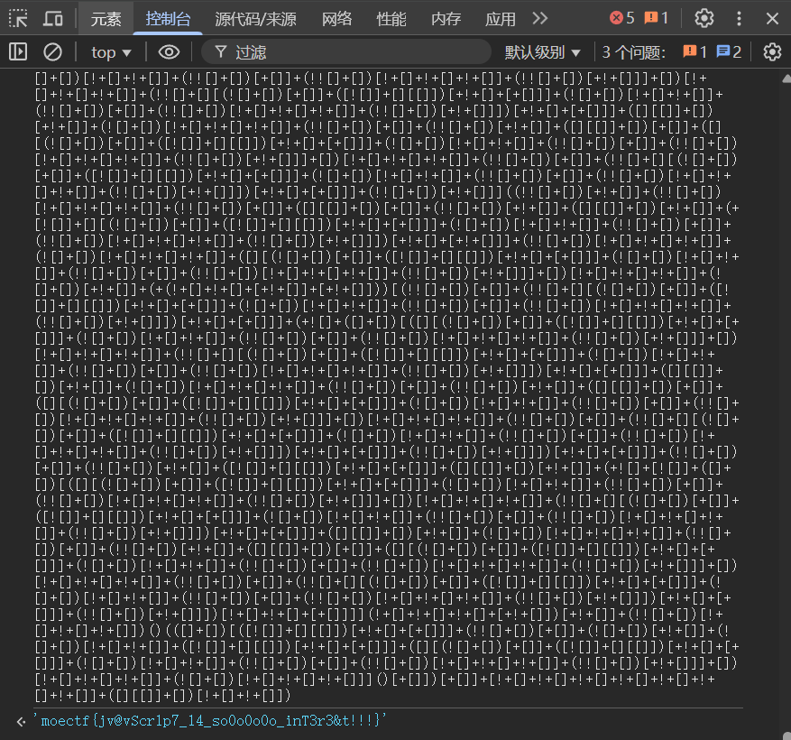

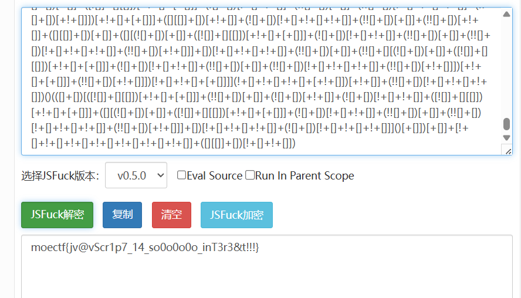

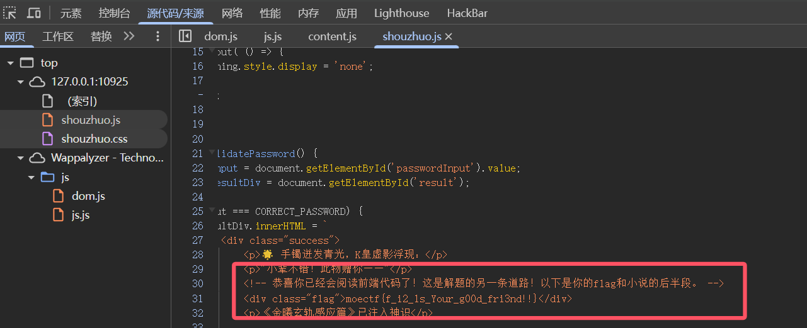

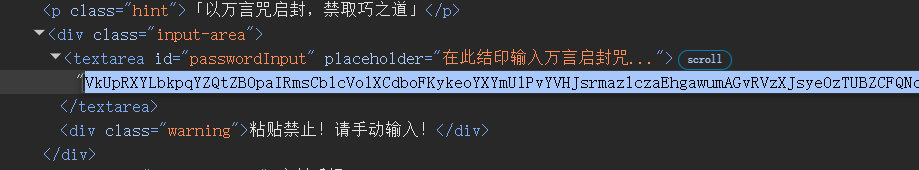

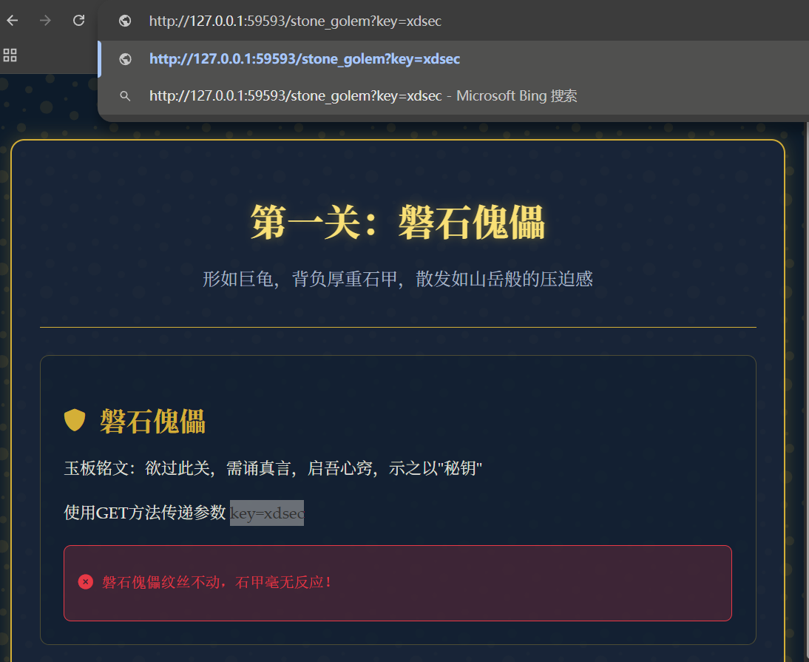

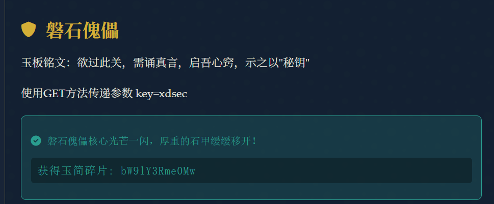

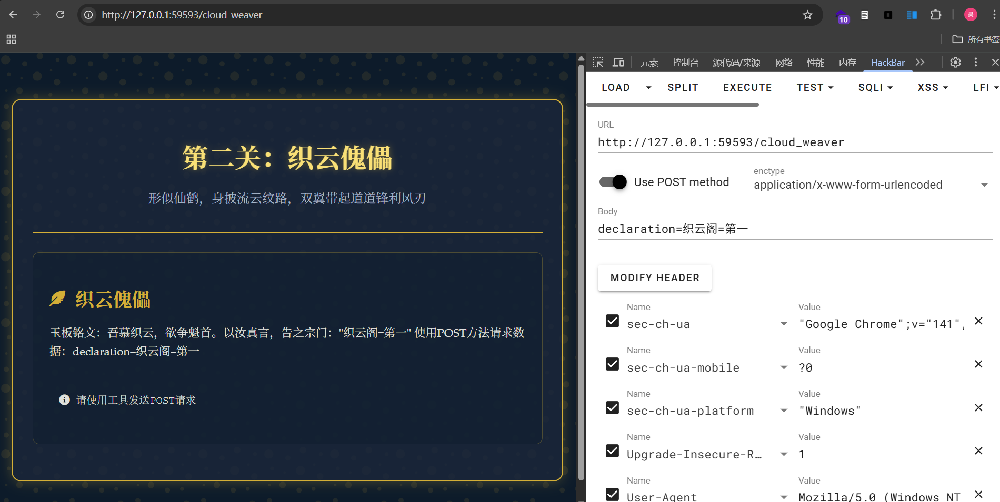

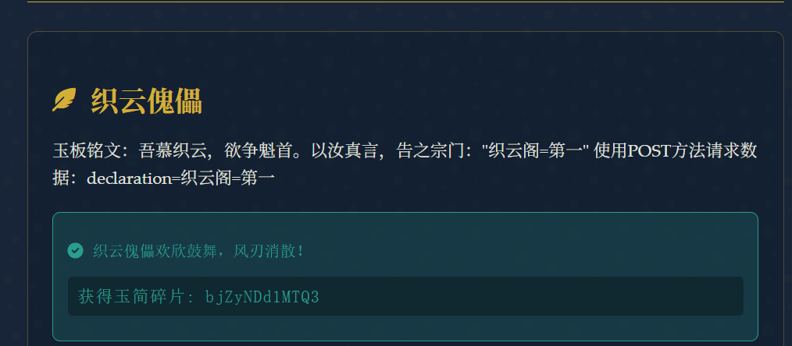

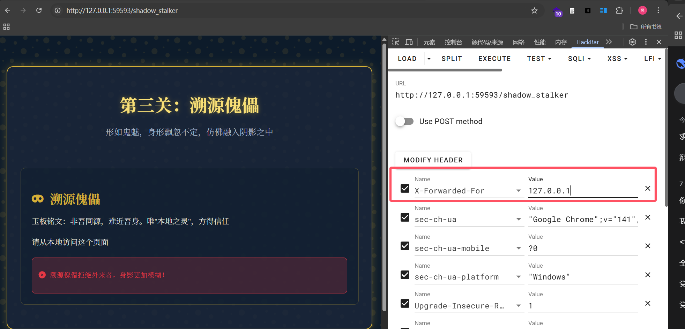

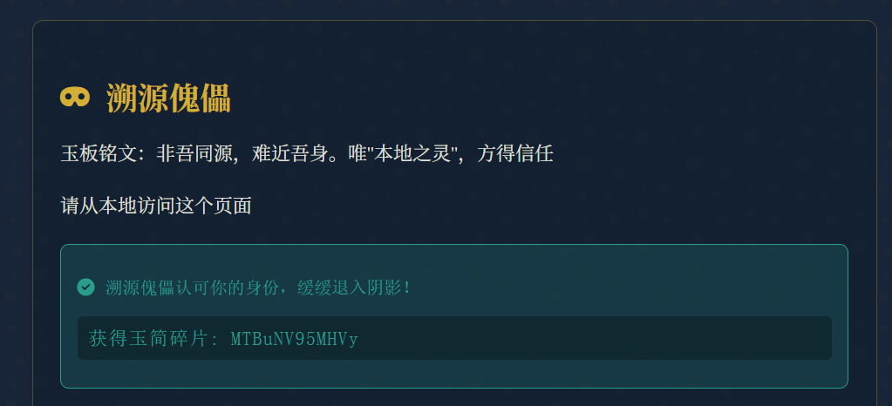

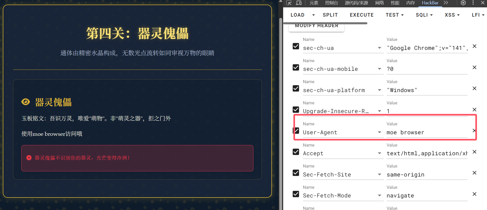

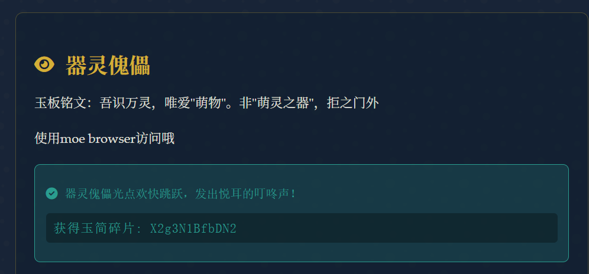

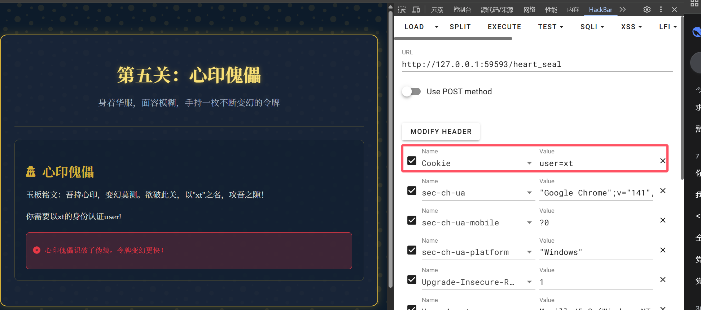

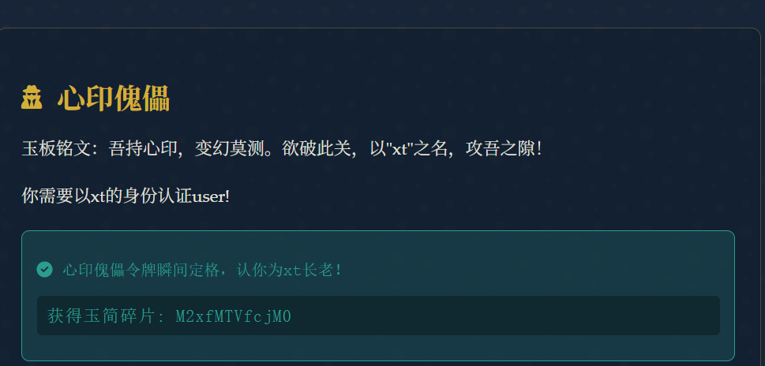

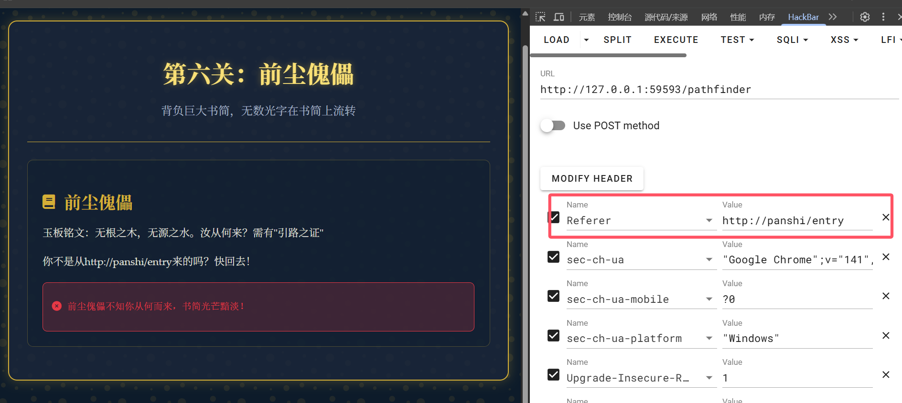

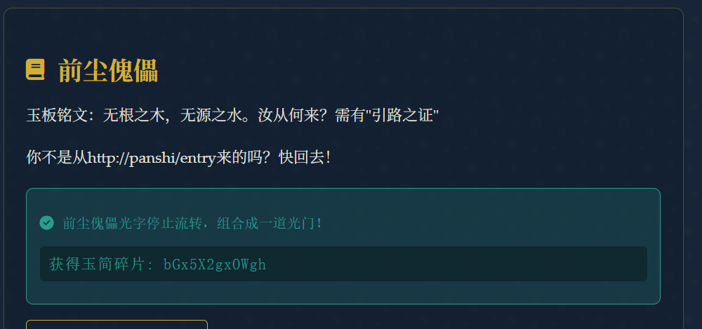

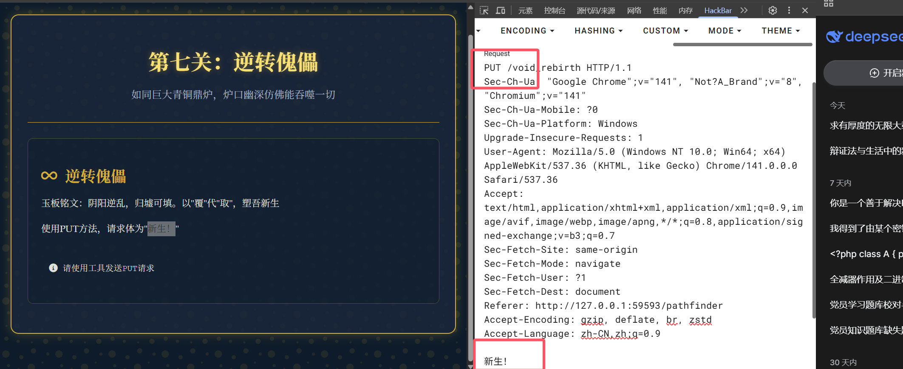

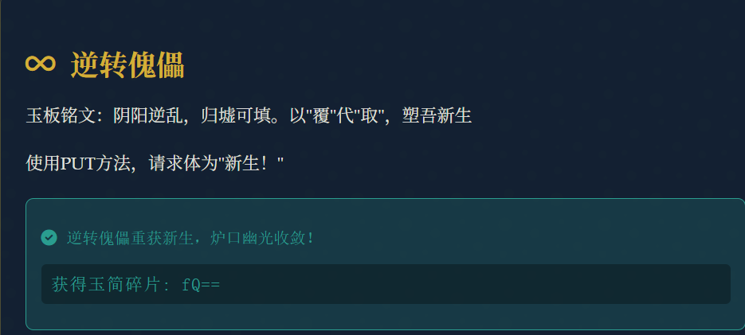
