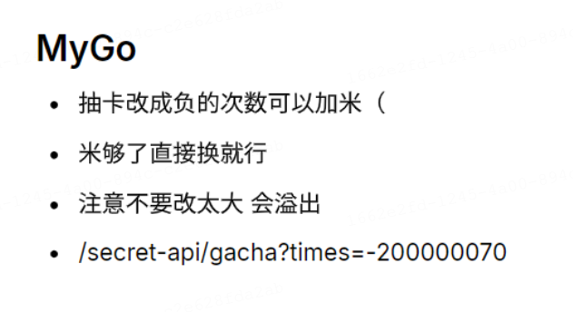

# r00t CTF 2024 / MyGo

> 来源：r00t CTF 2024  |  类型：wp_prose  |  https://github.com/r00t-security-lab/rtctf2024/blob/a273041a04a5dd1eed3e5f49c9345719923a8e9f/Web/MyGo.md

# MyGo

~~本来想做个抽卡模拟器，最后抽卡成了非预期的部分（悲~~

一个没什么内容还夹带了一堆私货的小游戏（求求你们去听 MyGo 版素颜吧，我什么都会做的），漏洞点是 Go 的整型溢出，理论上不需要找到源码也能测试出来，从最后的解题情况来看好像都是直接测（或者非预期）出来的。

游戏规则很简单，打工赚米抽卡吃保底拿 flag，但为了防止强行爆破（服务器爆炸）打工有内置 CD，以及黑心出题人暗调人物出货概率让客服小祥成为卡池里不存在的人物，因此抽卡是抽不出 flag 的。

点击「~~最新~~力作」按钮会跳出一个 B 站源的 iframe 视频，F12 打开页面源码能找到一个 `main.go` 的提示，观察 url 会发现传入了一个 link 参数：`?link=static/links/iframe_src` 实际上读取了资源文件作为 iframe 标签的 src，因此此处有一个任意文件读的漏洞，传入 `?link=main.go` 就能读取到题目的源码。

游戏提供了一个很诡异的扣金币的「购物」功能，表面上是消除疲劳值为了继续打工，实际上这里有一个整型溢出的洞。源码中对应函数如下：

消费力度首先不能为负数，避免简单的作弊。存在漏洞的是下面这一部分：

疲劳值与消费力度相乘后得到消费数额，再判断当前金币是否足够，两个过大的 int32 类型的变量相乘有可能出现整型溢出，int32 的范围是 `[-2^31, 2^31-1]` ，假设疲惫值为 -4，消费力度为 536871011，`-4*536871011 == -2^31 - 396` 超出 int32 的最小值 396，结果会直接变成一个特别大的正数，从而使你的金币变得特别多，就可以直接换到「客服小祥」拿到 flag。

Tips：你打工 4 次后金币值不为 0，溢出后的值如果过大加上已有的金币会二次溢出导致变回负数

### 非预期

cymic（null）发现抽卡的 API 忘了做负数 check，可以反向收钱变成百万富翁（这不合理！）

〔原图省略〕

## 原文配图

