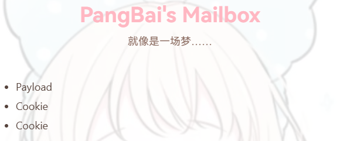
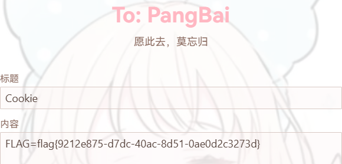

# NewStar CTF 2024 / PangBai 过家家（5）

> 来源：NewStar CTF 2024  |  类型：wp_prose  |  https://github.com/pj-newstar/wiki-docs/blob/1a0f2ba21a30f950276396118b315eef0328371c/docs/wp/2024/week5/web/pangbai5.md

import Container from '@/components/docs/Container.vue'

# PangBai 过家家（5）

本题已开源，关于题目源码和 EXP，详见：[cnily03-hive/PangBai-XSS](https://github.com/cnily03-hive/PangBai-XSS)

这是一题 XSS 题。XSS 题目的典型就是有一个 Bot，flag 通常就在这个 Bot 的 Cookie 里面。

XSS 的全称是跨站脚本攻击，存在这种攻击方式的原因是，用户访问到的网页内容并不是服务端期望的那样，可能存在恶意的代码。例如，你点击一个网页链接，但是它却执行了攻击者的前端 JavaScript 代码，将你的登录凭据、隐私信息发送给攻击者。在 XSS 题中，Bot 就承担这个受害者用户。

题目有一个发件的路由，还有一个查看信件的路由，以及一个「提醒 PangBai」的按钮，这个按钮实际就是让 Bot 访问查看当前信件的路由。

我们要做的就是找到一处能够展示我们的输入的地方，想办法使内容展示之后，浏览器能够执行我们恶意的 JavaScript 代码。这样，如果让 Bot 去访问这个 URL，恶意代码就会在 Bot 的浏览器执行，我们的恶意代码可以执行获取 Cookie 等操作。

从 `bot.ts` 可见，FLAG 在 Cookie 中：

我们直接输入 `` 做测试，访问查看信件的界面，查看源码，发现输入被过滤了。

跟踪附件中的后端源码，`page.ts` 中的 `/box/:id` 路由，会渲染我们的输入：

但是输入的内容都经过了 `safe_html` 过滤

可见这只是一个正则替换，正则中各个标志的作用：

- `i` 标志：忽略大小写
- `g` 标志：全局匹配，找到所有符合条件的内容
- `m` 标志：多行匹配，每次匹配时按行进行匹配，而不是对整个字符串进行匹配（与之对应的是 `s` 标志，表示单行模式，将换行符看作字符串中的普通字符）

由于 `m` 的存在，匹配开始为行首，匹配结束为行尾，因此我们只需要把 `<` 和 `>` 放在不同行即可，例如：

此时我们就能执行恶意代码了。直接使用 `document.cookie` 即可获取到 Bot 的 Cookie。
拿到 Cookie 之后，怎么回显呢？如果题目靶机是出网的，可以发送到自己的服务器上面；但是题目靶机并不出网，这时可以写一个 JavaScript 代码，模拟用户操作，将 Cookie 作为一个信件的内容提交（让 Bot 写信），这样我们就能查看到了。例如：

:::warning 注意

`fetch` 中的请求路径可以是相对路径、绝对路径等，因此上面忽略了 Origin，如果显示指定，必须和当前的 Origin 一样，否则存在跨域问题。从 bot.ts 中可以看到 Bot 访问的是 `http://localhost:3000`，因此使用 `http://127.0.0.1:3000` 是不行的。

把 Payload 提交之后，如果手动查看信件并点击「提醒 PangBai」，会触发两次 Payload，一次是你自己查看信件时触发的，一次是 Bot 触发的。

:::

提交并「提醒 PangBai」之后，稍等一会，查看信箱，就可以看到内容了。

〔原图省略〕

〔原图省略〕

## 原文配图

