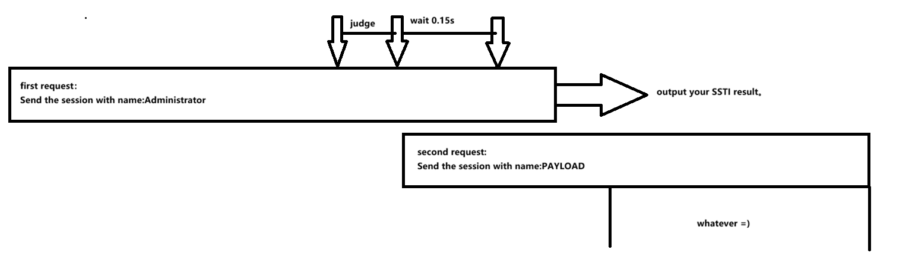

# NewStar CTF 2025 / 废弃的网站

> 来源：NewStar CTF 2025  |  类型：wp_prose  |  https://github.com/pj-newstar/wiki-docs/blob/1a0f2ba21a30f950276396118b315eef0328371c/docs/wp/2025/week5/web/abandoned-site.md

# 废弃的网站

首先我们对后端代码进行审计，发现了一个隐藏的 `/admin` 路由，其中包含了一个非常基础的 SSTI 漏洞。

如果你仍不知道 SSTI 是什么，可以去看看第三周的 [whossti](/wp/2025/week3/web/whossti) 以学习这方面知识点。

接下来的难点在于如何抵达这个漏洞点以及如何控制这里的 `tempuser['name']`，可以在源码的第 42 行看到后端处理了这个 `tempuser` 变量，并且在后面为他赋值。

那么我们只需要控制这里的 session 就可以控制 `tempuser` 的具体值了。session 是使用 JWT 进行加密的，在后端源码的最开头存在一个 JWT 密钥的生成方式：直接利用系统启动时间进行加密运算后生成。

继续观察源码第 33 行，存在这样一行代码：

直接向我们表明了当前系统已经运行的时间，我们直接通过当前时间减去这个时间即可。为了防止精度上存在的问题，特地使用了 `round` 函数来避免误差。

但是在 `admin_required` 函数中表明了当前 `user_data['name']` 只能是 `Administrator`。不过由于 `tempuser` 是全局属性，我们就可以用**条件竞争**的手法来绕过这个限制。

对于全局性的，需要维持的信息而言，非常容易出现**条件竞争**漏洞。这里的 `tempuser` 就是例子。

我们仔细梳理整个请求进行的时间线。首先我们发包，然后按照下面的流程进行数据处理：

1. 执行 `app.before_request` 中的 `load_user` 函数，在这个函数中我们修改了 `tempuser` 的具体值。
2. 再执行 `admin_required` 函数，对我们的身份进行认证。
3. 然后在 `admin_panel` 函数中输出我们当前的 `tempuser['name']` 的具体值。

我们现在要绕过第二步的认证，那么可以采取如下竞争方式（一图流）：

〔原图省略〕

如此便可以获取我们的 SSTI 结果了。

下面是整个流程的 EXP：

## 原文配图

