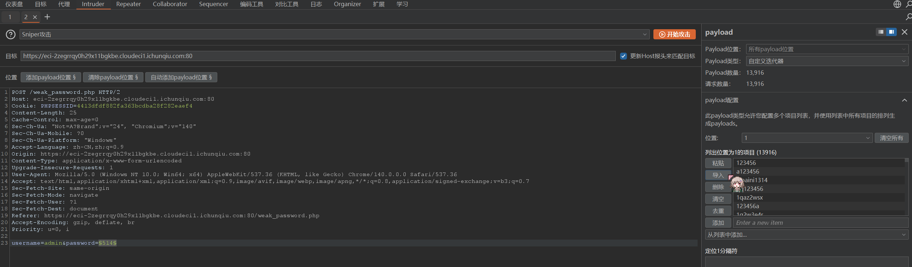
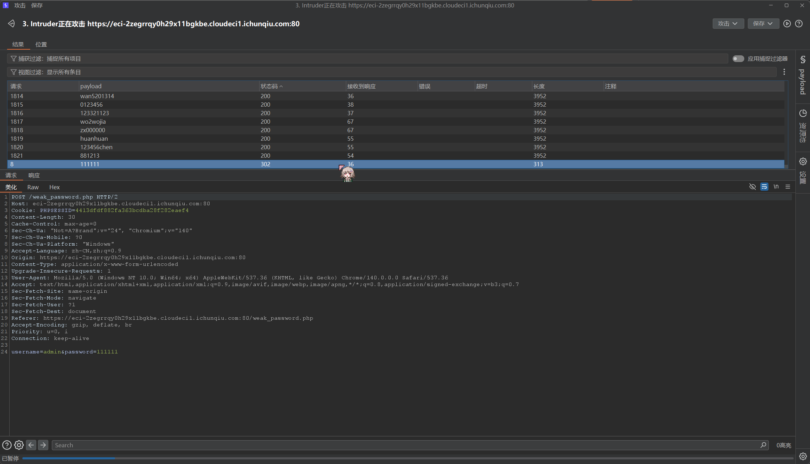

# NewStar CTF 2025 / 我真得控制你了

> 来源：NewStar CTF 2025  |  类型：wp_prose  |  https://github.com/pj-newstar/wiki-docs/blob/1a0f2ba21a30f950276396118b315eef0328371c/docs/wp/2025/week1/web/control-you.md

import Container from '@/components/docs/Container.vue'

# 我真得控制你了

本题考查前端源代码分析、弱口令爆破。

## 第一关

1. 先尝试浏览器打开控制台或查看源代码，发现全部被 ban 了，这里可以通过向 url 前添加 `view-source:` 来查看源代码。
2. 分析源码发现当元素 `#shieldOverlay` 存在时，按钮不可用。通过控制台删除该元素后按钮即可点击。

3. 先打开控制台后再进入网站，先后删除 `devToolsWarning` 和 `#shieldOverlay` 元素即可使启动按钮可用，通过第一关。你也可以通过以下控制台代码删除：

## 第二关

结合 `太弱了` 和 URL 中 `weak_password` 的提示，猜测是弱口令爆破。

这里使用 [这个字典](/resources/wp25/password.top1000.txt) 先进行对 `admin` 用户的爆破。

进入 BurpSuite 先随便输入个密码进行抓包，接着发送至 intruder，将输入密码的部分选中再点击“添加payload”

接着在右边的选项中选择“自定义迭代器”，导入你找到的字典，就可以进行攻击了

〔原图省略〕

找到状态码与其他不同的请求，得知 `111111` 就是正确的密码。

〔原图省略〕

BurpSuite爆破教程详情跳转 [https://blog.csdn.net/m0_62791201/article/details/141563438](https://blog.csdn.net/m0_62791201/article/details/141563438)

## 第三关

分析页面源码，知道这是一个简单的 RCE 挑战。要使传的表达式等于 2025。

分析上述代码可知：

无法使用数组绕过 `preg_match`。

正则表达式 `/[^\d*\/~()\s]/` 检查输入字符串 `$input` 是否包含**不允许的字符**。

**允许的字符集合**包括：

- `\d`：数字（0-9）
- `*`：星号（乘法运算符或通配符）
- `\/`：斜杠（除法运算符，注意在正则中需要转义为 `\/`）
- `~`：波浪号（位非运算符）
- `()`：左括号和右括号（用于分组）
- `\s`：空白字符（包括空格、制表符、换行符等）

无法仅使用数字和空白字符，必须包含至少一个运算符（`*`、`/`、`~`、`(`、`)`）才能通过第二个正则表达式 `/^[\d\s]+$/` 的检查。

这限制了我们不能直接输入 2025 或使用字母构造复杂的代码，只能使用数字和基本的数学运算符。所以思路便变得清晰：我们可以构造数学运算表达式来得到 2025。

尝试表达式：

成功计算 2025 后获取 FLAG

## 原文配图

