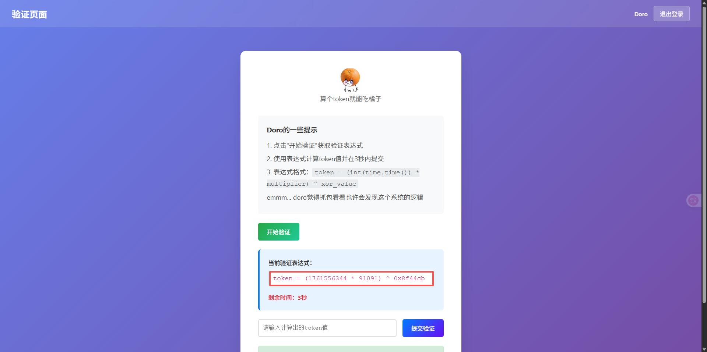
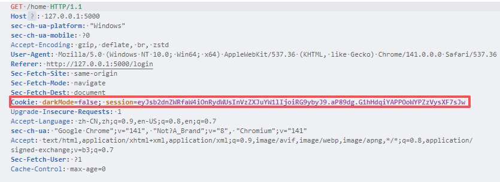
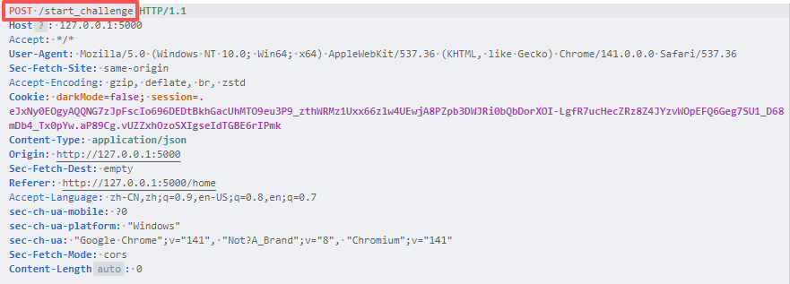
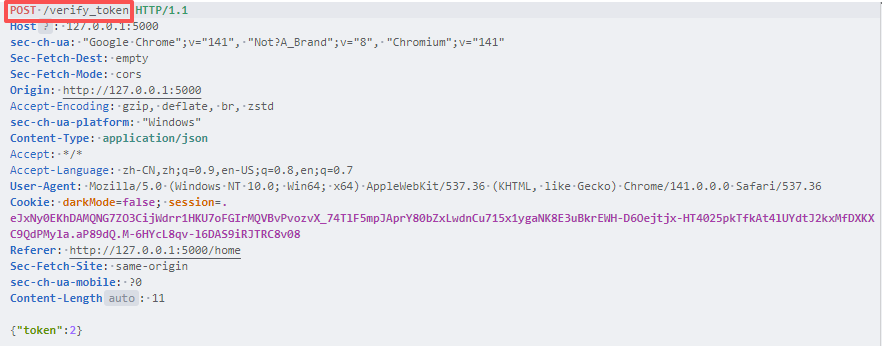
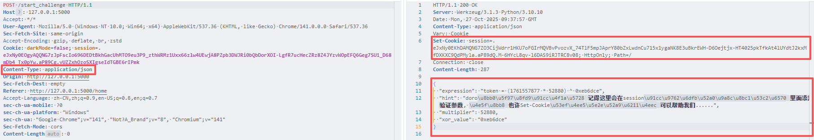
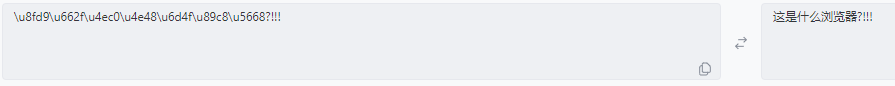
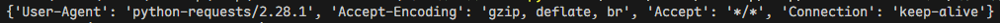

# NewStar CTF 2025 / 搞点哦润吉吃吃🍊

> 来源：NewStar CTF 2025  |  类型：wp_prose  |  https://github.com/pj-newstar/wiki-docs/blob/1a0f2ba21a30f950276396118b315eef0328371c/docs/wp/2025/week2/web/orange-snack.md

import Container from '@/components/docs/Container.vue'

# 搞点哦润吉吃吃🍊

本题考查基本的 Web 自动化脚本编写。

> [!INFO]
> 本来是想通过社会工程学密码生成器生成弱密码爆破登录，但是觉得有点偏题了，干脆直奔考点吧整体其实就是 Python 脚本的编写，如果部分同学有爬虫的基础，那这道题只能是轻轻又松松建议提前了解知识点：HTTP 协议包括请求及响应基本格式内容（Week1 中你们已经学习）、Python 的基本语法和 requests 库基本用法、正则表达式模块当然如果你喜欢用别的代码语言或模块，请随意

## 收集信息

登录后，让我们计算 token。

〔原图省略〕

且每次 token 表达式是不一样的，显然 3s 内想要计算再填入验证框中是很困难的；届时如果能利用代码脚本帮助我们自动化整个过程，这一定是能够完成的。

在此之前，你需要了解 [requests 模块](https://www.runoob.com/python3/python-requests.html) 的基本用法，其主要用于发送 HTTP 请求，处理网络通信与 Web 服务器进行数据交互。

在我们的 web 网页中，一些动态数据是通过特定的路由来传递数据，我们需要清楚各个路由的作用，以此构建脚本内容，显然 Doro 给了我们提示。（从后面的解题情况来看，这个提示多此一举了）

## 编写解题脚本

假设你已经掌握了 Week1 学习的 HTTP 协议相关知识，那么服务器验证每个用户的登录凭据就是叫 Cookie🍪 的东西，我们抓个包来看看。

〔原图省略〕

要想在请求 `/home` 路由后得到登录后的页面，你需要加上这个 Cookie

可以看到后端代码会从你的 session 中检查 `logged_in` 字段

现在你想知道表达式的路由，点击开始验证后抓包

〔原图省略〕

验证路由

〔原图省略〕

如果你尝试过直接通过路由传输数据，那么服务器会显示“未登录”，这是因为每个路由都经过鉴权处理，确保这些操作是授权了的

所以，现在你有一个构建脚本的清晰思路，拿到已登录的 Cookie，请求 `/start_challenge` 拿到数据，计算后，再将数据传递给 `/verify_token` 用于验证。

不过在这中间依旧有些细节需要我们注意

---

〔原图省略〕

`Content-Type: application/json`：表示传输的数据格式是 JSON，从后面的相应也可以看出

`Set-Cookie`：用于在客户端（浏览器）设置 Cookie，通过提示可以发现设置的新 Cookie 里包含了以下这些参数，这是用于验证的，而我们需要从 json 中获取（`\u` 开头的字符串是 Unicode 编码）

因此我们提交数据时，记得带上这两个字段；现在打印这个相应可以看到

time 时间戳是在表达式中的，我们需要提取出来，这里需要用到 [正则表达式](https://docs.python.org/zh-cn/3.13/howto/regex.html)

> [!INFO]
> 简单来说，正则表达式可以匹配或者操作一段文本，通过特定的规则匹配我们想要处理或者过滤的字段，这在 CTF 的方方面面都会遇到

具体语法这里不过多赘述，简言之我们要获取 `1761560023`，这是数字字符，我们可以使用 `\d+` 来匹配，这里我们只需要提取遇到的第一个数字即可，因此不需要贪婪模式匹配

因此整体雏形大概是

不过光是这样会返回

〔原图省略〕

是的，依旧需要用到 Week1 学习的 HTTP 协议知识，看到这个提示，你应该想到 `User-Agent`

> [!INFO]
> User-Agent 一般用于标识客户端类型，例如：浏览器类型（Chrome、Firefox、Safari 等）、操作系统（Windows、macOS、Linux 等）以及设备类型（桌面、移动设备等）。服务器根据 User-Agent 返回不同的内容，可以为移动设备返回移动版页面，或者为不同浏览器提供兼容性处理。如果我们不添加 UA 头，那么默认就是：

〔原图省略〕

所以最终脚本如下：

事实上，你也可以使用 requests 库中的 Session 来进行管理会话，并且直接使用 eval 函数对相关表达式进行计算。

以上脚本是一个从登录到攻击的全过程脚本，只需要更新 `domain` 的值即可自动获取 FLAG。

## 原文配图

