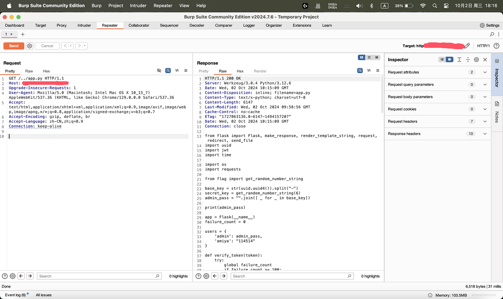

# NewStar CTF 2024 / 这「照片」是你吗

> 来源：NewStar CTF 2024  |  类型：wp_prose  |  https://github.com/pj-newstar/wiki-docs/blob/1a0f2ba21a30f950276396118b315eef0328371c/docs/wp/2024/week3/web/zhaopian.md

import Container from '@/components/docs/Container.vue'

# 这「照片」是你吗

查看网页源码：

很明显的提示，能够获得静态文件，但是没有用常见的反代服务来区别静态文件和服务型路由。

服务端处理文件和路由的逻辑很有可能会有漏洞。

简单的测试就能知道是路径穿越 + 任意文件读。

查看 Response Header，能够认出来是 Flask app，常用的 Flask 主程序名为为 `app.py`.

路径穿越常用 `../`，意为当前文件夹的上一层。

本题将静态文件存储在了 `./static` 中，主程序在 `static` 外，那么使用 `GET /../app.py` 就可以拿到源码了。

::: tip
若直接在浏览器中访问带 `../` 的路径，会先被浏览器按照网址路径规则解析一遍 `../`，最终发出的并不是含这个字符串的路径，因此需要用发包软件发送过去。
:::

〔原图省略〕

本题的漏洞代码是 `send_file("./static/" + file)`.

与 SQL 注入一样，直接拼接用户可控制输入的字符串是大忌！

很轻松的，我们获得了主程序的源代码。

审计源码，可以知道我们要用 `admin` 用户登录来进入面板。两种方法：获取密码或者伪造 `token`.

首先来看密码的长度：

`admin` 的密码长度是 32 个字符，而整个程序有登录次数限制，因此无法爆破密码来登录。

而伪造 `token` 则需要 `secret_key`，查看生成逻辑：

6 位数字字符串，可以在数秒内完成爆破。

通过本段代码我们可以知道一个有效账户 `amiya`，密码 `114514`，通过发包登录，我们可以获得一个有效的 `token`，据此能在本地认证签名 `secret_key` 的有效性（因为目标主机有认证次数限制）。

用明文存密码也是大忌！安全的做法是存储哈希值，并且加入一定的盐值（Salt）。

爆破出 `secret_key`，然后查看登录后的逻辑：

前端请求 `/execute` 指定 `api_address`，而 `api_address` 可控且没有校验，存在 SSRF 漏洞。

定位到源代码开头：

这是出题人故意漏的信息，将函数写在了 flag 模块并 import，提示查看 `flag.py`

::: tip
Python 程序可以 import 同一目录下的 `.py` 文件而不必创建 `__init__.py` 等标记模块的文件。因此这里同级目录下有文件名为 `flag.py` 的程序，模块名为 `flag`.
:::

我们的操作很明确了：利用 `/execute` 路由的 SSRF 漏洞让服务器自己访问 `http://localhost:5001/fl4g`，即访问 `/execute?api_address=http://localhost:5001/fl4g`.

EXP 如下：

## 原文配图

