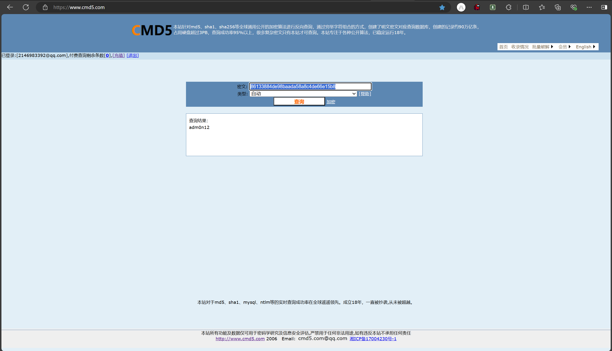

# NewStar CTF 2024 / RSA? cmd5!

> 本文由授权中文赛事 WP 正文导入（阶段 1，仅散文，代码段未导入）。
>
> - 来源：https://github.com/pj-newstar/wiki-docs/blob/1a0f2ba21a30f950276396118b315eef0328371c/docs/wp/2024/week5/crypto/rsa_cmd5.md
> - 许可：MIT
> - 署名：（未提供）
> - 文档族：official_event_archive
> - 赛事：NewStar CTF 2024
> - 年份：2024
> - 核验状态：official_source_not_reproduced
> - 正文 sha256：7247e9bc41e795d841290244496ef8f7335573979f141f0771d5430cf8fd0048
> - 导入 ID：official-d5145c5535ecefd91e094b
> - 原 domain：crypto
> - 本地快照：62_官方赛事题库/objects/11e3a5025c048b441196875a1048eb7516d8080535db028c87041b761cbf20af.blob
> - 源修订：1a0f2ba21a30f950276396118b315eef0328371c
> - 收录说明：官方发布来源的说明正文；代码单独索引，未运行或分析。按文件收录，不把多份文件算作多道题。图片及附件下载状态见清单；仅按路径/原题分类标方向，binary 等跨方向资料留待分类。
> - 判定依据：original_prose_not_runtime_verified
> - 附件引用：[{"owner_id": "official-d5145c5535ecefd91e094b", "relative_path": "docs/assets/images/wp/2024/week5/rsa_cmd5_1.png", "local_path": "62_官方赛事题库/objects/37325f77f7ba02010cc918fc4ae66c350a74ec1d522e7ad46e934cb6deb014ac.blob", "downloaded_bytes": 159124, "source_url": "https://github.com/pj-newstar/wiki-docs/blob/1a0f2ba21a30f950276396118b315eef0328371c/docs/assets/images/wp/2024/week5/rsa_cmd5_1.png", "sha256": "37325f77f7ba02010cc918fc4ae66c350a74ec1d522e7ad46e934cb6deb014ac", "kind": "image", "policy": "reference_only_no_execution"}]

> 原文：https://github.com/pj-newstar/wiki-docs/blob/1a0f2ba21a30f950276396118b315eef0328371c/docs/wp/2024/week5/crypto/rsa_cmd5.md

## 正文

---
titleTemplate: ":title | WriteUp - NewStar CTF 2024"
---

import Container from '@/components/docs/Container.vue'
import { ElCollapse, ElCollapseItem } from 'element-plus'
import 'element-plus/es/components/collapse/style/css'
import 'element-plus/es/components/collapse-item/style/css'

const vProps = {
  openCollapse: []
}

## 题目信息

RSA 的签名，往往是给接收方 B 确定发送方 A 的身份用的，但如果发送方用不安全的哈希算法来计算信息的信息摘要，那么有可能被中途的窃密者 C 利用而得到明文。

题目描述：

> 应该都了解 RSA 解密原理了吧？
>
> **Alice:** 你把服务器密码用 RSA 加密给我发过来吧，记得带上签名.
>
> **Bob:** 好麻烦，还要签名，算了，直接 MD5 签名一下就好了吧！

::: code-group

:::

## 解析

这里我们得到了 $c$、$s$、$n$、$e$，和平时的 RSA 不同，这里多了 $s$，让我们看看这个 $s$ 是什么

计算了 `m0` 的 MD5 为变量 `hm0`，然后将变量 `hm0` 转成整数 `hm1` 进行计算

$$
s = hm_1^{d} \mod n
$$

那么我们有 $e$，理解 RSA 解密原理

$$
\begin{gather}
e \cdot d \equiv 1 \mod \varphi \\
s^e \equiv (hm_1^{d})^e \equiv hm_1^{d \cdot e} \equiv hm_1^{1+k \cdot \varphi} \equiv hm_1 \mod n = hm_1
\end{gather}
$$

那么再结合题目名字和描述，去 [cmd5.com](https://cmd5.com) 找 `hm1` 的结果:

$m$ 为 `adm0n12`

计算 flag

## EXP

神秘数字：

## 原文配图

