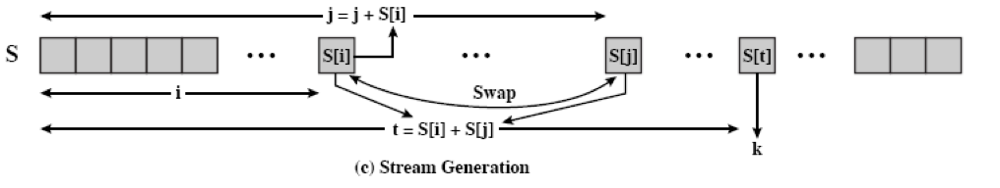
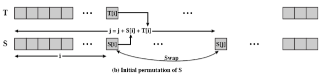
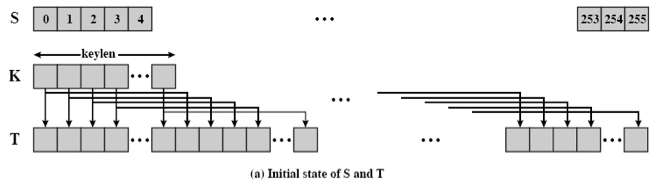

# RC4

> 本文由授权中文赛事 WP 正文导入（阶段 1，仅散文，代码段未导入）。
>
> - 来源：https://github.com/ctf-wiki/ctf-wiki/blob/e225ddfcd420a7f54a5940f47336ebdf8c29b875/docs/zh-tw/docs/crypto/streamcipher/special/rc4.md
> - 许可：CC-BY-NC-SA-4.0
> - 署名：ctf-wiki/ctf-wiki contributors; original at https://github.com/ctf-wiki/ctf-wiki/blob/e225ddfcd420a7f54a5940f47336ebdf8c29b875/docs/zh-tw/docs/crypto/streamcipher/special/rc4.md
> - 文档族：ctf-wiki
> - 赛事：（无）
> - 年份：（无）
> - 核验状态：source_document_not_reproduced
> - 正文 sha256：774a47eb46b1aeaa1e1545b6e8b4299ef4e671e9d5ec81817a4e5b23fff09e66
> - 导入 ID：ctf-wiki-dcd4eafdf46b81
> - 原 domain：crypto
> - 许可文件：61_中文赛事资料/来源与许可/ctf-wiki/LICENSE.txt
> - 本地快照：61_中文赛事资料/开源正文快照/ctf-wiki/docs/zh-tw/docs/crypto/streamcipher/special/rc4.md
> - 源修订：e225ddfcd420a7f54a5940f47336ebdf8c29b875
> - 抓取时间：2026-10-22T17:53:47.929157+00:00
> - 收录说明：开源中文文档正文。原作者与版本已保留；检索正文省略代码块、缩进代码和图片，完整 Markdown 另存；未复现。
> - 判定依据：original_prose_not_runtime_verified

> 原文：https://github.com/ctf-wiki/ctf-wiki/blob/e225ddfcd420a7f54a5940f47336ebdf8c29b875/docs/zh-tw/docs/crypto/streamcipher/special/rc4.md

## 基本介紹

RSA 由 Ron Rivest 設計，最初隸屬於 RSA 安全公司，是一個專利密碼產品。它是面向字節的流密碼，密鑰長度可變，非常簡單，但也很有效果。RC4 算法廣泛應用於 SSL/TLS 協議和 WEP/WPA 協議。

## 基本流程

RC4 主要包含三個流程

- 初始化 S 和 T 數組。
- 初始化置換 S。
- 生成密鑰流。

## 初始化 S 和 T 數組

初始化 S 和 T 的代碼如下

## 生成流密鑰

我們一般稱前兩部分爲 KSA ，最後一部分是 PRGA。

## 攻擊方法

待補充。

## 原文配图

