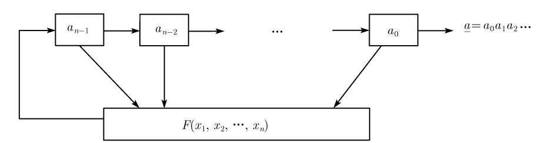

# 反饋移位寄存器

> 本文由授权中文赛事 WP 正文导入（阶段 1，仅散文，代码段未导入）。
>
> - 来源：https://github.com/ctf-wiki/ctf-wiki/blob/e225ddfcd420a7f54a5940f47336ebdf8c29b875/docs/zh-tw/docs/crypto/streamcipher/fsr/intro.md
> - 许可：CC-BY-NC-SA-4.0
> - 署名：ctf-wiki/ctf-wiki contributors; original at https://github.com/ctf-wiki/ctf-wiki/blob/e225ddfcd420a7f54a5940f47336ebdf8c29b875/docs/zh-tw/docs/crypto/streamcipher/fsr/intro.md
> - 文档族：ctf-wiki
> - 赛事：（无）
> - 年份：（无）
> - 核验状态：source_document_not_reproduced
> - 正文 sha256：175e85d10ec383a75a381c06853f8455612578acb293abe3aa4885f747dd9368
> - 导入 ID：ctf-wiki-f6774be991e218
> - 原 domain：crypto
> - 许可文件：61_中文赛事资料/来源与许可/ctf-wiki/LICENSE.txt
> - 本地快照：61_中文赛事资料/开源正文快照/ctf-wiki/docs/zh-tw/docs/crypto/streamcipher/fsr/intro.md
> - 源修订：e225ddfcd420a7f54a5940f47336ebdf8c29b875
> - 抓取时间：2026-10-22T17:53:47.486598+00:00
> - 收录说明：开源中文文档正文。原作者与版本已保留；检索正文省略代码块、缩进代码和图片，完整 Markdown 另存；未复现。
> - 判定依据：original_prose_not_runtime_verified

> 原文：https://github.com/ctf-wiki/ctf-wiki/blob/e225ddfcd420a7f54a5940f47336ebdf8c29b875/docs/zh-tw/docs/crypto/streamcipher/fsr/intro.md

## 反饋移位寄存器

一般的，一個 n 級反饋移位寄存器如下圖所示

其中

- $a_0$，$a_1$，…，$a_{n-1}$，爲初態。
- F 爲反饋函數或者反饋邏輯。如果 F 爲線性函數，那麼我們稱其爲線性反饋移位寄存器（LFSR），否則我們稱其爲非線性反饋移位寄存器（NFSR）。
- $a_{i+n}=F(a_i,a_{i+1},...,a_{i+n-1})$ 。

一般來說，反饋移位寄存器都會定義在某個有限域上，從而避免數字太大和太小的問題。因此，我們可以將其視爲同一個空間中的變換，即

$(a_i,a_{i+1},...,a_{i+n-1}) \rightarrow (a_{i+1},...,a_{i+n-1},a_{i+n})$
.
對於一個序列來說，我們一般定義其生成函數爲其序列對應的冪級數的和。

## 原文配图

