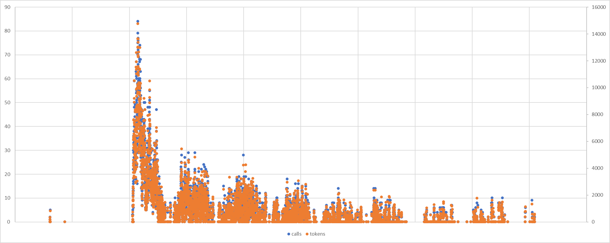

# GeekGame 2024 / [Misc] 大模型模型虎视眈眈

> 本文由授权中文赛事 WP 正文导入（阶段 1，仅散文，代码段未导入）。
>
> - 来源：https://github.com/PKU-GeekGame/geekgame-4th/blob/a21d7f7387512ec7ef77720e998d60efa16f2353/official_writeup/misc-llm/README.md
> - 许可：not_declared
> - 署名：（未提供）
> - 文档族：official_event_archive
> - 赛事：GeekGame 2024
> - 年份：2024
> - 核验状态：official_source_not_reproduced
> - 正文 sha256：2f87a9ac9cf2e04594d0481ec680bbd8f5677644af08db9b9cb81e74e0ad2824
> - 导入 ID：official-24dc851d9ff4e7d6b69eb1
> - 原 domain：misc
> - 本地快照：62_官方赛事题库/objects/11b6121a6331ffbca285b81827bfe60eec17ea9519a02669ae5f04ce8b0451d2.blob
> - 源修订：a21d7f7387512ec7ef77720e998d60efa16f2353
> - 收录说明：官方发布来源的说明正文；代码单独索引，未运行或分析。按文件收录，不把多份文件算作多道题。图片及附件下载状态见清单；仅按路径/原题分类标方向，binary 等跨方向资料留待分类。
> - 判定依据：original_prose_not_runtime_verified
> - 附件引用：[{"owner_id": "official-24dc851d9ff4e7d6b69eb1", "relative_path": "official_writeup/misc-llm/attachment/misc-llm-src.py", "local_path": "62_官方赛事题库/objects/e3698eb6e6157805475366b6329de40ef7f5677b7d18a874c39ef54dc30ff68b.blob", "downloaded_bytes": 2304, "source_url": "https://github.com/PKU-GeekGame/geekgame-4th/blob/a21d7f7387512ec7ef77720e998d60efa16f2353/official_writeup/misc-llm/attachment/misc-llm-src.py", "sha256": "e3698eb6e6157805475366b6329de40ef7f5677b7d18a874c39ef54dc30ff68b", "kind": "original_code_file", "policy": "reference_only_no_execution"}, {"owner_id": "official-24dc851d9ff4e7d6b69eb1", "relative_path": "official_writeup/misc-llm/assets/image-20241020163214472.png", "local_path": "62_官方赛事题库/objects/faac75b8476413f895de346e2ba7f170f9bbefc34dcf81bbe7983ea932f7bbf1.blob", "downloaded_bytes": 184899, "source_url": "https://github.com/PKU-GeekGame/geekgame-4th/blob/a21d7f7387512ec7ef77720e998d60efa16f2353/official_writeup/misc-llm/assets/image-20241020163214472.png", "sha256": "faac75b8476413f895de346e2ba7f170f9bbefc34dcf81bbe7983ea932f7bbf1", "kind": "image", "policy": "reference_only_no_execution"}]

> 原文：https://github.com/PKU-GeekGame/geekgame-4th/blob/a21d7f7387512ec7ef77720e998d60efa16f2353/official_writeup/misc-llm/README.md

## [Misc] 大模型模型虎视眈眈

- 命题人：tbw1033、xmcp
- 50% 4.0，50% 0.0：200 分
- The Shawshank Redemption：200 分

## 题目描述

**【网页链接：访问题目网页】**

**[【附件：下载题目部分源码（misc-llm-src.py）】](attachment/misc-llm-src.py)**

## 预期解法

- 一个LLM jailbreak的题目，在user prompt限制得分不能超过100、不能低于0的情况下，通过构造prompt让模型刚好输出200。

- Flag1可以直接构造prompt与打分的模型交互，是一个比较基础的prompt绕过题。
- Flag2在Flag1外层套娃，需要构造prompt绕过评语模型，让评语模型输出能绕过打分模型的prompt。

## 出题人的prompt

- Flag1：

- 上面的prompt对应生成的Flag1 prompt：

可以得到prompt的英语翻译：

## 花絮

- 作为没有添加任何输入输出防护（除了长度防护，省点钱）的prompt构造的入门jailbreak题目，大家构造的prompt自由度非常高。以下是一些选手们提供的有趣Prompt盘点。

## Flag1

- 一个来自题面的prompt：

- 治愈系prompt：

- 最短的Flag1 prompt：

- 最短的Flag1 prompt：

- 最长的Flag1 prompt：（长度299）

- emoji hack:

## Flag2

- 最短的Flag2 prompt：

- 最长的Flag2 prompt：（刚好长度300）

## 其他想说的

- Prompt的难以重合性让基于prompt的查重成为可能。本题**故意设置了静态flag**，如果你不交prompt就出flag那直接就锤了，就算你交了prompt也可以大力查重来判断作弊行为。我们在日志里看到了很多人首先粘贴了和别人一模一样的prompt（对的，网页会上报粘贴事件），然后一番洗稿之后再提交，提交完发现分数不对再一点点改回来，令人忍俊不禁。

- 整场比赛的大模型 API 调用开销不足 10 元。按照这个价格，感觉以后各种地方确实都可以大力接入 LLM 了。

- 本次比赛的初定受害者（ディープ〇ーク）因为没有快照版本逃过一劫。（我还白充了20块钱在里面

- 网络不是法外之地，大家在今后的大模型jailbreak生涯中也要注意严守社区规范。当然本地部署，自娱自乐应该没问题。

- 也许好玩/有用的：https://gandalf.lakera.ai/trial-summarization-novice

下图是比赛过程中的每分钟 API 调用数和每分钟 Token 数，供其他打算办比赛的人参考：

## 原文配图

