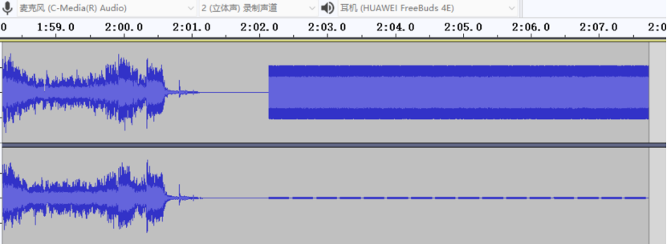
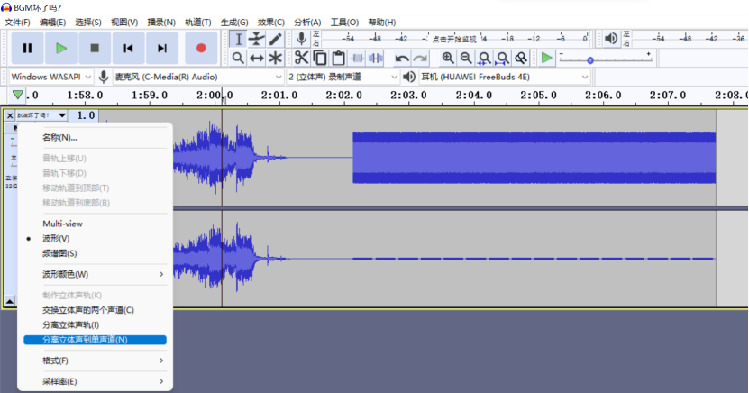
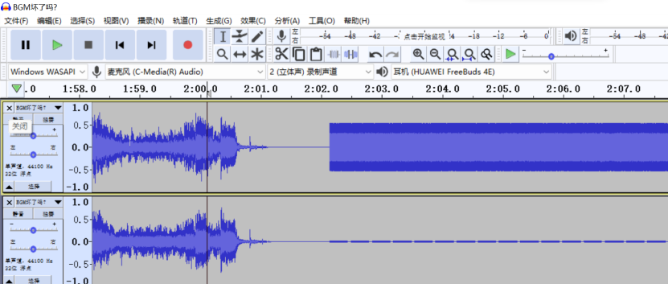
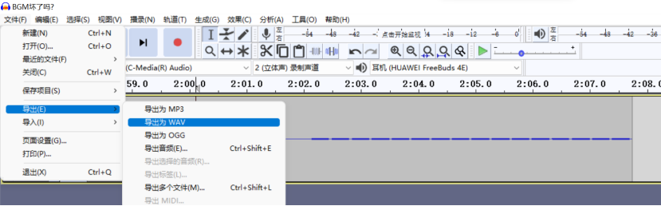
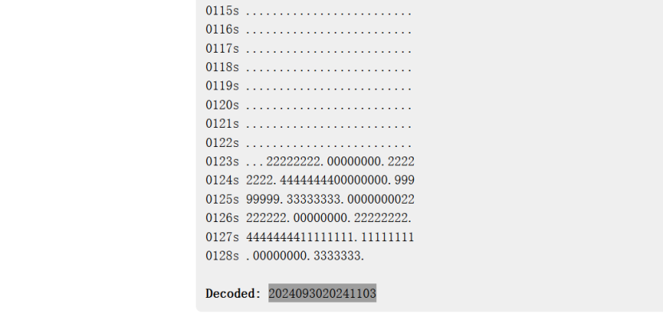

# NewStar CTF 2024 / BGM 坏了吗？

> 本文由授权中文赛事 WP 正文导入（阶段 1，仅散文，代码段未导入）。
>
> - 来源：https://github.com/pj-newstar/wiki-docs/blob/1a0f2ba21a30f950276396118b315eef0328371c/docs/wp/2024/week3/misc/bgm-broken.md
> - 许可：MIT
> - 署名：（未提供）
> - 文档族：official_event_archive
> - 赛事：NewStar CTF 2024
> - 年份：2024
> - 核验状态：official_source_not_reproduced
> - 正文 sha256：687ddfdc3694b402f715820434f8e446bf5ed236864a3bc5e611205e528a6a5d
> - 导入 ID：official-87666dd7ae91c6bade0f14
> - 原 domain：misc
> - 本地快照：62_官方赛事题库/objects/1efcacdbd4f62a9db15de15147c26a8be047e17a68cc5f50563dc11b5e3f2c5b.blob
> - 源修订：1a0f2ba21a30f950276396118b315eef0328371c
> - 收录说明：官方发布来源的说明正文；代码单独索引，未运行或分析。按文件收录，不把多份文件算作多道题。图片及附件下载状态见清单；仅按路径/原题分类标方向，binary 等跨方向资料留待分类。
> - 判定依据：original_prose_not_runtime_verified
> - 附件引用：[{"owner_id": "official-87666dd7ae91c6bade0f14", "relative_path": "docs/assets/images/wp/2024/week3/bgm-broken_1.png", "local_path": "62_官方赛事题库/objects/f769a396054763aa54b89a9cbbee471adafaf2952e95bb0710bd9dd0ee803c66.blob", "downloaded_bytes": 57523, "source_url": "https://github.com/pj-newstar/wiki-docs/blob/1a0f2ba21a30f950276396118b315eef0328371c/docs/assets/images/wp/2024/week3/bgm-broken_1.png", "sha256": "f769a396054763aa54b89a9cbbee471adafaf2952e95bb0710bd9dd0ee803c66", "kind": "image", "policy": "reference_only_no_execution"}, {"owner_id": "official-87666dd7ae91c6bade0f14", "relative_path": "docs/assets/images/wp/2024/week3/bgm-broken_2.png", "local_path": "62_官方赛事题库/objects/7d26b62e5b84ea2cec14c81f3891fca071025817f8ad7c392433c82dda332575.blob", "downloaded_bytes": 114017, "source_url": "https://github.com/pj-newstar/wiki-docs/blob/1a0f2ba21a30f950276396118b315eef0328371c/docs/assets/images/wp/2024/week3/bgm-broken_2.png", "sha256": "7d26b62e5b84ea2cec14c81f3891fca071025817f8ad7c392433c82dda332575", "kind": "image", "policy": "reference_only_no_execution"}, {"owner_id": "official-87666dd7ae91c6bade0f14", "relative_path": "docs/assets/images/wp/2024/week3/bgm-broken_3.png", "local_path": "62_官方赛事题库/objects/4e61c10b18ab4876c9c4125d4a90131ebc616423fe320a6bb02409deecaa7971.blob", "downloaded_bytes": 1175705, "source_url": "https://github.com/pj-newstar/wiki-docs/blob/1a0f2ba21a30f950276396118b315eef0328371c/docs/assets/images/wp/2024/week3/bgm-broken_3.png", "sha256": "4e61c10b18ab4876c9c4125d4a90131ebc616423fe320a6bb02409deecaa7971", "kind": "image", "policy": "reference_only_no_execution"}, {"owner_id": "official-87666dd7ae91c6bade0f14", "relative_path": "docs/assets/images/wp/2024/week3/bgm-broken_4.png", "local_path": "62_官方赛事题库/objects/06aca5ae2cc3a1f7cf895dda9340275bbfa113430808c3665cdbb4943b15720e.blob", "downloaded_bytes": 857248, "source_url": "https://github.com/pj-newstar/wiki-docs/blob/1a0f2ba21a30f950276396118b315eef0328371c/docs/assets/images/wp/2024/week3/bgm-broken_4.png", "sha256": "06aca5ae2cc3a1f7cf895dda9340275bbfa113430808c3665cdbb4943b15720e", "kind": "image", "policy": "reference_only_no_execution"}, {"owner_id": "official-87666dd7ae91c6bade0f14", "relative_path": "docs/assets/images/wp/2024/week3/bgm-broken_5.png", "local_path": "62_官方赛事题库/objects/9723c2e2d690e31a655a0be1e7fcf3d26bc9177a30a8dfa6bb63163896639afb.blob", "downloaded_bytes": 68566, "source_url": "https://github.com/pj-newstar/wiki-docs/blob/1a0f2ba21a30f950276396118b315eef0328371c/docs/assets/images/wp/2024/week3/bgm-broken_5.png", "sha256": "9723c2e2d690e31a655a0be1e7fcf3d26bc9177a30a8dfa6bb63163896639afb", "kind": "image", "policy": "reference_only_no_execution"}]

> 原文：https://github.com/pj-newstar/wiki-docs/blob/1a0f2ba21a30f950276396118b315eef0328371c/docs/wp/2024/week3/misc/bgm-broken.md

## 正文

---
titleTemplate: ":title | WriteUp - NewStar CTF 2024"
---

## BGM 坏了吗？

用 Audacity 打开音频很容易发现结尾处右声道有信息，而左声道是噪音

根据题目描述是拨号音，但是直接放解不出来，需要删掉噪音

选择 **分离立体音到单声道 » 关闭左声道 » 导出**

按键音（即DTMF）解密网站：[DTMF Decoder](https://dtmf.netlify.app/)

包上 `flag{}` 即可

## 原文配图

