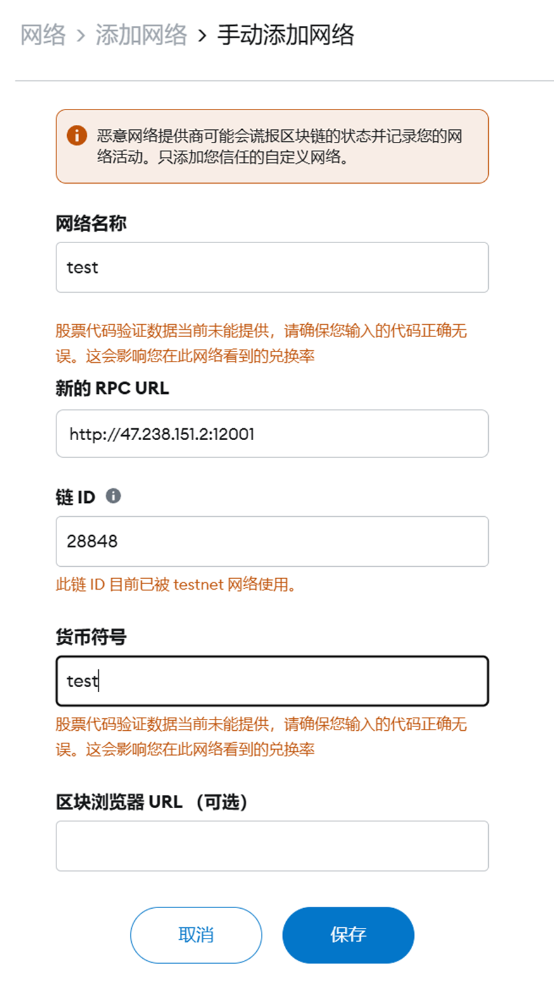
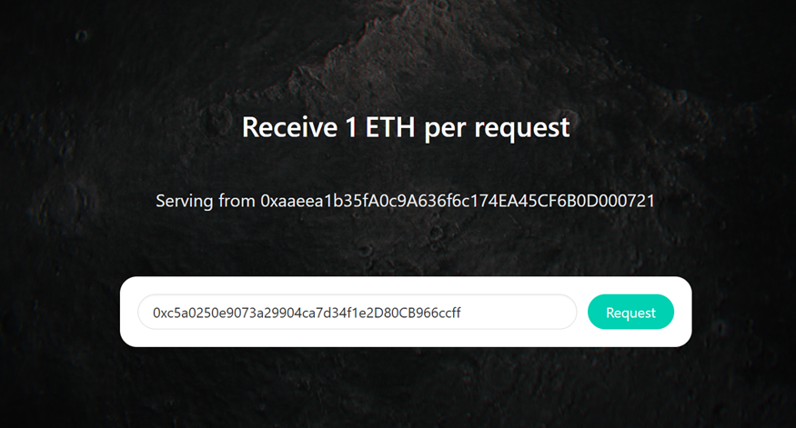
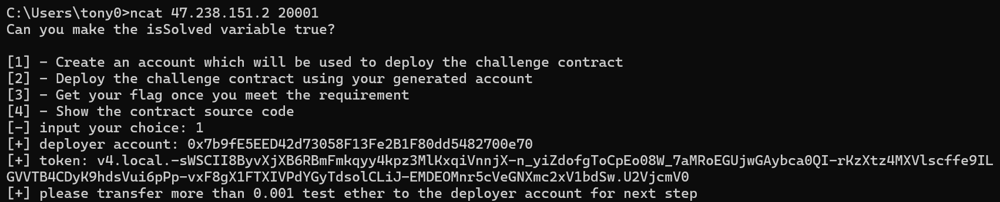
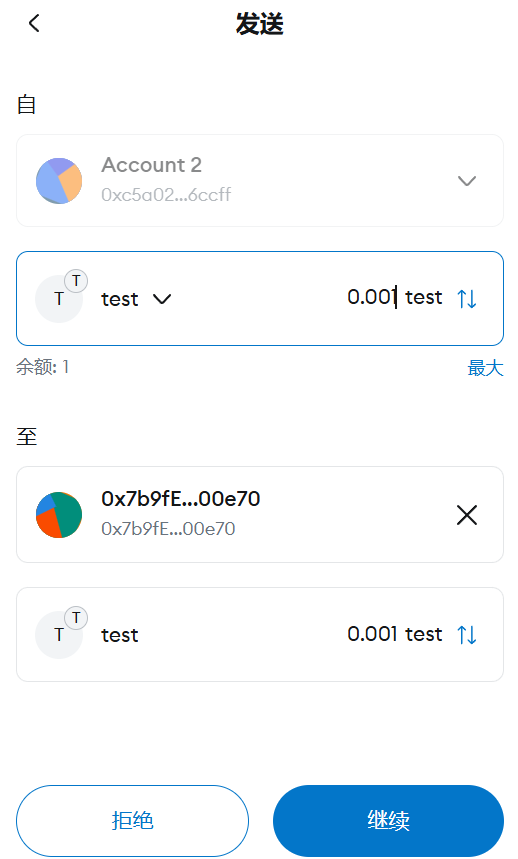
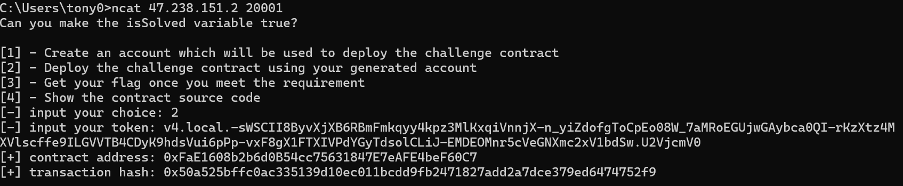
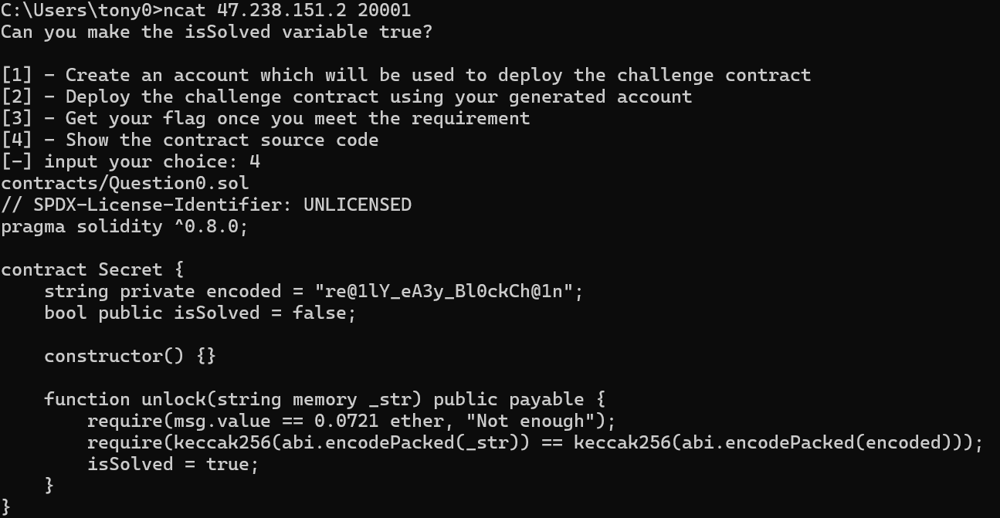
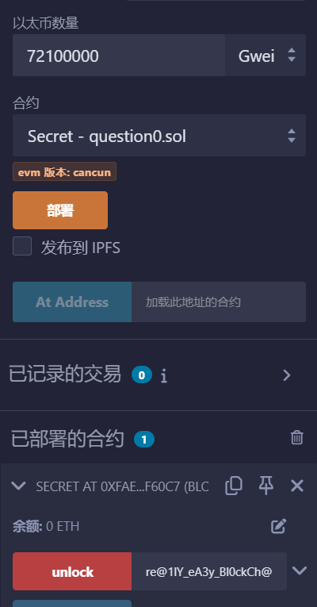
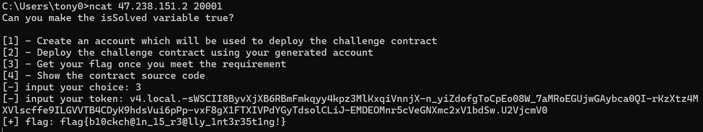

# NewStar CTF 2024 / ezblockchain

> 本文由授权中文赛事 WP 正文导入（阶段 1，仅散文，代码段未导入）。
>
> - 来源：https://github.com/pj-newstar/wiki-docs/blob/1a0f2ba21a30f950276396118b315eef0328371c/docs/wp/2024/week4/misc/ezblockchain.md
> - 许可：MIT
> - 署名：（未提供）
> - 文档族：official_event_archive
> - 赛事：NewStar CTF 2024
> - 年份：2024
> - 核验状态：official_source_not_reproduced
> - 正文 sha256：687ddfdc3694b402f715820434f8e446bf5ed236864a3bc5e611205e528a6a5d
> - 导入 ID：official-316e4235a17371288d885a
> - 原 domain：misc
> - 本地快照：62_官方赛事题库/objects/36fbfcc0059363a7d309928331a6cc423e6668dba5b6cf38378296eca2466497.blob
> - 源修订：1a0f2ba21a30f950276396118b315eef0328371c
> - 收录说明：官方发布来源的说明正文；代码单独索引，未运行或分析。按文件收录，不把多份文件算作多道题。图片及附件下载状态见清单；仅按路径/原题分类标方向，binary 等跨方向资料留待分类。
> - 判定依据：original_prose_not_runtime_verified
> - 附件引用：[{"owner_id": "official-316e4235a17371288d885a", "relative_path": "docs/assets/images/wp/2024/week4/ezblockchain_1.png", "local_path": "62_官方赛事题库/objects/8d0cde5eedeb5e16cceb10d4ae82e9932a0c79730cf1520ebda0371c773f59f3.blob", "downloaded_bytes": 254077, "source_url": "https://github.com/pj-newstar/wiki-docs/blob/1a0f2ba21a30f950276396118b315eef0328371c/docs/assets/images/wp/2024/week4/ezblockchain_1.png", "sha256": "8d0cde5eedeb5e16cceb10d4ae82e9932a0c79730cf1520ebda0371c773f59f3", "kind": "image", "policy": "reference_only_no_execution"}, {"owner_id": "official-316e4235a17371288d885a", "relative_path": "docs/assets/images/wp/2024/week4/ezblockchain_2.png", "local_path": "62_官方赛事题库/objects/08547756035422d9f29682111d67c3754a7284bf27e6c11456e31c3c4fad1d2a.blob", "downloaded_bytes": 452769, "source_url": "https://github.com/pj-newstar/wiki-docs/blob/1a0f2ba21a30f950276396118b315eef0328371c/docs/assets/images/wp/2024/week4/ezblockchain_2.png", "sha256": "08547756035422d9f29682111d67c3754a7284bf27e6c11456e31c3c4fad1d2a", "kind": "image", "policy": "reference_only_no_execution"}, {"owner_id": "official-316e4235a17371288d885a", "relative_path": "docs/assets/images/wp/2024/week4/ezblockchain_3.png", "local_path": "62_官方赛事题库/objects/4f7bb9777c9bbb93f03d92da60fba72252b91614f67e550451fa4579e618643a.blob", "downloaded_bytes": 62302, "source_url": "https://github.com/pj-newstar/wiki-docs/blob/1a0f2ba21a30f950276396118b315eef0328371c/docs/assets/images/wp/2024/week4/ezblockchain_3.png", "sha256": "4f7bb9777c9bbb93f03d92da60fba72252b91614f67e550451fa4579e618643a", "kind": "image", "policy": "reference_only_no_execution"}, {"owner_id": "official-316e4235a17371288d885a", "relative_path": "docs/assets/images/wp/2024/week4/ezblockchain_4.png", "local_path": "62_官方赛事题库/objects/3654eff962cdfee4ec56d67131a7f584882fac7100eb329593148503e3ffbc04.blob", "downloaded_bytes": 35049, "source_url": "https://github.com/pj-newstar/wiki-docs/blob/1a0f2ba21a30f950276396118b315eef0328371c/docs/assets/images/wp/2024/week4/ezblockchain_4.png", "sha256": "3654eff962cdfee4ec56d67131a7f584882fac7100eb329593148503e3ffbc04", "kind": "image", "policy": "reference_only_no_execution"}, {"owner_id": "official-316e4235a17371288d885a", "relative_path": "docs/assets/images/wp/2024/week4/ezblockchain_5.png", "local_path": "62_官方赛事题库/objects/0ec5bd5dbffbe88dd351505dd7635bbfb555db53e68dbf3618d036130bb9c6ed.blob", "downloaded_bytes": 64933, "source_url": "https://github.com/pj-newstar/wiki-docs/blob/1a0f2ba21a30f950276396118b315eef0328371c/docs/assets/images/wp/2024/week4/ezblockchain_5.png", "sha256": "0ec5bd5dbffbe88dd351505dd7635bbfb555db53e68dbf3618d036130bb9c6ed", "kind": "image", "policy": "reference_only_no_execution"}, {"owner_id": "official-316e4235a17371288d885a", "relative_path": "docs/assets/images/wp/2024/week4/ezblockchain_6.png", "local_path": "62_官方赛事题库/objects/afceb4f58ed5cb89fdd94c7b7519653c1cc3dfeab367edd6c6ffb24232c47a5a.blob", "downloaded_bytes": 74559, "source_url": "https://github.com/pj-newstar/wiki-docs/blob/1a0f2ba21a30f950276396118b315eef0328371c/docs/assets/images/wp/2024/week4/ezblockchain_6.png", "sha256": "afceb4f58ed5cb89fdd94c7b7519653c1cc3dfeab367edd6c6ffb24232c47a5a", "kind": "image", "policy": "reference_only_no_execution"}, {"owner_id": "official-316e4235a17371288d885a", "relative_path": "docs/assets/images/wp/2024/week4/ezblockchain_7.png", "local_path": "62_官方赛事题库/objects/af7d7b8a8eae24888ed5b952e9aa094cb386c0b20875b0c36980b859547e2419.blob", "downloaded_bytes": 39633, "source_url": "https://github.com/pj-newstar/wiki-docs/blob/1a0f2ba21a30f950276396118b315eef0328371c/docs/assets/images/wp/2024/week4/ezblockchain_7.png", "sha256": "af7d7b8a8eae24888ed5b952e9aa094cb386c0b20875b0c36980b859547e2419", "kind": "image", "policy": "reference_only_no_execution"}, {"owner_id": "official-316e4235a17371288d885a", "relative_path": "docs/assets/images/wp/2024/week4/ezblockchain_8.png", "local_path": "62_官方赛事题库/objects/06b4373877cd621a37820835084ed504d017956701c2a2e6f3f1eb4c4fdf0c10.blob", "downloaded_bytes": 56256, "source_url": "https://github.com/pj-newstar/wiki-docs/blob/1a0f2ba21a30f950276396118b315eef0328371c/docs/assets/images/wp/2024/week4/ezblockchain_8.png", "sha256": "06b4373877cd621a37820835084ed504d017956701c2a2e6f3f1eb4c4fdf0c10", "kind": "image", "policy": "reference_only_no_execution"}]

> 原文：https://github.com/pj-newstar/wiki-docs/blob/1a0f2ba21a30f950276396118b315eef0328371c/docs/wp/2024/week4/misc/ezblockchain.md

## 正文

---
titleTemplate: ":title | WriteUp - NewStar CTF 2024"
---

## ezblockchain

本题是一题区块链题。

浏览器安装 MetaMask 插件，在 MetaMask里 添加网络，网络符号和货币符号可以随便输

通过自己的账号地址在 faucet 获得测试代币

nc 获得合约部署账号并使用 Metamask 转账

交互部署合约，获得合约地址和代码

将代码复制进 [Remix 编辑器](https://remix.ethereum.org) 内，在「Solidity 编译器」选项卡点击编译，然后切换到「部署 & 发交易」选项卡，环境选择 Injected Provider，选择你有 eth 的账户，合约选择你刚编译的合约，然后加载前面 nc 获得的合约地址

阅读合约代码可以知道，我们要调用 `unlock` 函数，传入 `re@1lY_eA3y_Bl0ckCh@1n` 并发送 0.0721 个 eth. 因此在「部署 & 发交易」选项卡的以太币数量填入 0.0721 eth，由于无法填入小数，需将其转为 72100000 Gwei，在 unlock 填入 `re@1lY_eA3y_Bl0ckCh@1n`，点击 unlock 进行交易。

交易确认后点击 `isSolved` 可发现已经变为 `true`. 此时再 nc 交互即可得到 flag

## 原文配图

