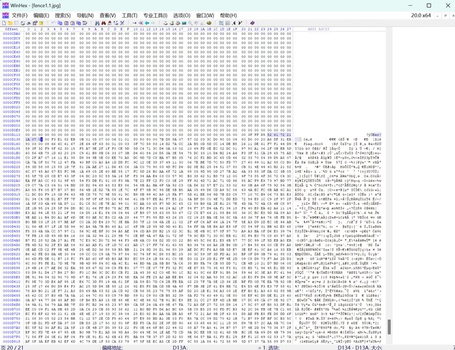
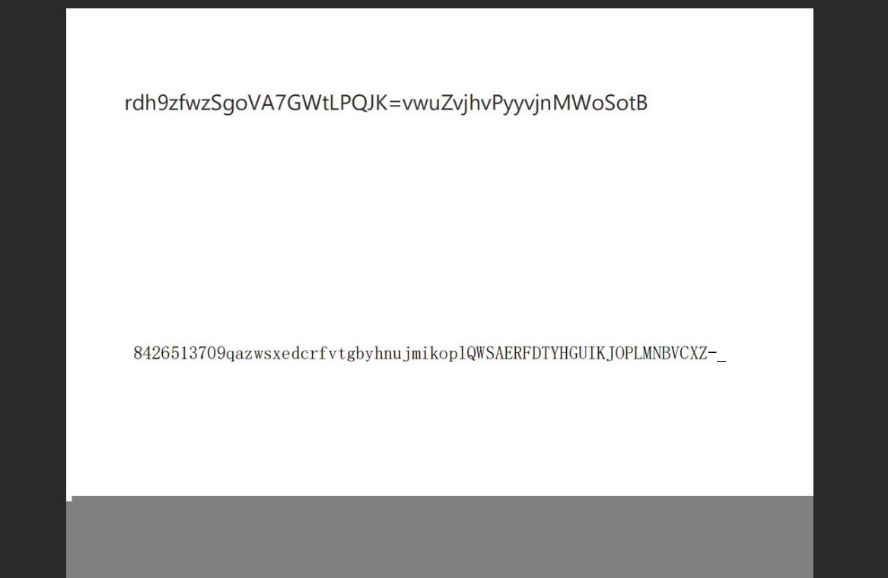

# NewStar CTF 2025 / EZ_fence

> 本文由授权中文赛事 WP 正文导入（阶段 1，仅散文，代码段未导入）。
>
> - 来源：https://github.com/pj-newstar/wiki-docs/blob/1a0f2ba21a30f950276396118b315eef0328371c/docs/wp/2025/week1/misc/ez-fence.md
> - 许可：MIT
> - 署名：（未提供）
> - 文档族：official_event_archive
> - 赛事：NewStar CTF 2025
> - 年份：2025
> - 核验状态：official_source_not_reproduced
> - 正文 sha256：3505c69bd87af33f36578bb0699417dda5647a640603bba828608be30f9ca761
> - 导入 ID：official-d714c24b2542d7e6073ba0
> - 原 domain：misc
> - 本地快照：62_官方赛事题库/objects/dd628c920bc11a59cbaad730371e473adfa2f2636a7322cb4674f09c1f0477c6.blob
> - 源修订：1a0f2ba21a30f950276396118b315eef0328371c
> - 收录说明：官方发布来源的说明正文；代码单独索引，未运行或分析。按文件收录，不把多份文件算作多道题。图片及附件下载状态见清单；仅按路径/原题分类标方向，binary 等跨方向资料留待分类。
> - 判定依据：original_prose_not_runtime_verified
> - 附件引用：[{"owner_id": "official-d714c24b2542d7e6073ba0", "relative_path": "docs/assets/images/wp/2025/week1/ez-fence_1.png", "local_path": "62_官方赛事题库/objects/be08ee0bbe8a2edb25212c5fac8dae371f09f25c465f9a7ad4356d443c48dcf5.blob", "downloaded_bytes": 409041, "source_url": "https://github.com/pj-newstar/wiki-docs/blob/1a0f2ba21a30f950276396118b315eef0328371c/docs/assets/images/wp/2025/week1/ez-fence_1.png", "sha256": "be08ee0bbe8a2edb25212c5fac8dae371f09f25c465f9a7ad4356d443c48dcf5", "kind": "image", "policy": "reference_only_no_execution"}, {"owner_id": "official-d714c24b2542d7e6073ba0", "relative_path": "docs/assets/images/wp/2025/week1/ez-fence_2.png", "local_path": "62_官方赛事题库/objects/9409ff4696031d6ea87414e8be404fea5fae93d9f208f30a3fa0cad5485c8bfc.blob", "downloaded_bytes": 108911, "source_url": "https://github.com/pj-newstar/wiki-docs/blob/1a0f2ba21a30f950276396118b315eef0328371c/docs/assets/images/wp/2025/week1/ez-fence_2.png", "sha256": "9409ff4696031d6ea87414e8be404fea5fae93d9f208f30a3fa0cad5485c8bfc", "kind": "image", "policy": "reference_only_no_execution"}]

> 原文：https://github.com/pj-newstar/wiki-docs/blob/1a0f2ba21a30f950276396118b315eef0328371c/docs/wp/2025/week1/misc/ez-fence.md

## 正文

---
titleTemplate: ":title | WriteUp - NewStar CTF 2025"
---

import Container from '@/components/docs/Container.vue'

## EZ_fence

题考查 Base64 编码、栅栏加密。

下载好附件可以看到一张图片，并且题干上提示了 rar，可以知道图片内藏了一个压缩包，用 winhex 打开图片，搜索 rar 文件头 `52 61 72 21 1A 07 01`（从文件头可以看出这是一个加密后的压缩包），可以看到

将文件头后剩余部分复制另存可以得到压缩包。

将文件头后剩余部分复制另存可以得到压缩包。

::: tip
这里还有一个偷懒的方法，直接改变图片的后缀也可以得到压缩包。
:::

再看图片内容是一串字符串，题目给了提示 fence 和数字 4，肯定使用了栏数为 4 的栅栏加密

运行后可以得到解密后字符串 `rSvMwgdouWZVhAvoj79GhSvWztPoyLfPytvQwJjBnKz=` 明显是通过 base64 编码后的字符串

题干提示图片破损，需要修改图片高度，修改后可得到

可以看出这是一个换表 base64，可以写出代码解密

可以得到压缩包密码 `New5tar_zjuatrojee1mage5eed77yo#`。

输入后可以得到 `flag{y0u_kn0w_ez_fence_tuzh0ng}`。

## 原文配图

