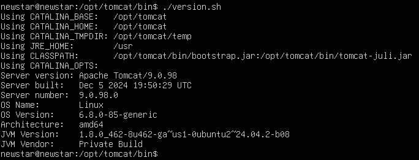
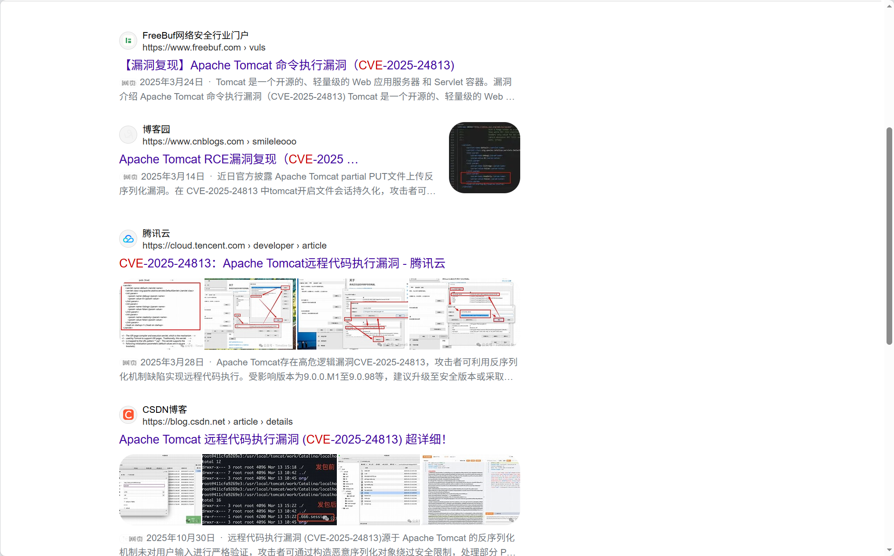
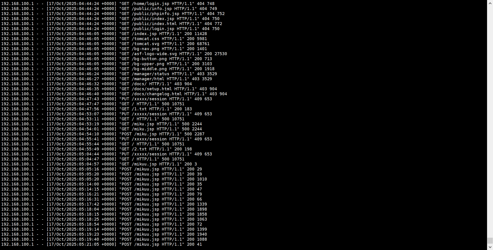

# NewStar CTF 2025 / 应急响应：把你 mikumiku 掉（1）

> 本文由授权中文赛事 WP 正文导入（阶段 1，仅散文，代码段未导入）。
>
> - 来源：https://github.com/pj-newstar/wiki-docs/blob/1a0f2ba21a30f950276396118b315eef0328371c/docs/wp/2025/week5/misc/mikumiku-1.md
> - 许可：MIT
> - 署名：（未提供）
> - 文档族：official_event_archive
> - 赛事：NewStar CTF 2025
> - 年份：2025
> - 核验状态：official_source_not_reproduced
> - 正文 sha256：46be4dee7413a0e557e883b20d933f502314ccca596eac91129f31092e378579
> - 导入 ID：official-a43c8fa599fe075e1b3ae1
> - 原 domain：misc
> - 本地快照：62_官方赛事题库/objects/4b7ec70fa940a6ed54e2cee2e72c24bab0dcddfd7155ecc227125d54ef670347.blob
> - 源修订：1a0f2ba21a30f950276396118b315eef0328371c
> - 收录说明：官方发布来源的说明正文；代码单独索引，未运行或分析。按文件收录，不把多份文件算作多道题。图片及附件下载状态见清单；仅按路径/原题分类标方向，binary 等跨方向资料留待分类。
> - 判定依据：original_prose_not_runtime_verified
> - 附件引用：[{"owner_id": "official-a43c8fa599fe075e1b3ae1", "relative_path": "docs/assets/images/wp/2025/week5/mikumiku-1_1.png", "local_path": "62_官方赛事题库/objects/1d6bcbbdbc693fe0ee1bdc757fa27b8b77743fa91ba571c27059c8017cb25ba1.blob", "downloaded_bytes": 8550, "source_url": "https://github.com/pj-newstar/wiki-docs/blob/1a0f2ba21a30f950276396118b315eef0328371c/docs/assets/images/wp/2025/week5/mikumiku-1_1.png", "sha256": "1d6bcbbdbc693fe0ee1bdc757fa27b8b77743fa91ba571c27059c8017cb25ba1", "kind": "image", "policy": "reference_only_no_execution"}, {"owner_id": "official-a43c8fa599fe075e1b3ae1", "relative_path": "docs/assets/images/wp/2025/week5/mikumiku-1_2.png", "local_path": "62_官方赛事题库/objects/d91bf2e31e48aecdc5cc70d7ed6d7c635a43ae961dea27368db5ac551d05c6e3.blob", "downloaded_bytes": 748677, "source_url": "https://github.com/pj-newstar/wiki-docs/blob/1a0f2ba21a30f950276396118b315eef0328371c/docs/assets/images/wp/2025/week5/mikumiku-1_2.png", "sha256": "d91bf2e31e48aecdc5cc70d7ed6d7c635a43ae961dea27368db5ac551d05c6e3", "kind": "image", "policy": "reference_only_no_execution"}, {"owner_id": "official-a43c8fa599fe075e1b3ae1", "relative_path": "docs/assets/images/wp/2025/week5/mikumiku-1_3.png", "local_path": "62_官方赛事题库/objects/eb12f2e226c0b41e5ddb3e875ae2ecc313ad6f91b66e6b0a334f54855f8e0d8a.blob", "downloaded_bytes": 197610, "source_url": "https://github.com/pj-newstar/wiki-docs/blob/1a0f2ba21a30f950276396118b315eef0328371c/docs/assets/images/wp/2025/week5/mikumiku-1_3.png", "sha256": "eb12f2e226c0b41e5ddb3e875ae2ecc313ad6f91b66e6b0a334f54855f8e0d8a", "kind": "image", "policy": "reference_only_no_execution"}]

> 原文：https://github.com/pj-newstar/wiki-docs/blob/1a0f2ba21a30f950276396118b315eef0328371c/docs/wp/2025/week5/misc/mikumiku-1.md

## 正文

---
titleTemplate: ":title | WriteUp - NewStar CTF 2025"
---

## 应急响应：把你 mikumiku 掉（1）

我们查看 tomcat 的版本信息，可以得到，版本号为 `9.0.98`

我们搜索 `tomcat9.0.98 cve` 可以搜索到编号为 `CVE-2025-24813` 的历史漏洞

结合日志，可以确定使用的 cve

结合日志，可以确定使用的 cve

**CVE-2025-24813**

## 原文配图

