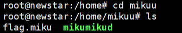
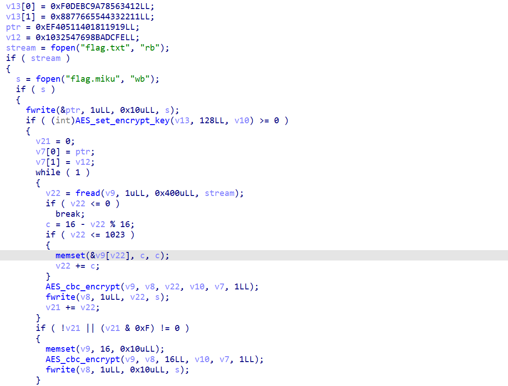

# NewStar CTF 2025 / 应急响应：把你 mikumiku 掉（3）

> 本文由授权中文赛事 WP 正文导入（阶段 1，仅散文，代码段未导入）。
>
> - 来源：https://github.com/pj-newstar/wiki-docs/blob/1a0f2ba21a30f950276396118b315eef0328371c/docs/wp/2025/week5/misc/mikumiku-3.md
> - 许可：MIT
> - 署名：（未提供）
> - 文档族：official_event_archive
> - 赛事：NewStar CTF 2025
> - 年份：2025
> - 核验状态：official_source_not_reproduced
> - 正文 sha256：46be4dee7413a0e557e883b20d933f502314ccca596eac91129f31092e378579
> - 导入 ID：official-9c120763ffc7daabec2d17
> - 原 domain：misc
> - 本地快照：62_官方赛事题库/objects/2a4d23a6a7426f228b3563f4e7abbd316012542d3c30e5906f1b86f5c33d93a1.blob
> - 源修订：1a0f2ba21a30f950276396118b315eef0328371c
> - 收录说明：官方发布来源的说明正文；代码单独索引，未运行或分析。按文件收录，不把多份文件算作多道题。图片及附件下载状态见清单；仅按路径/原题分类标方向，binary 等跨方向资料留待分类。
> - 判定依据：original_prose_not_runtime_verified
> - 附件引用：[{"owner_id": "official-9c120763ffc7daabec2d17", "relative_path": "docs/assets/images/wp/2025/week5/mikumiku-3_1.png", "local_path": "62_官方赛事题库/objects/18bd232d08b2edf65e2e7d32d0b7fed6fdb115b52e37439afc696c3a78907a3b.blob", "downloaded_bytes": 3875, "source_url": "https://github.com/pj-newstar/wiki-docs/blob/1a0f2ba21a30f950276396118b315eef0328371c/docs/assets/images/wp/2025/week5/mikumiku-3_1.png", "sha256": "18bd232d08b2edf65e2e7d32d0b7fed6fdb115b52e37439afc696c3a78907a3b", "kind": "image", "policy": "reference_only_no_execution"}, {"owner_id": "official-9c120763ffc7daabec2d17", "relative_path": "docs/assets/images/wp/2025/week5/mikumiku-3_2.png", "local_path": "62_官方赛事题库/objects/a06a7340b0eca46b957b738bc453079943365c3b27d6909e190c8c1aaefafe4e.blob", "downloaded_bytes": 63321, "source_url": "https://github.com/pj-newstar/wiki-docs/blob/1a0f2ba21a30f950276396118b315eef0328371c/docs/assets/images/wp/2025/week5/mikumiku-3_2.png", "sha256": "a06a7340b0eca46b957b738bc453079943365c3b27d6909e190c8c1aaefafe4e", "kind": "image", "policy": "reference_only_no_execution"}]

> 原文：https://github.com/pj-newstar/wiki-docs/blob/1a0f2ba21a30f950276396118b315eef0328371c/docs/wp/2025/week5/misc/mikumiku-3.md

## 正文

---
titleTemplate: ":title | WriteUp - NewStar CTF 2025"
---

## 应急响应：把你 mikumiku 掉（3）

进入 `/home/mikuu`，可以看到恶意程序和被加密的 `flag.miku`。

使用 FTP 将文件传到本地，并用 IDA 打开 `mikumikud` 进行分析。

可以看出这是一个 AES 加密程序，分析 `key` 和 IV 后即可编写解密脚本。

可以得出 `v13` 数组为 `key`。需要注意小端序低字节在前，因此 `key` 为：

IV 来自 `ptr` 和 `v12` 变量：

在加密过程中，IV 被写入文件开头。

在加密过程中，IV 被写入文件开头。

知道 `key` 和 IV 后，编写脚本运行即可还原 FLAG。

## 原文配图

