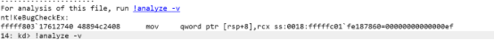
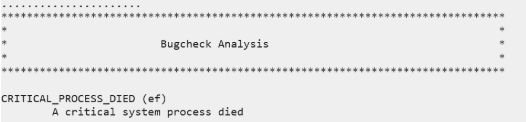
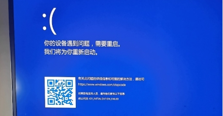

# NewStar CTF 2025 / 我不要革命失败

> 本文由授权中文赛事 WP 正文导入（阶段 1，仅散文，代码段未导入）。
>
> - 来源：https://github.com/pj-newstar/wiki-docs/blob/1a0f2ba21a30f950276396118b315eef0328371c/docs/wp/2025/week1/misc/no-revolution-fail.md
> - 许可：MIT
> - 署名：（未提供）
> - 文档族：official_event_archive
> - 赛事：NewStar CTF 2025
> - 年份：2025
> - 核验状态：official_source_not_reproduced
> - 正文 sha256：3505c69bd87af33f36578bb0699417dda5647a640603bba828608be30f9ca761
> - 导入 ID：official-cedad5e6c6a28af09755ef
> - 原 domain：misc
> - 本地快照：62_官方赛事题库/objects/cebe3bd85b1f3eb066fdb6da672b5ab7983228d8308e15c9fa07c302ef939d75.blob
> - 源修订：1a0f2ba21a30f950276396118b315eef0328371c
> - 收录说明：官方发布来源的说明正文；代码单独索引，未运行或分析。按文件收录，不把多份文件算作多道题。图片及附件下载状态见清单；仅按路径/原题分类标方向，binary 等跨方向资料留待分类。
> - 判定依据：original_prose_not_runtime_verified
> - 附件引用：[{"owner_id": "official-cedad5e6c6a28af09755ef", "relative_path": "docs/assets/images/wp/2025/week1/no-revolution-fail_1.png", "local_path": "62_官方赛事题库/objects/57606a6309bbab5276f8553fef33119a107d6421dbb68560b43cc4c104fef920.blob", "downloaded_bytes": 12863, "source_url": "https://github.com/pj-newstar/wiki-docs/blob/1a0f2ba21a30f950276396118b315eef0328371c/docs/assets/images/wp/2025/week1/no-revolution-fail_1.png", "sha256": "57606a6309bbab5276f8553fef33119a107d6421dbb68560b43cc4c104fef920", "kind": "image", "policy": "reference_only_no_execution"}, {"owner_id": "official-cedad5e6c6a28af09755ef", "relative_path": "docs/assets/images/wp/2025/week1/no-revolution-fail_2.png", "local_path": "62_官方赛事题库/objects/1724ac4da4d891e956e057b703e1cddb166f793c7ed268295c8025645e50f7f0.blob", "downloaded_bytes": 20144, "source_url": "https://github.com/pj-newstar/wiki-docs/blob/1a0f2ba21a30f950276396118b315eef0328371c/docs/assets/images/wp/2025/week1/no-revolution-fail_2.png", "sha256": "1724ac4da4d891e956e057b703e1cddb166f793c7ed268295c8025645e50f7f0", "kind": "image", "policy": "reference_only_no_execution"}, {"owner_id": "official-cedad5e6c6a28af09755ef", "relative_path": "docs/assets/images/wp/2025/week1/no-revolution-fail_3.png", "local_path": "62_官方赛事题库/objects/c5a85da6fcd1e494b1a903ed3bf32aec8061e972a37f43155e35bb8ad076771c.blob", "downloaded_bytes": 132597, "source_url": "https://github.com/pj-newstar/wiki-docs/blob/1a0f2ba21a30f950276396118b315eef0328371c/docs/assets/images/wp/2025/week1/no-revolution-fail_3.png", "sha256": "c5a85da6fcd1e494b1a903ed3bf32aec8061e972a37f43155e35bb8ad076771c", "kind": "image", "policy": "reference_only_no_execution"}, {"owner_id": "official-cedad5e6c6a28af09755ef", "relative_path": "docs/assets/images/wp/2025/week1/no-revolution-fail_4.png", "local_path": "62_官方赛事题库/objects/c27770600a261109003dc978ccab0854204ef02d6c89a80fb38c4618c8b9a7b2.blob", "downloaded_bytes": 3908, "source_url": "https://github.com/pj-newstar/wiki-docs/blob/1a0f2ba21a30f950276396118b315eef0328371c/docs/assets/images/wp/2025/week1/no-revolution-fail_4.png", "sha256": "c27770600a261109003dc978ccab0854204ef02d6c89a80fb38c4618c8b9a7b2", "kind": "image", "policy": "reference_only_no_execution"}]

> 原文：https://github.com/pj-newstar/wiki-docs/blob/1a0f2ba21a30f950276396118b315eef0328371c/docs/wp/2025/week1/misc/no-revolution-fail.md

## 正文

---
titleTemplate: ":title | WriteUp - NewStar CTF 2025"
---

import Container from '@/components/docs/Container.vue'

## 我不要革命失败

本题考查 Windows 操作系统出现蓝屏的日志分析。

直接下载 [windbg](https://learn.microsoft.com/zh-cn/windows-hardware/drivers/debugger/) 然后打开。

依照提示或者直接点击超链接，就会开始分析蓝屏日志。

最开始的这一条，即为崩溃类型（如果蓝屏过的话，这就是蓝屏下面的那行终止代码）

然后可以从下图位置找到故障进程。

:::warning
如果使用 windows 自带的 notepad 打开文本文档，默认缩放下会看不到下划线的，记得放大。
:::

## 原文配图

