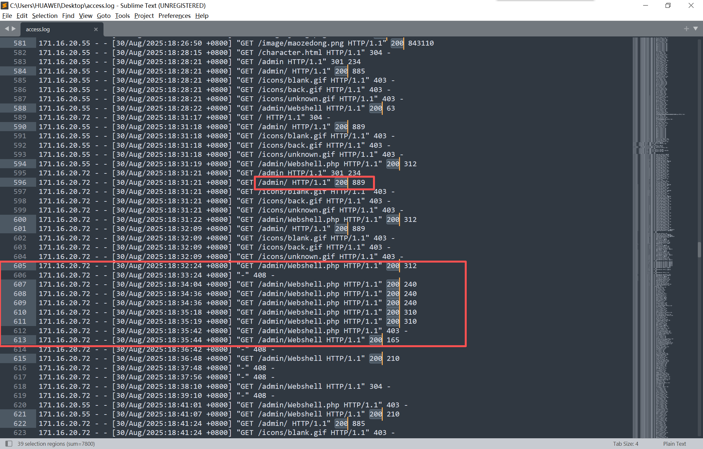

# NewStar CTF 2025 / 日志分析：不敬者的闯入

> 本文由授权中文赛事 WP 正文导入（阶段 1，仅散文，代码段未导入）。
>
> - 来源：https://github.com/pj-newstar/wiki-docs/blob/1a0f2ba21a30f950276396118b315eef0328371c/docs/wp/2025/week2/misc/log-intrusion.md
> - 许可：MIT
> - 署名：（未提供）
> - 文档族：official_event_archive
> - 赛事：NewStar CTF 2025
> - 年份：2025
> - 核验状态：official_source_not_reproduced
> - 正文 sha256：3505c69bd87af33f36578bb0699417dda5647a640603bba828608be30f9ca761
> - 导入 ID：official-81a784b7c28f8bde1efb90
> - 原 domain：misc
> - 本地快照：62_官方赛事题库/objects/c0a130bcf95f063522c185495a83ad478aa5d2ccbcb96eec19570324a70a87c2.blob
> - 源修订：1a0f2ba21a30f950276396118b315eef0328371c
> - 收录说明：官方发布来源的说明正文；代码单独索引，未运行或分析。按文件收录，不把多份文件算作多道题。图片及附件下载状态见清单；仅按路径/原题分类标方向，binary 等跨方向资料留待分类。
> - 判定依据：original_prose_not_runtime_verified
> - 附件引用：[{"owner_id": "official-81a784b7c28f8bde1efb90", "relative_path": "docs/assets/images/wp/2025/week2/log-intrusion_1.png", "local_path": "62_官方赛事题库/objects/bc3a08f8e053e96ad39d0e6810efe9e973f47834913511671380b0b74419117a.blob", "downloaded_bytes": 804205, "source_url": "https://github.com/pj-newstar/wiki-docs/blob/1a0f2ba21a30f950276396118b315eef0328371c/docs/assets/images/wp/2025/week2/log-intrusion_1.png", "sha256": "bc3a08f8e053e96ad39d0e6810efe9e973f47834913511671380b0b74419117a", "kind": "image", "policy": "reference_only_no_execution"}]

> 原文：https://github.com/pj-newstar/wiki-docs/blob/1a0f2ba21a30f950276396118b315eef0328371c/docs/wp/2025/week2/misc/log-intrusion.md

## 正文

---
titleTemplate: ":title | WriteUp - NewStar CTF 2025"
---

import Container from '@/components/docs/Container.vue'

## 日志分析：不敬者的闯入

本题考查日志分析和漏洞排查的基本能力。

题目中附件给了一个 `access.log`。在线环境打开是一个网站。

我们分析 `access.log`，筛选 `状态码 200` 的日志

在日志里可以看到 ip 为 `171.16.20.72` 访问了 `/admin/Webshell.php` 的记录，同时 `/admin/` 也是允许被访问的

我们访问 `/admin/` 可以发现有目录浏览漏洞，而在里面只有 `Webshell.php`，访问后可以发现连接密码即为 flag.

## 原文配图

