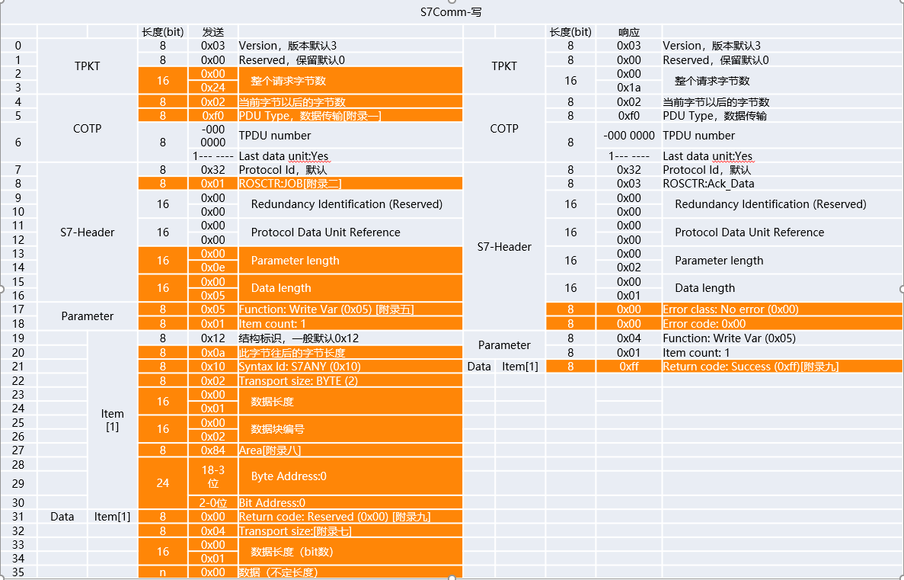
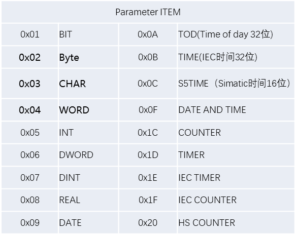
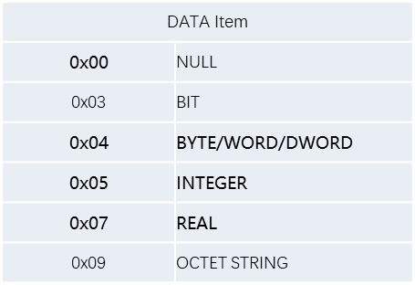
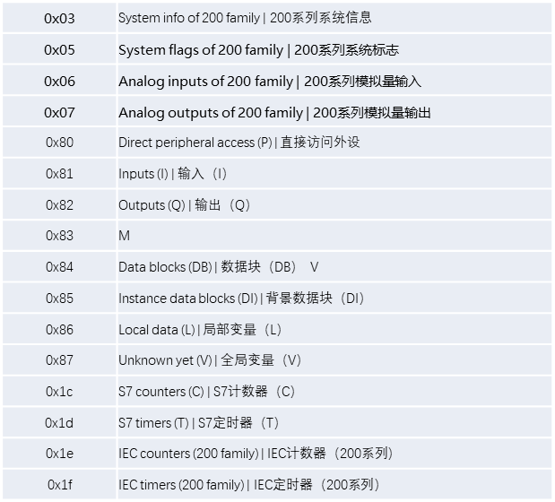
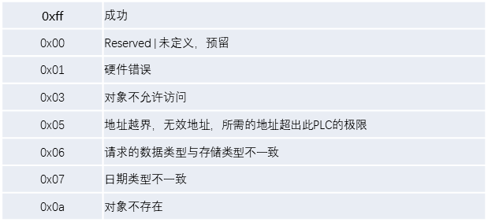

# NewStar CTF 2025 / 流量分析：S7 的秘密

> 本文由授权中文赛事 WP 正文导入（阶段 1，仅散文，代码段未导入）。
>
> - 来源：https://github.com/pj-newstar/wiki-docs/blob/1a0f2ba21a30f950276396118b315eef0328371c/docs/wp/2025/week3/misc/traffic-s7-secret.md
> - 许可：MIT
> - 署名：（未提供）
> - 文档族：official_event_archive
> - 赛事：NewStar CTF 2025
> - 年份：2025
> - 核验状态：official_source_not_reproduced
> - 正文 sha256：46be4dee7413a0e557e883b20d933f502314ccca596eac91129f31092e378579
> - 导入 ID：official-9abe0e5405f1d55790ee2a
> - 原 domain：misc
> - 本地快照：62_官方赛事题库/objects/20179352b5d5e9d415f5eed93b70856edd25f9708511d28b2de261c140ab58fc.blob
> - 源修订：1a0f2ba21a30f950276396118b315eef0328371c
> - 收录说明：官方发布来源的说明正文；代码单独索引，未运行或分析。按文件收录，不把多份文件算作多道题。图片及附件下载状态见清单；仅按路径/原题分类标方向，binary 等跨方向资料留待分类。
> - 判定依据：original_prose_not_runtime_verified
> - 附件引用：[{"owner_id": "official-9abe0e5405f1d55790ee2a", "relative_path": "docs/assets/images/wp/2025/week3/traffic-s7-secret_1.png", "local_path": "62_官方赛事题库/objects/d3063761defae39d288f44408c547d4b9008ec7782147215d64ea2e95f028e2b.blob", "downloaded_bytes": 126604, "source_url": "https://github.com/pj-newstar/wiki-docs/blob/1a0f2ba21a30f950276396118b315eef0328371c/docs/assets/images/wp/2025/week3/traffic-s7-secret_1.png", "sha256": "d3063761defae39d288f44408c547d4b9008ec7782147215d64ea2e95f028e2b", "kind": "image", "policy": "reference_only_no_execution"}, {"owner_id": "official-9abe0e5405f1d55790ee2a", "relative_path": "docs/assets/images/wp/2025/week3/traffic-s7-secret_2.png", "local_path": "62_官方赛事题库/objects/2c7d8aa2a2a481603e2d47b257f9b332be12dd2c76a4c8aeec8a5898c215f6ca.blob", "downloaded_bytes": 11426, "source_url": "https://github.com/pj-newstar/wiki-docs/blob/1a0f2ba21a30f950276396118b315eef0328371c/docs/assets/images/wp/2025/week3/traffic-s7-secret_2.png", "sha256": "2c7d8aa2a2a481603e2d47b257f9b332be12dd2c76a4c8aeec8a5898c215f6ca", "kind": "image", "policy": "reference_only_no_execution"}, {"owner_id": "official-9abe0e5405f1d55790ee2a", "relative_path": "docs/assets/images/wp/2025/week3/traffic-s7-secret_3.png", "local_path": "62_官方赛事题库/objects/8c86e5bbca71c6fcef31c19af33bfb271639bc3cef6123b519bb234c08657071.blob", "downloaded_bytes": 4588, "source_url": "https://github.com/pj-newstar/wiki-docs/blob/1a0f2ba21a30f950276396118b315eef0328371c/docs/assets/images/wp/2025/week3/traffic-s7-secret_3.png", "sha256": "8c86e5bbca71c6fcef31c19af33bfb271639bc3cef6123b519bb234c08657071", "kind": "image", "policy": "reference_only_no_execution"}, {"owner_id": "official-9abe0e5405f1d55790ee2a", "relative_path": "docs/assets/images/wp/2025/week3/traffic-s7-secret_4.png", "local_path": "62_官方赛事题库/objects/d85cc633a7c415b351c4203551d5c4a936541a7786d30b7f23dfa7f648532a6a.blob", "downloaded_bytes": 17197, "source_url": "https://github.com/pj-newstar/wiki-docs/blob/1a0f2ba21a30f950276396118b315eef0328371c/docs/assets/images/wp/2025/week3/traffic-s7-secret_4.png", "sha256": "d85cc633a7c415b351c4203551d5c4a936541a7786d30b7f23dfa7f648532a6a", "kind": "image", "policy": "reference_only_no_execution"}, {"owner_id": "official-9abe0e5405f1d55790ee2a", "relative_path": "docs/assets/images/wp/2025/week3/traffic-s7-secret_5.png", "local_path": "62_官方赛事题库/objects/51d064bd3b52bad6e197a1a3a352e5353631117980d4096c34975d26b27a48a1.blob", "downloaded_bytes": 8270, "source_url": "https://github.com/pj-newstar/wiki-docs/blob/1a0f2ba21a30f950276396118b315eef0328371c/docs/assets/images/wp/2025/week3/traffic-s7-secret_5.png", "sha256": "51d064bd3b52bad6e197a1a3a352e5353631117980d4096c34975d26b27a48a1", "kind": "image", "policy": "reference_only_no_execution"}]

> 原文：https://github.com/pj-newstar/wiki-docs/blob/1a0f2ba21a30f950276396118b315eef0328371c/docs/wp/2025/week3/misc/traffic-s7-secret.md

## 正文

---
titleTemplate: ":title | WriteUp - NewStar CTF 2025"
---

## 流量分析：S7 的秘密

这是一道工业流量协议的题目，在写本题之前，可以先了解一下 `s7comm` 协议报文的结构

附录 7：S7Parameter->Item->Transport size 常见值

附录 8：S7Parameter->Item->Area 常见值

附录 9：S7Data->Item->Return code 已知枚举值

而在流量里面，对应结构可以观察到 `s7comm.resp.data` 字段是写入的值，`s7comm.param.item.address.byte` 字段影响值的顺序位置。

我们按照顺序排列 `s7comm.resp.data` 字段后解码即可得到 FLAG

## 原文配图

